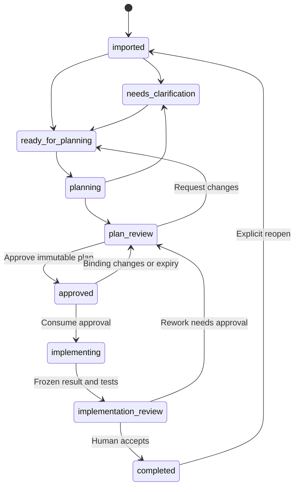
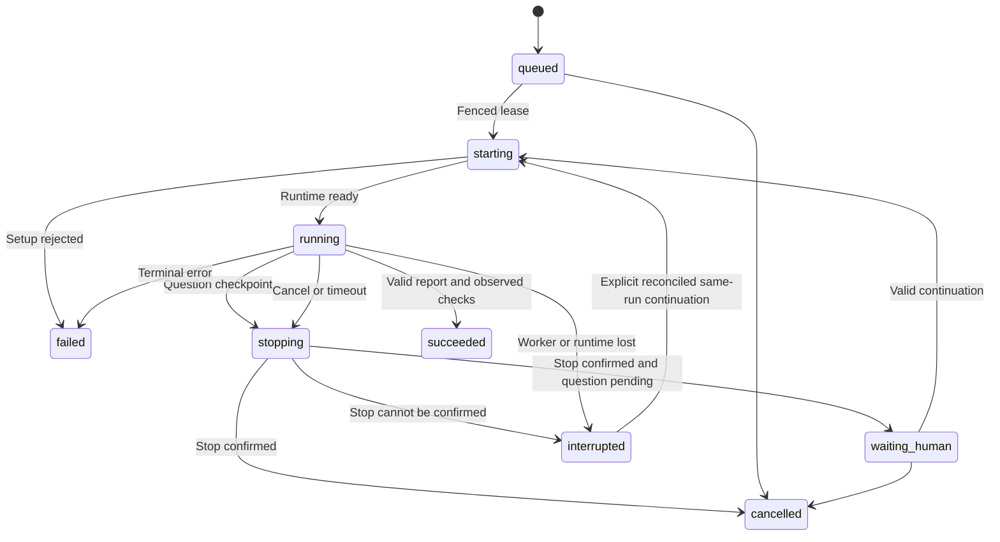

# Agent contracts and workflow

Status: normative proposed NEXUS contracts, schema version `1`. These are harness-independent application contracts, not undocumented runtime APIs. All instructions, identifiers and reports are English. OpenCode is the first/default runtime adapter; native and candidate ACP transport compatibility is specified in [OPENCODE_INTEGRATION.md](OPENCODE_INTEGRATION.md).

## 1. Common envelope

Every request is created by the worker from committed inputs. Agents cannot supply authoritative task/run/approval identities. Report schemas reject unknown fields and invalid enums, bound strings/arrays, and use artifact references instead of unrestricted file URLs. Use JSON Schema generated from strict Pydantic models. Preserve the exact validated JSON, its SHA-256 hash, schema version, agent definition hash and input fingerprints. Display Markdown is derived and safely rendered.

| Request field | Required meaning |
| --- | --- |
| `schema_version` | Integer `1`; reject unsupported versions |
| `task_id`, `run_id`, `job_id` | UUIDs allocated by NEXUS; task ID required for development roles, absent for setup role with an explicit config/proposal binding |
| `agent_definition_revision_id` | Immutable role/model/prompt/tool-policy revision |
| `runtime_binding` | Adapter ID/revision, harness build/image, transport/schema and tested capability-report hashes; effective permissions |
| `source_profile_revision_id`, `source_profile_hash` | Activated immutable routing policy for development roles; setup instead binds optional base config and inactive proposal revisions |
| `input_snapshot_id`, `source_fingerprint` | Development-source evidence/route fingerprint; setup uses bounded metadata/test-receipt snapshot hashes |
| `repository_snapshot_ids` | Explicit repository IDs, base object IDs and manifest hashes |
| `context_artifact_ids` | Bounded, sanitized, typed context; untrusted data labels retained |
| `execution_scope_id` | Immutable allowed repositories/paths/actions/test profiles |
| `approval_id` | Required only for implementation; worker checks it, never model authorization |
| `limits` | Active duration, cost budget, tool steps, report size and deadline |
| `requested_output_schema` | Role-specific contract/version |

Every report includes `schema_version`, `outcome`, `summary`, `evidence_refs`, `assumptions`, `uncertainties`, and `question_proposals`. Evidence references use a typed artifact ID plus an anchor, repository relative path/base commit, or source snapshot field path. Verify references belong to the run's inputs or outputs. Text mentioning another file is not evidence that it was inspected.

Common outcomes are `succeeded`, `needs_input`, `blocked`, or `failed`. These are agent assessments. The worker separately records the authoritative run status, schema validation, policy violations and observed completion. A report claiming success after a disallowed tool call is rejected.

## 2. Roles and privileges

| Role | Inputs | Required outputs | Available capabilities | Forbidden |
| --- | --- | --- | --- | --- |
| Setup assistant | Explicitly allowed metadata, connection test receipts, inactive profile draft | Proposed typed configuration diff, validation findings and unresolved questions | Bounded read-only discovery/tests and draft-proposal tools | Issuing credentials/grants, arbitrary config writes, activating profile, broadening access |
| Requirements analyst | Routed source snapshots, project mapping, previous answers | Requirements, acceptance criteria, missing facts, conflict/dependency/risk list, readiness | Read sanitized task context; request input | Source modifications, invented criteria labeled as supplied, credentials |
| Repository planner | Valid analysis, read-only repository snapshots, Odoo mapping | Version evidence, affected paths/methods, ordered steps, tests, scope, complexity, risks, rollback guidance | Bounded repository read/search, trusted skill, request input | Editing source, executing repo code, external writes |
| Implementer | Approved plan revision, immutable source/base/scope, answers | Change summary, per-step result, requested deviations, artifact refs, verification claims | Capability-checked patch/read/search; approved test profiles; request input | Unapproved paths, hidden scope expansion, approval mutation, push/merge/deploy |
| Independent reviewer | Frozen base/final diff, plan/criteria, worker-observed tests | Findings with severity/evidence, coverage gaps, criteria assessment, recommendation | Read frozen snapshot/diff and evidence; request input | Editing implementation, treating previous agent claims as proof, granting approval |

The worker, not an LLM, dispatches roles. Default concurrency is two total agent runs: at most one read-only run and one implementation, with one implementation lock per repository and atomic provider-budget admission. Disable autonomous harness subagent spawning in MVP, including OpenCode; an explicit NEXUS review run supplies independence and attribution. Later delegation requires an inherited capability ceiling, cost attribution and child-session reconciliation.

Requirements and planning may run automatically after sync. Implementation requires human authorization. Review may run automatically after an authorized implementation, but remains read-only. Only the developer records final acceptance and completion. A reviewer using the same harness or model is independent in session/context and role, not an independent human assurance.

### Setup and runtime eligibility

The setup assistant is a distinct role with no task implementation capabilities. Manual connection/profile setup works without an AI runtime and precedes optional setup assistance. A setup run has a setup-proposal/configuration binding instead of a fabricated development task; its usage is setup overhead, not a task-efficiency score. It may invoke `discover_metadata`, `test_read_connection` and `propose_profile` through narrow setup tools; these are proposed NEXUS tools, not provider APIs. Each test is bounded to operator-selected accounts, hosts, models/fields and read-only methods. Repository discovery reads approved metadata only, never executes a manifest or starts a runtime from an unreviewed path. Missing credentials become a secure-authentication instruction with a configuration reference, never a request for a secret in a model conversation.

The setup report has `proposal_revision_id`, `base_config_revision`, `proposed_changes`, `validation_receipt_ids`, `unverified_capabilities`, `affected_projects`, `data_transmission_summary`, `risks` and `question_proposals`. Proposal storage is append-only and inactive. A human authenticated through the setup UI reviews and approves activation; a control-plane transaction checks the draft hash, current config version and connection evidence, activates a new profile revision, audits it and invalidates affected fingerprints/grants. Setup recommendations and successful connection tests never themselves authorize activation, implementation or external writes.

Before dispatch, the worker compares the role's required capabilities with the selected adapter/build's `tested_pass` capability evidence. `tested_fail`, `untested`, `unsupported` or `stale` blocks a required capability; advertised native support alone is insufficient. A planning-only adapter stays planning-only; choosing a different display mode/model/harness cannot unlock code tools. Resolve runtime selection by project-role override → project default → global role default → global default, without silently falling back when the chosen runtime is ineligible. Freeze runtime binding and source profile in the run; switching default profiles affects future runs. A different harness/build/transport or changed effective permissions requires a stopped predecessor and a linked new run; implementation handoff requires fresh approval. A same-run question continuation uses the original binding and cannot silently switch to another adapter when resume is unavailable.

Native session identifiers are optional adapter-specific metadata linked to NEXUS run/segment IDs. Human questions, approvals and reports reference NEXUS identities even when a harness has no native session or uses several sessions. NEXUS does not promise migration of a native conversation between harnesses. Native OpenCode skills/plugins may implement a role, while another adapter must prove its own equivalent bounded tool/report path; identical prompt text is not sufficient evidence of equivalence.

## 3. Requirements report

### Scheduling and requirements authority

The intended source chain is Tempo planning allocations → referenced Jira issues → requirements according to the activated source-routing profile. Preserve each allocation's source/account/immutable identity and issue-reference evidence. The Tempo product/API variant/account access are unverified until a read-only connector probe succeeds; no guessed endpoint or title-based resolution is permitted.

Helpdesk classification normally selects Jira description/criteria as requirements authority. A configured project-work classification may select an explicitly linked Odoo task, with instance/database/project identity included. Some Jira project issues remain Jira-only. Classification rules and explicit link policies determine this; issue type or title alone never implies an Odoo association. Ambiguous/missing classification, broken explicit link, inaccessible Odoo task or conflicting criteria produces a blocker with evidence, rather than silently falling back. Scheduling authority and requirements authority are independent profile choices, so a calendar event can display a task without replacing Tempo allocation truth.

The requirements report records `source_route` containing profile revision/hash, classification rule ID/result, schedule snapshot/allocation IDs, Jira issue identity, selected requirements-source snapshot IDs, explicit link evidence and unresolved conflicts. Every requirement's provenance identifies its actual authority. Fingerprints include the route and profile; changing them supersedes derived reports and grants. Sources unrelated to the selected task's bindings do not all need to be online for launch; every bound authoritative source does.

Each extracted requirement has an ID, kind (`functional`, `technical`, `constraint`), text, provenance (`source`, `human_answer`, `proposed`), source evidence and acceptance-criterion associations. Proposed criteria remain explicitly proposed until accepted by a human. A missing test environment does not make a requirement complete.

```json
{
  "schema_version": 1,
  "outcome": "needs_input",
  "summary": "The requested report title is clear; the document variants are unspecified.",
  "readiness": "needs_clarification",
  "requirements": [
    {
      "id": "R1",
      "kind": "functional",
      "text": "Display Order Confirmation in the confirmed sales document.",
      "provenance": "source",
      "evidence_refs": ["source:snapshot-17/description"]
    }
  ],
  "acceptance_criteria": [],
  "dependencies": [],
  "risks": [],
  "conflicts": [],
  "assumptions": [],
  "uncertainties": ["Whether pro-forma previews share the new title."],
  "evidence_refs": ["source:snapshot-17/description"],
  "question_proposals": [
    {
      "client_key": "document-variants",
      "category": "clarification",
      "prompt": "Which document variants should display Order Confirmation?",
      "answer_kind": "text",
      "blocking": true
    }
  ]
}
```

Illustrative artifact aliases in examples stand for real validated IDs. They are not valid production UUIDs. Readiness is `ready`, `needs_clarification` or `blocked`. Completeness evaluation covers purpose, observed versus desired behavior, reproduction/version/environment, relevant repository/project, supplied criteria, constraints and dependencies. List the missing facts individually. Treat conflicting source instructions as unresolved evidence, never silently choose the newest text unless the configured authoritative source establishes precedence.

## 4. Planning report and immutable plan revision

The plan contains:

- `analysis_revision_id`, input fingerprint and one or more repository snapshots.
- Odoo version with evidence and confidence; distinguish manifest target version, checked-out core branch, observed running version and installed modules. Source manifests alone cannot establish what is installed in a remote DB. Optional environment inventory is collected by a read-only integration, never inferred.
- Module dependencies, existing model/view/report/controller/security implementation, external dependencies and relevant test setup. Record absent source or unavailable enterprise dependencies.
- Requirements-to-steps mapping. Each step names repository, paths, symbols/XML IDs, operation and expected behavior. Locations are evidence-backed candidates; unknown path expansion requires a new scope approval.
- Explicit execution scope, exclusions, test profiles and criteria-to-verification mapping.
- Complexity assessment, assumptions, risks with mitigation, unknowns and proposed questions.
- Verification and recoverability: local diff inspection, test fixtures, Odoo install/upgrade checks against disposable databases, rendered-report comparison where appropriate. No staging/prod mutation unless separately approved outside MVP.

A complete plan cannot be submitted with placeholders such as “inspect relevant files later.” Missing evidence creates a question or uncertainty with a bounded investigation step. Do not demand exhaustive repository scanning for a one-file change.

```json
{
  "schema_version": 1,
  "outcome": "succeeded",
  "summary": "Change the inherited report title and verify translations.",
  "analysis_revision_id": "analysis-rev-3",
  "repositories": [
    {"repository_id": "repo-1", "base_commit": "<full-git-object-id>", "odoo_version": "19.0", "version_evidence": ["repo:repo-1/addons/custom_sale/__manifest__.py@base"]}
  ],
  "steps": [
    {"id": "S1", "requirement_ids": ["R1"], "repository_id": "repo-1", "paths": ["addons/custom_sale/report/sale_report.xml"], "symbols": ["custom_sale.report_saleorder_document"], "action": "Update the inherited title expression while preserving the draft quotation condition."}
  ],
  "verification": [
    {"criterion_id": "AC1", "profile_id": "odoo-module-tests", "expected": "Confirmed report displays the approved title in each configured language."}
  ],
  "scope": {"repository_ids": ["repo-1"], "write_paths": ["addons/custom_sale/report/sale_report.xml"], "test_profile_ids": ["odoo-module-tests"], "network_profile": "provider-only"},
  "complexity": {"class": "small", "assessment_id": "complexity-2"},
  "risks": ["The inherited XML ID must be confirmed in the checked-out version."],
  "assumptions": [],
  "uncertainties": [],
  "evidence_refs": ["repo:repo-1/addons/custom_sale/report/sale_report.xml@base"],
  "question_proposals": []
}
```

This is a shape example, not an actual plan for a real repository. Production validation rejects a nonexistent XML ID, unresolved placeholder commit or a verification profile that does not exist. A report with unresolved blocking risk is routed to clarification, not marked implementation-ready.

A new plan changes neither previous revisions nor approvals. Revisions are append-only and linked by parent. The developer can request changes, producing a recorded instruction and new analysis/plan job. Display an explicit diff between revisions. Human edits also create a new immutable revision with provenance.

## 5. Approval contract and authorization boundary

An approval binds a canonical hash of:

| Bound item | Required evidence |
| --- | --- |
| Plan | Revision ID and content hash, schema/prompt/tool-policy revision |
| Ticket inputs | Relevant Tempo allocation/Jira/Odoo/source snapshot IDs, authority route, explicit links and fingerprint across bound authoritative items |
| Source profile | Activated immutable revision/hash, classification rule and schedule/requirements authority policy |
| Repository | Full base commit for each repository and snapshot manifest hash |
| Scope | Repository/path/actions/test/network/resource permissions, scope hash |
| Execution | Agent definition/model/config revision, adapter/revision/harness build/transport/API/image/tested-capability/permissions hashes, attempt number, budget ceiling |
| Human decision | Authenticated user, decision time, expiry and approval kind |

Default expiry is 24 hours. Execution requires a sync no older than five minutes, an upstream reread and base-ref revalidation at the start boundary. If any bound scheduling or requirements authority (including the selected Tempo/Jira/Odoo source) cannot be freshly verified, do not consume approval and execute against unverified stale inputs. An unrelated disabled source does not block a route that does not use it. Title-only or schedule changes are fingerprinted according to the field set defined in [DATA_MODEL.md](DATA_MODEL.md); never silently ignore a changed binding.

`implementation_start` approval is single-use for initial dispatch; its consumed grant remains bound to that run until expiry/revocation. A continuation within that validity uses the existing run grant, not a second approval consumption. If renewal is needed, a new `implementation_continuation` approval is bound to the same run, next segment and unchanged immutable inputs; it is consumed once at that segment start. In one DB transaction, compare all bindings, consume approval, create/claim execution, record audit event and enqueue outbox event. Process startup then uses a fencing token. A crash cannot authorize a second attempt. A transport restart/valid answer may continue the same logical run after revalidation; an implementation retry is a new attempt and needs new approval. Changes to source-routing/profile/runtime binding/permissions/scope/base/requirements/plan invalidate authorization and require a new revision and approval. Cancelling/revoking an in-flight approval stops the run; its partial diff remains reviewable.

`external_write` approval is a separate kind bound to exact destination/source revision and immutable payload draft. Neither an implementation approval nor a question answer can authorize it. No agent can directly write approval records or call human endpoints.

## 6. Persistent questions and answers

A question has `id`, `task_id`, `run_id?`, `plan_revision_id?`, `client_key`, `category`, `prompt`, `answer_schema`, `options`, `evidence_refs`, `blocking_condition`, `status`, `version`, timestamps, `expires_at?`, and supersession link. Categories: `clarification`, `technical_decision`, `configuration`, `unexpected_repository`, `scope_expansion`, `approval_request`. An `approval_request` is a request to display the proper authorization screen, not an answer that grants permission.

Question states: `open → answered | rejected | expired | cancelled | superseded`. Supersession records the replacement-question link and blocks answers to the obsolete revision. Store answer rows append-only with actor, question version, exact response/guidance and timestamps. A correction is a new answer revision; it can invalidate derived plans. A composite uniqueness constraint on run/segment/tool request key prevents duplicate attention items. Questions generated from a report are committed in the same transaction as that validated report.

| Category | Safe answer path | Resume condition |
| --- | --- | --- |
| Clarification | Text/selected option and attachments | Required answer schema satisfied; revised requirements if material |
| Technical decision | Recorded choice with rationale | Choice fits existing approved scope |
| Configuration | Named configuration handle/status | Backend validates secret/config availability; secret never in answer text |
| Unexpected repository | Guidance or stop | Worktree/snapshot integrity and approval remain valid |
| Scope expansion | Accept need for revised plan or reject | New plan/scope and fresh approval; never auto-resume old grant |
| Approval request | Open immutable review screen | Required approval record created by human API |

Attachments use allowlisted MIME types, size limits, quarantine/scanning and sanitized extraction; they remain untrusted input. Sensitive text entered in an answer is redacted from telemetry and prompts where possible, and the UI directs credentials to a secure settings workflow. A developer can reject or abandon a question, which cancels or fails its waiting attempt with a recorded reason. Timeouts notify and retain partial work; no default answer or inferred approval.

Every blocking condition has a database kind (`answer`, `configuration`, `approval`, `evidence`) plus a typed predicate and target identity. Predicates include `question_answered`, `config_available`, `approval_valid`, `dependency_completed`, and `manual_recovery`; the last two are evidence conditions. All necessary conditions must be true before a continuation is claimed. Guidance may be attached without satisfying a condition. Nonblocking questions remain visible but do not freeze unrelated jobs.

## 7. State machines and ownership

### Task lifecycle



`blocked` is an independent hold, with typed reasons and blocking-condition rows, not a second task lifecycle. Holds disable unsafe transitions. A failed run does not erase a valid previous plan; show the last usable artifact and failed attempt together. Task `approved` is a display projection of a current valid approval and can become `plan_review` after expiry or input changes. Upstream completed/cancelled/deleted state is separate and puts local work on hold pending explicit resolution; never silently discard a worktree.

Task state transitions belong to application services. Agent role outputs propose changes; they cannot issue arbitrary transitions. Completion requires human acceptance and required observed verification/review evidence. A reopened task retains all historical costs, reviews and completed scores; a new outcome version is created.

### Run lifecycle



A run with status `waiting_human` must have no active sandbox process/provider turn. Until stop is acknowledged it is `stopping`, with a pending wait reason. `interrupted` requires reconciliation before any restart. Terminal `succeeded`, `failed`, `cancelled` runs are immutable outcomes; retry allocates a new run. Persist execution segments separately to measure actual active, waiting, retry and recovery time.

Jobs use `queued`, `leased`, `running`, `waiting`, `retry_wait`, `succeeded`, `failed`, `cancelled`, `uncertain`. Job leases and fencing prevent concurrent dispatch; the worker maps job waiting to run waiting and retains the condition. A lost lease is never immediate permission to launch a second live sandbox. Reconcile/stop its predecessor first.

## 8. Implementation, testing and review evidence

Implementation runtime never mounts a writable authoritative worktree. It reads a sanitized source export; `nexus_apply_patch` asks the worker-owned broker to update approved paths and refresh that export. `nexus_run_verification` executes an approved profile against a frozen export in a separate disposable test sandbox without provider/connector credentials, writable host mounts or network access.

The implementer records per-step `completed`, `partial`, `blocked` or `not_started`; touched files; rationale; accepted deviations; claimed criteria; tests requested; and error evidence. The worker computes actual diff against approved base, including untracked additions, deleted files, binary/mode/symlink changes and submodules. Every path is checked against scope. Disallowed changes are quarantined and the run fails; do not silently delete suspicious output and claim success.

Test outcomes come from the test runner: profile revision, command digest, environment/image, fixture DB identity, start/end, exit code, passed/failed/skipped counts, report artifact hashes and limitations. “No tests discovered,” skipped suites, parse errors or a model saying “tests pass” are not passing evidence. Record baseline failures separately from introduced failures and never let an agent rewrite the verification profile or acceptance evidence.

A review report includes findings (`id`, severity, affected path/range, evidence, concrete effect, suggested remedy), criterion assessments (`verified`, `failed`, `not_verified`), scope compliance and recommendation (`accept`, `changes_requested`, `blocked`). Compare final diff hash with the reviewer input before presenting acceptance; a changed worktree invalidates the review. Human completion is disabled until configured required checks pass or a specific, audited waiver is recorded. Waivers remain visible and lower confidence; they do not become passing tests.

## 9. Failure, cancellation and retry policy

| Scenario | Required behavior |
| --- | --- |
| Provider timeout/rate limit | Bound transport retries; account every request; obey provider retry delay; no hidden new implementation attempt |
| Invalid report | Save rejected evidence, one bounded repair turn; then fail and show reason |
| Worker restart | Reconcile lease, runtime health, sessions, pending questions and worktree; no blind rerun |
| Unknown prompt acceptance | Job `uncertain`; inspect correlated messages; require manual decision if unresolved |
| Approval expires while waiting | Keep question/answer; require renewed authorization before continuation |
| Source/base changes during run | Revoke capability, stop run, preserve diff, route to replan/review |
| Cancellation | Set cancellation request transactionally; revoke capabilities; abort; escalate to process/container termination; confirm stop |
| Stop not confirmed | `interrupted` and repository execution lock retained; attention item; no overlapping implementation |
| Test exceeds limit | Kill test process group; preserve report/log tail; record timeout, not failed test assertions |
| Credentials missing | Configuration question without secret values; never request credentials in chat text |
| Disk full/corrupt artifact | Stop writes; preserve DB transactional integrity; attention item and recovery procedure |

Suggested defaults for configuration: requirements 5 minutes active, planning 15, implementation 45, independent review 15; test profiles have separate explicit limits. These are operational defaults, not performance claims. Run budgets and provider request counts are configured per project/role. Human waiting does not consume active execution time; wall duration remains recorded. Retry/recovery never evades budgets or deletes failed-attempt costs.

## 10. Contract tests and acceptance

Require a fake alternate adapter with no OpenCode session identifier to prove domain, questions and UI operate through NEXUS identities without dashboard code changes. No second production harness is required before M1. Require adapter capability fixtures proving planning-only versus execution eligibility, failed/unknown probes blocking admission, and a changed harness/transport/profile invalidating continuation. Setup fixtures prove metadata discovery cannot issue secrets/grants/activate config and human activation alone commits a new version. Source-route fixtures cover helpdesk Jira requirements, explicitly linked Odoo project requirements, Jira-only project work, ambiguous classification, broken links, changed Tempo allocations and disabled-source handling. Require JSON schema fixtures for each role, unknown/oversized field rejection, invalid evidence references, Odoo-version uncertainty and proposed-criteria provenance. Test every allowed/forbidden transition, immutable-revision hashing and approval staleness/expiry/race. Run chaos tests at question commit, stop acknowledgment, answer commit, continuation claim, session creation and prompt submission. Prove a repeated question or answer creates one continuation; a scope answer creates none without new approval.

For the first planning milestone, demonstrate import → requirements → read-only inspection → validated plan → human review, with a deliberately ambiguous Odoo ticket producing a durable question. Prove source-tree hashes are unchanged. Implementation-phase demonstrations must additionally prove stale approvals, out-of-scope edits and arbitrary shell access are blocked before offering a successful run for human acceptance.
