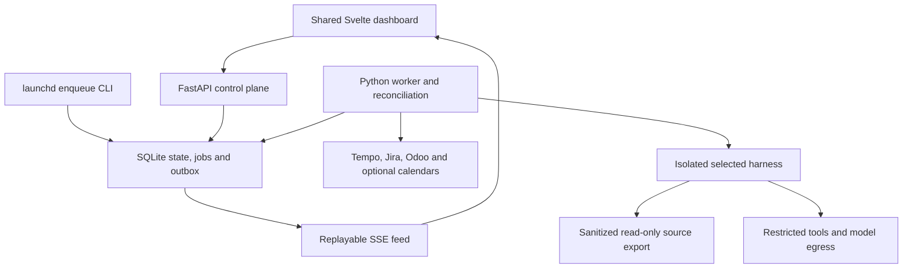

# Technical architecture

Design revision 2, 2026-10-20. `CONNECTIONS_AND_PROFILES.md` specifies the confirmed Tempo/Jira/Odoo profile and provider-neutral boundaries. Read with `DECISIONS.md`, `DATA_MODEL.md`, `SECURITY.md`, and `OPENCODE_INTEGRATION.md`. This describes a proposed system; the inspected folder was empty and was not a Git repository.

## Recommended topology

One Python package provides the HTTP control plane, domain services, connectors, job worker and scheduler-enqueue CLI. These are process roles, not microservices. SQLite is the authority. SvelteKit builds a static client that FastAPI serves on the same loopback origin. Selected harness instances run headlessly through a NEXUS RuntimeAdapter (OpenCode first/default) inside isolated execution environments; their terminal UI need not remain open.



The runtime receives only its input envelope, sanitized read-only source export and narrowly scoped capability token. The worker owns the authoritative isolated worktree; broker tools apply approved patches and refresh the source view. It cannot reach the control database, connector secrets or approval endpoints. Provider model access is a separate controlled egress path. Neither dashboard mode talks directly to a harness. Source and runtime adapters expose versioned NEXUS contracts; configuration selects an installed adapter without changing dashboard code.

## Layers and responsibilities

| Layer | Responsibilities | Forbidden shortcut |
| --- | --- | --- |
| Domain/application | Transition guards, freshness, scope, approval, question, deduplication and outcome rules | Logic duplicated in UI or prompts |
| HTTP API | Local user session, CSRF/origin protection, validation, command idempotency, DTOs | Starting long agent work inside a request |
| Persistence | Short transactions, versioned records, queue claims, audit/outbox, blob manifest | DB session held during LLM/network work |
| Connectors | Version-specific read/write contracts, cursors, provenance and error classification | Generic model/endpoint proxy exposed to agents |
| Worker | Job leases, fencing, sandbox lifecycle, runtime adapter contract, telemetry reconciliation | Re-executing a job whose prior execution is uncertain |
| Runtime tools | Read approved files, submit validated artifacts/questions, permitted edits/tests | Direct DB writes or policy changes |
| Frontend | Shared domain cache, presentation mode, forms and event reconciliation | Treating hidden buttons as authorization |

Use synchronous SQLAlchemy with a session per transaction; FastAPI DB services run in the appropriate threadpool. Network I/O uses asynchronous HTTP where beneficial. Do not share ORM sessions across coroutines or threads. Pydantic owns external contracts/configuration, SQLAlchemy owns persisted entities; use explicit mapping only at these boundaries. Do not generate an enterprise repository abstraction over every table.

## Storage, transactions and event delivery

Use SQLite WAL on local disk, `foreign_keys=ON` on every connection, busy timeout initially five seconds, explicit modern transaction control for Python's sqlite3 driver, and short write transactions. Serialize claims using a short `BEGIN IMMEDIATE` transaction; do not rely on SQLite's unsupported row-level `SKIP LOCKED`. Use optimistic version predicates for operator commands and state changes, checking affected row count. A command's state changes, idempotent response, audit event and outbox event commit together.

The outbox is also the replayable UI event journal: monotonic integer sequence plus UUID identity, timestamp, type, entity/version, correlation and redacted payload. API streams `id: sequence` over SSE. Client sends `Last-Event-ID`, discards duplicate event IDs, and applies only newer entity versions. Initial snapshot includes a high-water sequence from a consistent transaction; subscribe/replay after that point. A cursor older than retained events produces `resync_required`, then a new snapshot. Heartbeat every 15 seconds, exponential reconnect jitter, one shared browser stream, and bounded client buffers. Event payloads invalidate/refetch large details rather than sending unlimited logs/diffs. No promise that OpenCode's own stream is replayable; reconnect by querying persisted sessions/messages and reconciling usage.

Domain snapshots and audit records are immutable in application semantics. Current-state tables are mutable projections. This is not full event sourcing: recovery uses durable records plus checkpoints, not arbitrary replay of every historical command.

## External synchronization contracts

All connector outputs map to versioned `ExternalItemSnapshot`, `ScheduleSnapshot`, `SourceCursor`, and `SyncResult` contracts. Fields include source instance ID, immutable remote identity, remote revision/modified time, fetched time, payload hash, normalized requirement fingerprint, origin URI and tombstone/visibility status. Raw bodies are bounded, sanitized and retained separately from searchable text. Authentication failure is not a deleted task.

### Initial planning source: Tempo and configured routing

The developer confirmed Tempo in Jira supplies planned work. Initial profile resolves each allocation to a Jira issue, classifies helpdesk versus project work using configured metadata, and reads requirements from Jira helpdesk tickets or the explicit Odoo project-task link. Outlook is optional context/alternative scheduling. See `CONNECTIONS_AND_PROFILES.md` for the verified Cloud candidate, product/deployment uncertainty, date/effort semantics and complete setup tests. Allocation resource identity controls daily membership; do not discard a scheduled issue because its Jira assignee differs. Missing Odoo links block readiness rather than silently substituting Jira descriptions.

Connections and profiles have immutable typed revisions, redacted read-test reports, sample-day preview and human activation/rollback. Profile/config/routing hashes enter task fingerprints and approval envelopes. New providers may need backend adapters; known provider changes require configuration only. The setup agent can propose/test drafts but never authenticate for a user, receive secrets, install code or activate itself.

### Jira Cloud

Verified official API: enhanced `POST /rest/api/3/search/jql`, selecting explicit fields and paging with `nextPageToken`. Older `/search` GET/POST endpoints are documented as being removed. Discover field IDs before mapping description, acceptance criteria and scheduled fields. Jira descriptions may be Atlassian Document Format; parse to structured safe text and preserve provenance, never render raw HTML.

Configured JQL filters project/account and updated watermark with overlap (default ten minutes). Re-fetch watched tasks even if they fall outside today's schedule so assignment/move/removal changes are detected. Search may lag; exact issue reads before execution prevent trusting search freshness alone. Persist page results idempotently; advance the successful watermark only after all pages commit. Nightly full reconciliation catches missed updates and visibility changes. Respect 429/`Retry-After`, authentication-specific quotas and bounded jittered retry. No universal hardcoded provider quota.

Issue identity is source-instance plus immutable numeric issue ID; key and URL may change. Map account IDs explicitly, not display names. Due date is a deadline; actual planned date/time requires configured fields or calendar mapping. Read-only integration is first. External updates later use allowlisted field edits or comments through distinct writeback drafts; workflow transitions require a separate explicit contract, not an arbitrary status string.

### Odoo 17/18/19

Use explicit instance/version/database/company/project configuration, `fields_get` metadata where permitted, and an allowlist of readable models/fields/methods. Initial models: `project.task`, related `project.project` metadata, and configured planning fields; optionally `calendar.event` as the selected calendar source. Do not assume Enterprise planning fields exist. Validate schema and rights at setup; missing fields disable the relevant mapping with a clear error.

Verified Odoo 19 JSON-2 pattern: `POST /json/2/<model>/<method>`, bearer API key, optional `X-Odoo-Database`, JSON keyword arguments including context. Each call has its own transaction. For 17/18 use documented RPC `authenticate` and `execute_kw` through XML-RPC, with a version-specific adapter; do not call JSON-2 on those versions. API plan availability and custom deployment rights must be confirmed. Avoid promising a deprecation removal date: it can change; recheck on upgrade.

Read tasks with configured domain including project/company scope and `(write_date, id)` stable ordering, overlap watermark and deduplication. Freeze a sync upper bound, page conservatively, and run periodic reconciliation because mutable remote ordering is not a snapshot. `allowed_company_ids` is context, not a permission bypass; use least-privilege service-user record rules. Treat access loss as inaccessible. Tombstone only on confirmed deletion/archival evidence. API method existence does not authorize invoking it.

Multiple repositories/versions map through `project_repositories` plus explicit task bindings. Planner detects Git evidence from manifests/version files and addon dependency graph. Installed modules require a separately authorized metadata snapshot (instance, DB, timestamp, module names/versions); without it report `installed_modules_unknown`. Never parse and execute a Python manifest or import repository Python merely to inspect it: literal AST parsing only.

### Calendar

Calendar adapters are optional context/replacement sources; the initial live schedule authority is Tempo. Google Calendar and Microsoft Graph require their own verified adapter when selected, not mandatory implementation before the Tempo workflow works. Local ICS import provides a credential-free demo with a real parser, recurrence tests, UID/RECURRENCE-ID identity and no fetching arbitrary URLs. Microsoft Graph supports calendar-view delta queries, but the actual account/scopes and chosen sync window still require setup probes. No live calendar adapter was tested.

For an optional Google adapter, `events.list` initial full pagination records `nextSyncToken` only at the last page. Incremental calls retain permitted query parameters, use the sync token, and include cancelled entries. Do not combine syncToken with `timeMin`, `timeMax`, `q`, `orderBy`, or other prohibited filters. Use a stable full-sync query and filter the daily horizon locally. For larger calendars a separately versioned window-query mode may be added, not mixed with token semantics. A 410 rebuilds that source's calendar projection in a new sync generation, then swaps it atomically; never clear task history. Preserve recurring master/occurrence identity and exceptions. A local calendar expansion library must be chosen and verified during Phase 2.

Calendar task association accepts structured external IDs, exact issue URL/key with a configured trusted host, or a user-confirmed mapping. A key reference alone cannot fetch arbitrary hosts. One calendar event may schedule multiple tasks; one task may have multiple intervals. Calendar cancellation removes membership, not the task or its audit history. All-day end date is exclusive. Compute days in IANA timezone and convert instants to UTC; never use a fixed 24-hour day around DST.

Polling works on local macOS. Provider push/webhooks need a reachable verified HTTPS endpoint, renewal and replay protection; defer until continuously running deployment. Treat notifications only as hints to re-fetch source data. No public tunnel is necessary for M1.

## Identity and change detection

Persist each source item's immutable revisions. Canonical task fingerprint is SHA-256 of canonical JSON containing material planning-profile/configuration revisions, routing/identity resolution evidence, allocation date/effort precision, title, normalized primary/secondary requirements, acceptance criteria IDs/text, assignments, schedule identity/times, task-source associations, project/repository mapping and conflict resolutions. Sort unordered sets, normalize line endings, preserve meaningful text; exclude fetch timestamps, volatile HTML and usage counters. Store fingerprint algorithm version. Raw source hash separately detects any payload change.

A task can associate many source items, but a source item has one active canonical-task association. Only explicit confirmed `same_work` links merge them; `depends_on` and `related` do not. Conflicting equivalence claims enter attention queue. Merge/unmerge carries history pointers and invalidates plans, grants and complexity assumptions.

Any relevant fingerprint change supersedes analyses/plans for launch and revokes unused grants. Running work stops at a safe checkpoint with capability revocation and sandbox stop; operator decides whether to replan. Cosmetic raw-payload changes are audited without invalidating requirements. Schedule/assignment changes are relevant by default, even if code requirements are unchanged.

## Runtime harness selection

Use the NEXUS RuntimeAdapter contract in `OPENCODE_INTEGRATION.md`. Implement OpenCode native HTTP first and a fake alternate harness contract test. ACP v1 is a candidate additional transport; it does not prove sandbox/tool control, restart recovery or usage semantics. Select runtime with explicit precedence project-role → project default → global role → global default. Resolve once at run creation and freeze adapter/build/config/transport/tested capabilities in the execution envelope. Unsupported or unverified required capabilities block the role; never silently fall back to a more privileged harness. Switching a live/waiting run requires explicit handoff/restart and fresh implementation authorization, not a settings toggle.

## Proposed API surface

These are NEXUS routes to implement, not OpenCode routes. JSON schemas publish in FastAPI OpenAPI. Mutations require `Idempotency-Key`; entity updates require expected version (`If-Match` or explicit `expected_version`). Same key with a different body yields 409. Error envelope includes code, safe message, correlation ID and current version. 422 validation; 401 unauthenticated; 403 unauthorized; 409 stale/conflict; 503 required execution capability unavailable.

| Route | Purpose / boundary |
| --- | --- |
| `GET /api/v1/snapshot`, `/tasks`, `/tasks/{id}`, `/calendar` | Versioned domain projections and SSE high-water mark |
| `GET /api/v1/events` | Same-origin SSE, authenticated user only |
| `POST /api/v1/sync-requests` | Enqueue read-only synchronization |
| `POST /api/v1/tasks/{id}/analysis-requests`, `/plan-requests` | Enqueue read-only agent jobs |
| `POST /api/v1/plans/{revision_id}/reviews` | Accept/request changes; no execution grant |
| `POST /api/v1/execution-approvals` | Exact immutable execution-envelope authorization, user only |
| `POST /api/v1/execution-approvals/{id}/launch` | Recheck then atomically consume/create one run/job |
| `POST /api/v1/questions/{id}/answers` | Durable answer/guidance; no scope escalation |
| `POST /api/v1/runs/{id}/commands` | Pause/cancel/resume/retry with guards; retry requires new grant |
| `POST /api/v1/implementations/{id}/reviews` | Human acceptance/change request bound to patch hash |
| `POST /api/v1/writeback-drafts/{id}/approvals`, `/send-requests` | Separate exact-payload authorization and delivery |
| `GET /api/v1/usage`, `/efficiency`, `/health` | Evidence/provenance, degraded states; no secret-bearing detail |
| `GET/POST /api/v1/connections`, `/planning-profiles`, `/runtime-connections` | Versioned typed drafts, discovery and capability schemas; secret entry uses secure auth/settings flow |
| `POST /api/v1/connections/{id}/test-requests`, `/planning-profiles/{id}/preview-requests` | Read-only allowlisted tests and isolated sample-day resolution trace |
| `POST /api/v1/planning-profiles/{id}/activations` | User-only exact revision activation or rollback, CAS and impact preview; setup agent cannot call |
| `GET/PATCH /api/v1/preferences` | User mode/motion/layout settings, not permissions |

Internal tool ingress is a distinct listener reachable only from sandbox gateway, with run-specific capabilities and narrow actions (`submit_artifact`, `ask_human`, file/test broker where required). It is not a general API proxy. Prefer Unix-domain sockets/private container network; no user approval route is exposed there.

## Scheduling, queue and recovery

- macOS `launchd` supervises API and worker as user LaunchAgents and triggers an idempotent enqueue CLI on a five-minute heartbeat. CLI evaluates typed schedule policy; morning sync at 07:30 weekdays, incremental every 15 minutes, nightly reconciliation 02:00. API manual sync uses the same enqueue service. Wall clock timezone is Brussels; lease durations use monotonic time while process lives and UTC deadlines persist across restart.
- Unique scheduling slot `(policy_id, local_date, slot_key, timezone)` prevents repeated launchd ticks or DST replay from duplicating morning jobs. Store UTC slot instants too. Spring gaps run at next valid local instant; autumn overlap runs once. On wake, run one catch-up sync for missed periods, not every missed interval.
- Queue rows persist `not_before`, attempt, lease owner/expiry, fencing epoch, checkpoint and idempotency key. Claim/heartbeat/release are CAS operations. A stale worker cannot write results under a newer lease epoch.
- Default concurrency: total agent runs two, implementation one, read-only one; connector requests four. One worker manages async I/O and sandbox process handles. Repository write lock is per repository across worktrees; MVP avoids competing implementation patches. Budget reservations are atomic before launch.
- Retry idempotent read failures at most five attempts with exponential full jitter (base two seconds, cap five minutes), honoring longer `Retry-After`; 401/403 wait for configuration, 400 fails mapping validation. Agent semantic failure is not a connector retry. Never automatically retry an implementation or an ambiguous launch/write.
- Active-time defaults are five minutes for requirements, 15 for planning, 45 for implementation and 15 for independent review, configurable by role; tool command timeout five minutes unless explicitly approved otherwise. Heartbeat/last-event is liveness, not proof of progress. Human wait expiry seven days leaves a reviewable interrupted run. Retries preserve attempt history and costs.
- Persist launch intent before calling OpenCode. If timeout occurs after session creation/prompt submission, reconcile known runtime/session IDs and intent markers. If identity cannot be proved, mark `uncertain`, stop/quarantine runtime and require operator recovery. Do not create a second session blindly.
- On worker restart: reclaim expired read-only jobs only after reconciliation; enumerate owned sandbox instances, session status, patch manifest and pending questions. Unknown implementation state becomes interrupted/uncertain; no automatic code continuation. Revoked capability epochs stop late results. API restart does not cancel worker jobs.
- Pause means checkpoint and stop runtime, not an invented provider-level pause. Cancel revokes capability then aborts runtime/process group, escalates stop after ten seconds, preserves logs/diff and releases locks only after isolation has stopped. Quarantine on stop failure.
- Notification routing starts with durable in-app inbox. Optional local OS notifications carry generic text and deep links. Email/chat is off by default and requires an explicitly configured destination/authorization. Deduplicate `(event, channel, recipient)` and honor quiet hours. Do not leak client data in system notifications.

## Intended directory layout

Only the documents exist at this stage. Create each implementation directory when its owning phase needs it.

```text
AGENTS.md
docs/                         # This blueprint and later ADR updates
pyproject.toml                # Python package, tooling, pinned lock companion
src/nexus/
  api/                        # Routes, DTOs, local auth and event feed
  domain/                     # States, approval/fingerprint/scope rules
  services/                   # Command transactions and query services
  persistence/                # SQLAlchemy models, claims, outbox
  connectors/                 # source contract, tempo.py, jira.py, odoo*.py, calendar.py
  runtime/                    # adapter contract, opencode adapter, capability tests, sandbox lifecycle
  telemetry/                  # Usage observations, pricing and reconciliation
  efficiency/                 # Deterministic score and baseline builder
  worker.py
  cli.py                      # enqueue, doctor, backup, recovery
migrations/                   # Alembic
frontend/src/
  lib/api/                    # Generated API types and one command client
  lib/domain/                 # Shared store, selectors, SSE reducer
  lib/components/             # Task, approval, blocker, diff and usage components
  lib/modes/                  # MissionControl and Focus presentation
  routes/
opencode/                     # Trusted role configs, skills and plugin sources
config/                       # Example typed policies/profiles/connection schemas, no secrets
tests/{unit,integration,contracts,fixtures}/
frontend/tests/               # Vitest and Playwright journeys
ops/{launchd,systemd}/         # Added Phase 8
```

Runtime state defaults to a private user data directory outside Git: DB, content-addressed artifacts, sanitized runtime homes, worktree metadata and logs. Sensitive DB/artifact paths are never mounted in agent sandboxes. Configuration stores secret references only; keychain/environment injection is process-specific. Source Git operations are performed by trusted worker code with hooks disabled; uncommitted host work is never stashed or overwritten automatically.

## Continuously running deployment and PostgreSQL migration

For a single always-on Linux machine retain the same package and local-disk SQLite first, use systemd timers/services and a tested container runtime. Add TLS reverse proxy, authenticated access, secure cookies, access logs/redaction and firewall review before leaving loopback. Do not copy macOS keychain secrets; reprovision server secrets. Local sleeping/offline state is visible as stale and catches up on wake; launchd cannot provide uptime while powered off.

Move to PostgreSQL for multi-host workers, team access or measured lock contention. Use portable UUID strings, UTC instants, integer minor/micro currency amounts, portable JSON/text and explicit FK/check constraints. Alembic batch mode handles SQLite changes; PostgreSQL-specific indexes/JSON queries are optional optimizations. Migration procedure: stop enqueues/workers, reconcile active runs, consistent DB/artifact backup, apply target migrations, export/import in FK order preserving IDs/sequences, validate row counts/checksums/FKs/unique constraints and UTC values, exercise replay/claims on PostgreSQL, then switch DSN. No dual-write migration. Keep old DB read-only for rollback until new writes are accepted; after new writes rollback requires reverse migration/restore, not simply switching DSN. PostgreSQL claims can adopt `FOR UPDATE SKIP LOCKED` under the same fencing contract. Run a portability CI job before this switch.

## Official-source verification register

Researched 2026-10-20 using Context7 and official documentation. These verify public capabilities, not private instance entitlement or deployed-version compatibility. OpenCode's more detailed version discrepancies and references are in `OPENCODE_INTEGRATION.md`.

| Source | Verified design consequence | Remaining validation |
| --- | --- | --- |
| [Jira issue search](https://developer.atlassian.com/cloud/jira/platform/rest/v3/api-group-issue-search/) | Enhanced JQL pagination; deprecated legacy search | Tenant fields, account rights, search lag |
| [Jira rate limiting](https://developer.atlassian.com/cloud/jira/platform/rate-limiting/) | Respect 429/Retry-After and auth-dependent quotas | Observe response headers; no fixed quota assumption |
| [Odoo 19 JSON-2](https://www.odoo.com/documentation/19.0/developer/reference/external_api.html) | API-key method calls, transaction per call | Current build, model fields, API entitlement |
| [Odoo RPC](https://www.odoo.com/documentation/19.0/developer/reference/external_rpc_api.html), [Odoo 18 API](https://www.odoo.com/documentation/18.0/developer/reference/external_api.html) | Version-specific RPC adapter; API availability restrictions | 17/18 instance probe; do not infer future removal dates |
| [Tempo Cloud API](https://apidocs.tempo.io/), [v4 endpoint changes](https://help.tempo.io/planner/latest/tempo-api-version-4-0-vs-version-3-0-a-comparison) | Planning allocations and v4 search/user surfaces; read-only POST is possible | Product/deployment/account schema, effort/date normalization and permissions |
| [Microsoft calendar delta](https://learn.microsoft.com/en-us/graph/delta-query-events) | Provider-specific calendar-window incremental synchronization | Optional adapter; live account not tested |
| [Calendar sync](https://developers.google.com/workspace/calendar/api/guides/sync), [events.list](https://developers.google.com/workspace/calendar/api/v3/reference/events/list) | Sync-token pagination, restrictions and 410 reset | Account scopes, recurrence fixtures and chosen provider |
| [Calendar push](https://developers.google.com/workspace/calendar/api/guides/push) | Watch channels require reachable receiver and renewal | Deferred for local-only deployment |
| [SQLAlchemy SQLite](https://docs.sqlalchemy.org/en/20/dialects/sqlite.html), [versioning](https://docs.sqlalchemy.org/en/20/orm/versioning.html) | Explicit transaction/FK setup and CAS discipline | Test Python/SQLite pinned build and bulk-update guards |
| [FastAPI background tasks](https://fastapi.tiangolo.com/tutorial/background-tasks/) | HTTP background tasks are not the durable worker | Worker restart tests |
| [Git worktree](https://git-scm.com/docs/git-worktree) | Worktree metadata is shared; isolation needs extra boundary | Container must not mount host common Git directory |

Odoo pages were available through Context7 official-document extracts; direct web retrieval timed out. No live service accounts were accessed. All proposed private routes, job policies, score thresholds and performance budgets are NEXUS design choices, not claims made by these APIs.
