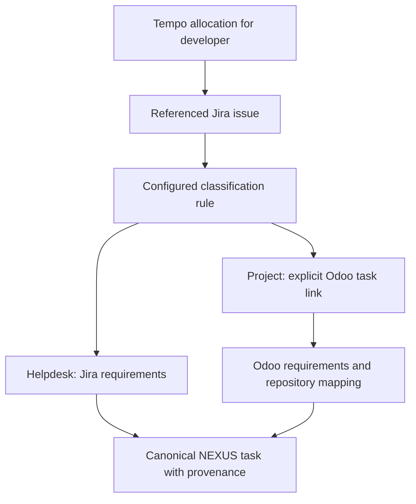

# Connections, planning profiles and runtime selection

Blueprint revision 2, implementation status updated 2026-10-21. This document captures the confirmed workflow and provider-agnostic integration boundary. Phase 2 typed connection/profile revisions, read tests, preview/activation/rollback, fixture adapters and canonical route resolution are implemented; no live connection has been tested. See `PHASE2_VERIFICATION.md`.

## Confirmed initial workflow

| Work category | Schedule authority | Work identity / classification | Requirements authority | Repository context |
| --- | --- | --- | --- | --- |
| Helpdesk | Tempo planning allocation attached to a Jira issue | Jira issue and configured helpdesk project/type/field rule | Jira ticket description and configured acceptance fields | Explicit project/repository mapping |
| Project development | Tempo/Jira planning issue | Jira issue and configured project-work rule | Explicitly linked Odoo `project.task` in a configured instance/database | Odoo project/version to approved repository/branch mapping |

Tempo schedules the work; Jira identifies the issue; an Odoo-linked project task describes the work. Do not assume Jira's description contains the project requirements. Outlook is an optional alternative or supplementary calendar connection, not a prerequisite or the schedule authority for this initial profile. Verify which Tempo product/API the account uses during setup: Cloud Capacity Planner is the initial candidate, not a confirmed private-account fact. Timesheets worklogs are actual time and must not be substituted for planned allocations.

**Canonical persistence:** Jira issue identity is the canonical NEXUS task key for
both helpdesk and project branches. The Odoo task is requirements-source provenance,
not another canonical work item. Every route rule explicitly names a local NEXUS
project and one or more repository-binding IDs linked to that project; absent or stale
bindings are configuration errors. Each Tempo allocation and source snapshot is a
separate association to the Jira-keyed task. Re-resolution appends immutable evidence
when profile, source snapshot, link, requirement content or allocation evidence changes.



Work classification uses configured Jira project IDs, issue types or reviewed custom field values. An unknown type or overlapping rule is unresolved, not guessed by an LLM. The setup flow previews representative helpdesk and project cases before activation. Other users may configure an additional explicit Jira-only project rule; this does not weaken the initial Odoo-required branch or permit automatic fallback.

## Two adapter boundaries

**Source adapters** implement trusted, versioned connection configuration schemas, authorization flow, discovery, safe read tests, item retrieval, schedule/allocation retrieval where supported, cursor/pagination semantics and normalized provenance. Writeback is a distinct optional capability and remains disabled without its own approval.

**Runtime adapters** implement the small NEXUS execution/session/activity/cancel/reconcile/report contract described in `OPENCODE_INTEGRATION.md`. OpenCode is the first/default concrete adapter. ACP is a candidate common transport after protocol/build probes; native adapters retain provider-specific features. No requirement to implement a second production harness before M1, but a fake alternate adapter must prove the domain/UI are not tied to OpenCode identifiers.

The frontend uses normalized NEXUS APIs. Switching among installed supported adapters needs configuration, not dashboard code edits. A truly new provider or harness may need a reviewed backend adapter; arbitrary APIs cannot be made safe by field mappings alone. Keep these as small modules in the monolith, not a marketplace/plugin-loading framework.

## Connections and planning profiles

A connection records adapter ID/version, remote instance/account identity, typed configuration and secret references. Configuration is data: no executable Python, shell templates, runtime-downloaded plugins or unrestricted expressions. OAuth and token entry use secure settings, never chat answers.

A planning profile revision contains schedule sources, optional context calendars, user/account mappings, work-item resolver, classification rules, per-class requirements resolver, allowed explicit link extractors, repository bindings, timezone, source freshness policy and precedence. Immutable revisions have canonical hashes. One active revision per profile; daily materialization records which revision resolved each task.

| Rule | Initial value / behavior |
| --- | --- |
| Schedule selection | Tempo allocations for configured Atlassian account ID; do not infer identity from display name |
| Issue identity | Allocation's typed Jira issue identity in configured tenant; store immutable issue ID plus current display key |
| Allocation versus issue assignee | Daily membership follows the allocated developer; Jira assignee is separate evidence and a mismatch is visible |
| Helpdesk requirements | Jira normalized description, allowed comments/acceptance fields only as configured |
| Project requirements | Exactly one configured Odoo task link, resolved to instance/database/model/record ID |
| Link extraction | Reviewed custom field, validated Odoo URL or a user-confirmed cross-source association; never title similarity |
| Missing/ambiguous link | Create attention hold and show missing requirements; no silent fallback to Jira description |
| Inaccessible Odoo task | Preserve known identity/history, mark unavailable and block readiness; never interpret 403 as deletion |
| Repository selection | Explicit Odoo project/version binding; missing or contradictory binding blocks planning |
| Source conflict | Show authoritative source plus conflicting context; human resolves before accepted planning/execution |
| Project/generic Tempo allocation | Capacity/context item unless explicitly resolved to a concrete task; never fabricate a Jira issue/task |

Initial deployment can use one profile with two routing branches. Do not require separate services or a profile per ticket. Jira and Odoo links express authoritative work equivalence/context explicitly; the Tempo allocation is a scheduling association, not a duplicate development task.

### Illustrative configuration data

The following YAML is a design example with placeholder connection IDs and instance-specific field identifiers. It is not a ready-to-run file or a claim those fields exist.

```yaml
profile: developer-work
revision: 1
timezone: Europe/Brussels
schedule:
  connection: tempo-work
  allocated_account_ref: developer-atlassian-account
work_items:
  connection: jira-work
rules:
  - category: helpdesk
    nexus_project_id: local-helpdesk-project-id
    repository_binding_ids: [local-project-repository-binding-id]
    jira_project_refs: [configured-helpdesk-project]
    requirements:
      connection: jira-work
      fields: [description, configured-acceptance-field]
  - category: project
    nexus_project_id: local-development-project-id
    repository_binding_ids: [local-project-repository-binding-id]
    jira_project_refs: [configured-development-project]
    requirements:
      connection: odoo-client
      model: project.task
      resolver: configured-odoo-task-link-field
      missing_link: block
repository_mapping_ref: reviewed-project-repository-map
context_calendars: []
```

## Tempo allocation semantics and synchronization

Official Cloud documentation exposes plan search at `POST /4/plans/search` and user allocation retrieval at `GET /4/plans/user/{accountId}`. This is a read operation despite POST search. Authentication and pagination must be captured from the selected current API and private-account probe. Context7 resolution returned only unrelated Data Center Timesheets material; it was not used to infer Cloud Planner behavior.

Retain allocation ID, source identity, allocated account/resource type, typed item reference, native date range, effort breakdown, available start-time information and source modified time. The adapter converts date-range inclusivity only after verified fixtures. Prefer provider daily effort breakdown where exposed; do not spread a period total evenly without evidence of workload/holiday rules. Unknown daily distribution remains unknown. A multi-day date range may establish planned membership with uncertain daily effort; label that precision.

Store capacity allocations separately from calendar appointments. Four planned hours on a date do not establish a 09:00–13:00 meeting or an all-day busy event. Show date/effort bars separately from exact clock intervals. Keep scheduled effort, NEXUS proposed agent execution estimates and actual agent activity distinct.

Use bounded horizon/account queries and documented update filters with overlap, plus periodic full-horizon reconciliation. Verify that retrieved allocations overlapping the horizon are included even if they started earlier; expand the queried envelope or fetch watched allocation IDs if the provider's date filters select only contained ranges. Cursor advancement follows completed pages. Absence from a partial query never proves deletion. Handle reallocation, cancellation/deletion, rescheduling, source-access loss, project-only allocations and orphaned Jira references explicitly. When no documented delete feed is available, complete scope reconciliation detects removal with provenance; failure retains stale last-known data.

Tempo can optionally synchronize planning fields with Jira. NEXUS does not require enabling that feature or write those fields during setup. If both sources expose the same allocation, configured precedence uses Tempo once; no double planned hours. A Tempo allocation's assigned resource may differ from Jira's issue assignee, so do not filter the initial Jira fetch to only Jira-assigned issues and lose planned work.

## Setup and test workflow

1. Select an installed adapter and create a draft connection. Manual setup is always available before any runtime harness is connected.
2. Authenticate through secure settings. Discover accessible accounts/projects/calendars and permitted schema metadata. Do not change provider settings, subscribe webhooks or enable Tempo/Jira sync while testing.
3. Create a draft profile, select schedule authority and map identities. Map helpdesk/project classification and explicit Odoo references with allowlisted hosts/instances.
4. Run versioned read-only tests: authentication, account/tenant identity, scope, field availability, retrieval/pagination, date/effort/timezone normalization, link resolution, requirements selection and repository mapping.
5. Preview a representative day/week with the full chain `allocation → Jira issue → classification → requirements source → repository`. Show counts, excluded items, permissions gaps, overlaps, planned-effort precision and unresolved links. Test data stays in an isolated preview generation; it does not change active task memberships or approvals.
6. Compare proposed and active configuration. A human approves local activation; remote write permissions remain separate. Activation records actor, exact revision/config hash and fresh test results.
7. Run a new sync generation; atomically switch current projections after success. Preserve canonical task IDs and cross-source links. If identity changes cannot be reconciled, require confirmation rather than merge on title.
8. On failure keep active profile unchanged. Rollback reactivates an immutable prior revision via a new activation event, then resynchronizes. Neither rollback nor activation restores old execution grants; affected bindings are stale and require review.

The optional setup agent uses a separate narrow role: inspect redacted connection metadata/test results, propose typed profile revisions, request read-only tests and explain failures. It cannot receive credentials in prompts, install adapter code, broaden permission scopes, activate its own draft, issue execution approval or send external writes. User interactive authentication and activation remain explicit. A setup agent cannot be mandatory for configuring its own first runtime connection; manual bootstrap avoids that cycle.

## Profile changes and approval integrity

Include profile revision/hash, connection configuration revisions, routing resolution evidence, identity mapping and chosen requirement snapshots in the task fingerprint manifest. Execution envelopes also bind selected runtime adapter/build/protocol/capability-test/config hashes. Changes revoke affected unused grants and stop active code work under the existing checkpoint policy. Do not invalidate unrelated tasks for a cosmetic connection display-name edit; document a versioned material-field fingerprint policy.

Switching from Tempo to Outlook, or changing a Jira-to-Odoo link, never deletes historical tasks/plans. It changes current membership/authority and creates an audited resolution revision. Preview impacted tasks, requirements, grants and job ownership before activation. Paused/waiting runs remain bound to their old inputs and cannot resume under a new profile silently.

## Delivery and acceptance

- Phase 1: provider-neutral source/task identities and typed config/hash foundations only. No new provider/runtime scaffolding or live credentials.
- Phase 2: NX-051 connection/profile contracts and CLI testing, NX-052 Tempo adapter plus Jira/Odoo routing, and NX-011 canonical Jira task resolution with explicit local project/repository bindings and persisted Odoo/Tempo provenance. ICS is a demo/context adapter; Outlook/Google are selectable follow-up adapters when requested, not prerequisites.
- Phase 3: NX-053 runtime adapter contract and OpenCode first implementation; NX-054 optional setup agent over the existing draft/test services.
- Phase 4: NX-055 shared Connections/Planning Profiles/runtime settings and setup preview in both modes.
- Phases 5–8: bind revisions to approvals, enforce runtime capability admission and test configuration migration/recovery with existing safety gates.

Required tests include scheduled helpdesk with Jira requirements; project task with an explicit Odoo link; missing/ambiguous/inaccessible Odoo task; changed link/database/company; Jira key rename; multiple allocations for one task; allocated account different from issue assignee; project-only allocation; date/effort without invented clock time; day-breakdown uncertainty; pagination failure; overlapping-horizon allocation; profile activation/rollback preserving history; no duplicate planned effort from synced fields; setup-agent privilege denial; fake alternate harness with no dashboard changes.

## Evidence and remaining setup decisions

Official sources reviewed 2026-10-20: [Tempo Cloud API](https://apidocs.tempo.io/), [v4 planning endpoint changes](https://help.tempo.io/planner/latest/tempo-api-version-4-0-vs-version-3-0-a-comparison), [Tempo/Jira optional field synchronization](https://help.tempo.io/planner/latest/sync-plans-with-jira-issues). Current official integration references also reviewed during Phase 2: [Jira Cloud REST API](https://developer.atlassian.com/cloud/jira/platform/rest/v3/intro/), [Odoo 19 JSON-2](https://www.odoo.com/documentation/19.0/developer/misc/api/odoo.html), and [Odoo 18 external API](https://www.odoo.com/documentation/18.0/developer/reference/external_api.html). ACP evidence belongs in `OPENCODE_INTEGRATION.md`.

Confirmed by the developer: Tempo/Jira provides planning; helpdesk work uses Jira tickets; project requirements live in Odoo tasks. Still requiring real setup evidence: Cloud/Data Center/product variant, account IDs, permissions, Jira classification fields, actual Jira→Odoo reference mechanism, Odoo instance/version/company restrictions and repository mappings. No private connection was tested. These questions block their live adapter setup, not Phase 1.
