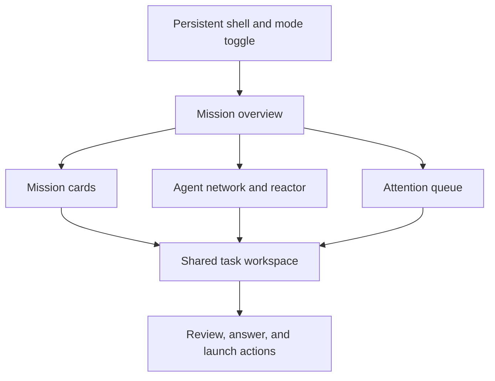
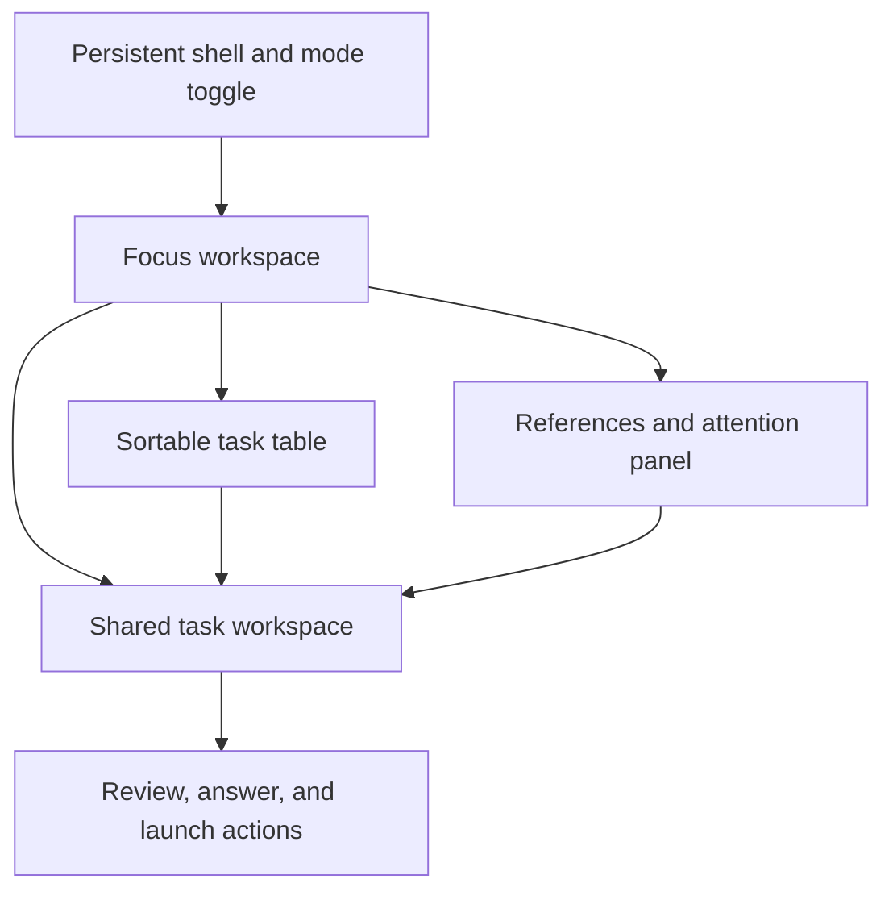

# NEXUS dashboard design

Status: implementation blueprint, not an implemented interface. Verified documentation review: 2026-10-20. The two presentation modes share one application, authorization model, and live state. The acceptance criteria below are product targets to measure during implementation, not claims about current performance.

## 1. Information architecture and navigation

The application shell always exposes the NEXUS mark, selected project, current date and timezone, global search, connection health, attention count, and a two-option **Mission Control / Focus** segmented control. The selected mode is visible without opening settings. Full-screen is optional and never required to reach an action.

Primary sections are Overview, Calendar, Agent Operations, Attention, Usage, and Efficiency. Settings exposes Connections, Planning Profiles, and Harnesses. Task Detail is a deep-linkable workspace opened from any section. A stable navigation landmark and breadcrumbs keep these relationships clear. Critical actions and guided setup use the same domain components in both modes.

Canonical context includes section, task ID, day/week, project IDs, query, filters, sort, selected run, task-detail tab, and pagination. Shareable selection and filters belong in URL search parameters. Display mode, density, preferred timezone, panel widths, reduced-motion override, and effects level belong in dashboard preferences. Ephemeral drafts and scroll positions remain in the application shell, with history snapshots where appropriate. Do not put answer text, ticket descriptions, credentials, or approvals into URLs or browser local storage.

Task lifecycle labels map to the canonical states in `DATA_MODEL.md`: imported, needs_clarification, ready_for_planning, planning, plan_review, approved, implementing, implementation_review, and completed. A blocked task retains its lifecycle state and displays an orthogonal `task_holds` badge/reason; do not add a competing blocked lifecycle. Run, job, source-health, and question states are separate projections. **Reconciliation required** is a human-readable presentation of interrupted/uncertain execution evidence, not another task state.

## 2. Initial wireframes

These are low-fidelity layout specifications. Each named region becomes a semantic DOM region; diagrams and Canvas effects enhance the region rather than replacing its content.

### 2.1 Mission Control, desktop

| Grid row | Left, 3 columns | Center, 6 columns | Right, 3 columns |
| --- | --- | --- | --- |
| Header, 64 px | NEXUS and project selector | Search, date, Brussels timezone | Health, attention count, mode toggle |
| Status strip, 72 px | Today and upcoming counts | Plans ready, active agents, blockers | Last sync and runtime health |
| Main, minimum 420 px | Today's mission cards; priority and schedule | Agent network around a central activity reactor; selected task and active run highlights | Human attention queue with answer/review actions |
| Secondary, minimum 220 px | Upcoming schedule | Planning timeline with planned and actual intervals | Usage summary with exact telemetry and confidence labels |
| Context workspace, on selection | Task navigation | Shared Task Detail, plan/review/question tabs | Contextual action rail and references |

The reactor background never sits behind body text. Agent network nodes represent active sessions and repositories; a maximum of twelve detailed nodes is shown before grouping by project. The selected node and edges are navigational shortcuts to DOM task/run details. The network has a synchronized accessible list containing the same entities and statuses. Cards include external source keys, exact state labels, and stale-input warnings.

### 2.2 Focus Mode, desktop

| Grid row | Left navigation, 200 px | Main workspace, flexible | Context panel, 320–440 px |
| --- | --- | --- | --- |
| Header, 56 px | NEXUS and section | Search, project/date filters | Health, attention, mode toggle |
| Toolbar, 48 px | Saved views | Sort, status, repository, assignee filters | List/detail and panel controls |
| Content | Section navigation | Dense table of tasks or selected task plan/diff | Requirements, source references, blockers, or run summary |
| Task selection | Task list, collapsible | Requirements / Plan / Execution / Review / Usage tabs | Shared review/answer/launch action panel |
| Footer | Sync status | Result count and keyboard hints | Compact telemetry sparkline and exact totals |

The default daily workspace places a task list beside its selected plan. A plan view includes numbered steps, affected files, tests, assumptions, risks, and immutable revision identity. Code review uses a two-panel file tree and diff; the user can switch split/unified diff without changing review state. Large diffs load per file. A chronological log is available independently of visual agent activity.

### 2.3 Smaller screens

| Width | Layout rule | Mission Control behavior | Focus behavior |
| --- | --- | --- | --- |
| At least 1440 px | Twelve-column grid; 24 px gaps; maximum readable text width 85 characters | Full network, queue, timeline, contextual workspace | Three panels, user-resizable within minimum widths |
| 1024–1439 px | Eight columns; 16 px gaps | Queue below network; context opens a side sheet | Two panels; context uses a drawer |
| 768–1023 px | Six columns; 16 px gaps | Compact reactor and mission list; network on demand | List/detail navigation; optional two-pane plan |
| 320–767 px | Single column; 12–16 px padding | Status strip, mission list, attention, then compact telemetry; full network deferred | Full-width list or detail; back returns to same list and scroll |

Header search collapses to a labeled button on small screens. The mode toggle stays reachable. Tables provide meaningful column priority and a column chooser; horizontal scroll is limited to the table region. Diff and timeline scroll horizontally within labeled regions. Actions use a bottom action bar on small screens with safe-area spacing and no content occlusion. No action is hover-only or drag-only. Calendar rescheduling requires a form confirmation and creates an external writeback draft; dragging does not write remotely.

## 3. Shared frontend architecture

Use SvelteKit and TypeScript with Tailwind tokens. Build a static client application served from the FastAPI origin for the local deployment; no independent Node production service is needed. A development proxy preserves the same-origin API contract. Use Svelte's supported reactive state and component context for a shell-owned domain store. No backend business rule is duplicated in Svelte.

| Layer | Main components | Responsibility |
| --- | --- | --- |
| Application shell | `AppShell`, `PrimaryNavigation`, `ModeToggle`, `ConnectionBanner`, `CommandPalette` | Session context, accessibility landmarks, routing, connection lifecycle |
| Shared client state | `DomainState`, `ViewContext`, `PreferenceState`, `CommandClient`, `EventClient` | One normalized entity map per entity, snapshot loading, ordered updates, conflict handling |
| Presentation shells | `MissionLayout`, `FocusLayout` | Layout and effects only; consume shared selectors |
| Shared domain components | `TaskSummary`, `TaskTable`, `TaskWorkspace`, `PlanViewer`, `ApprovalPanel`, `QuestionForm`, `RunControls`, `RunLog`, `DiffViewer`, `ReviewPanel`, `ExternalDraftReview` | Identical interactions, validation, and authorization feedback in both modes |
| Calendar | `CalendarToolbar`, `DayView`, `WeekView`, `TimelineView`, `ScheduleItem` | Timezone-aware schedule and dependency presentation |
| Observatory | `UsageTotals`, `UsageTable`, `ThroughputChart`, `ActivityReactor`, `TelemetryLegend`, `AllowanceStatus` | Same telemetry projection in numerical and animated forms |
| Analytics | `EfficiencyBreakdown`, `EvidenceDrawer`, `CohortComparison`, `OutcomeFilters` | Display server-calculated, versioned scores and missing evidence |
| Setup | `ConnectionList`, `ConnectionWizard`, `DiscoveryResults`, `ProfileEditor`, `ResolutionPreview`, `ProfileVersionDiff`, `HarnessSettings`, `CapabilityReport` | Backend-declared configuration schemas, read-only tests, explicit mapping, human activation and harness eligibility |
| UI primitives | `Button`, `Dialog`, `Drawer`, `Tabs`, `Table`, `StatusBadge`, `Tooltip`, `Toast`, `Skeleton`, `EmptyState` | Accessible shared controls and consistent feedback |

One `EventClient` per mounted application shell connects to backend SSE. It does not connect directly to OpenCode or another coding harness. Persisted events carry sequence IDs and entity versions. Ignore duplicates and old versions; a sequence gap or expired replay cursor triggers snapshot reload with an explicit reconnecting banner. Merge snapshot and subsequent events using the returned watermark to avoid a subscribe/fetch race. Commands use HTTP with an idempotency key and expected entity version. The backend is authoritative for permissions and state transitions.

All task, schedule, requirement, run, capability, and setup data uses normalized backend contracts with explicit provenance. The dashboard does not implement Tempo/Jira/Odoo routing or provider authentication protocols. Adding an account or changing mappings for an existing supported adapter uses backend-declared schema forms and requires no dashboard code. A new provider requires a tested backend adapter and schema/contract support; the generic dashboard cannot connect arbitrary APIs or execute provider-supplied UI code. Unsupported configuration schema versions show a safe compatibility error.

Do not infer successful execution from a submitted command, animation, or disconnected runtime. Show pending state until a persisted response/event confirms it. On unknown command outcome, query by idempotency key before offering a retry. Event disconnection leaves cached data readable, with timestamp and stale badge; disable authority-dependent actions until current state is fetched. No offline command queue for approvals or external writes.

For future SSR, instantiate state per request/component tree and never retain user data in shared server module variables. Official SvelteKit guidance supports context-scoped state and URL selection; it does not require a third-party global state library. Package versions and exact APIs must be pinned and checked when Phase 4 begins.

## 4. Mode-switching interaction

1. Activate the segmented toggle by pointer, touch, or keyboard. It is an accessible single-select control with explicit labels and selected state.
2. Preserve canonical view context and all submitted domain state. Keep an open answer draft in the shell; never silently submit or discard it.
3. Switch only the presentation shell. Keep the SSE client, data store, selected detail component, command status, and active modal alive. Do not refetch simply because mode changed.
4. Save preference in the backend. If that fails, keep the mode for the session and show a discreet retry affordance. Mode preference changes never grant privileges.
5. Restore focus to the equivalent selected task/control after layout changes; if absent, focus the task workspace heading and announce the mode once. Preserve list scroll separately for each presentation, without changing selected task.
6. Mount or resume the reactor only when Mission Control, a visible relevant section, the visible document, and the effects preference all permit it. Focus Mode unmounts Canvas and removes its animation loop/listeners.

Use a 120–180 ms opacity/position transition when motion is allowed. Never animate movement across the entire screen. Under reduced motion, update immediately. Switching with an approval dialog open keeps the same dialog and revision; it cannot create a second launch command. Both modes provide review, answer, reject, cancel, and launch through shared components.

## 5. Screen specifications

### Mission Overview

Show today's scheduled tasks, upcoming items, ready plans, active implementations, blocked runs, pending questions, failed jobs, and system health. Counts use the same explicit filters as the task list; selecting a count applies that filter. A task crossing midnight remains a persistent task and appears according to schedule, not creation date. The dashboard displays Europe/Brussels by default and labels another selected timezone. Display last successful synchronization per source and distinguish empty schedule from failed/unconfigured source.

Mission Control uses mission cards and operational summary. Focus uses a sortable table with source key, title, project/version, scheduled interval, readiness, plan revision, execution/review state, attention, and cost. Optional columns do not hide critical warnings. Show duplicate-source associations as references under one canonical task; never visually merge on title similarity. A profile/version badge opens the item's resolution trace: schedule authority, stable work-item identity, classification rule, authoritative requirements, and repository binding. Missing or ambiguous mapping is a visible hold with a setup deep link.

### Planning Calendar

Provide Day, Week, and Timeline controls with Today and previous/next navigation. Show schedule-source/work-item/requirements associations and separate bars for scheduled time, planned agent execution, and actual activity. Initially, Tempo allocations associated with Jira issues supply planned intervals; helpdesk requirements come from Jira and project-work requirements from an explicitly linked Odoo task. Outlook, when configured, appears as supplementary context or an explicitly selected alternative schedule authority. It is not required, and its events do not silently replace failed Tempo data. Include authority and context legends; missing actual intervals are blank rather than zero duration. Dependencies have a list alternative and open the linked task. Overlaps stack rather than obscure labels. Handle DST transitions with offset-aware timestamps and label repeated or missing local hours. A display date change never changes task identity.

### Agent Operations

List runs by task, role, project/repository, coding harness and adapter/runtime version, runtime session, state, model, start time, active/wait duration, current tool activity when reported, and latest heartbeat. OpenCode is the first/default harness. Unknown tool activity says **Unavailable**. Logs distinguish application lifecycle events, tool summaries, and redacted runtime output. Filter by run and severity; pause log auto-scroll when the user scrolls up.

Open a session through an allowlisted session link generated by the backend, only when a supported UI endpoint is configured for that harness. A known session ID is available for support; do not invent a harness web URL or show session creation as confirmed before the runtime acknowledges it. The runtime server remains inaccessible to the browser.

Run controls are state-aware. **Pause at checkpoint** is a cooperative request and must display **Pause requested** until the checkpoint and sandbox stop are confirmed. Do not promise immediate process suspension. **Cancel** revokes execution capabilities, requests abort, waits for confirmation, and may escalate sandbox termination under backend policy. **Retry** creates a new attempt and requires fresh execution approval for implementation. **Resume** remains disabled until required answers, configuration checks, and approval predicates hold. A run with lost heartbeat becomes **Reconciliation required**, not automatically successful or safe to restart.

### Task Detail

Tabs expose Original requirements, Analysis, Plan, Execution, Review, and Usage. The header shows linked sources, active resolution profile/version, authoritative requirements source, repository/base commit, Odoo version, current source freshness, selected plan revision, and lifecycle status. The resolution trace preserves the actual configuration version used for that revision/run, even when current defaults change. Jira-routed and Odoo-routed descriptions have clear labels; an unresolved Odoo link shows **Requirements unavailable: mapping required**, never substituted Jira text. Original content is sanitized and explicitly labeled external input. Plans show assumptions and evidence references separately from confirmed facts.

**Accept plan review** and **Request plan changes** create immutable `plan_reviews` records. Accepting review in M1 leaves the task in `plan_review` and grants no execution authority. From Phase 5 onward, **Authorize implementation** separately creates a bound execution approval; it does not launch code execution. **Launch approved implementation** becomes available only in Phase 6 after the writable sandbox gate passes. Use these distinct labels and explain the current phase capability; never label all three operations simply **Approve**. A launch action is not a third authorization dialog when an exact valid approval already exists.

Plan revision comparison highlights scope, files, tests, and assumptions. Approval summary presents exact revision, source fingerprint freshness, repository commit, selected harness/adapter/runtime/configuration and capability-test versions, allowed paths/commands/network scope, limits, and expiry. The approved immutable snapshot remains inspectable after a later revision. Launch is a separate explicit action, with an understandable explanation if reapproval is required. Display the five-minute maximum cached source-check age and the result of the required live launch-time recheck; an unavailable live source blocks implementation launch. A configuration change never swaps the harness of an existing run.

Execution displays worktree identity, step progress where reported, tests, and run timeline. Review contains diff, automated tests with pass/fail/error/skipped distinctions, reviewer findings, acceptance-criterion evidence, and human accept/request-changes controls. An agent's completion claim cannot mark the task accepted. Show partial changes and artifacts on failure or cancellation. Usage and efficiency expose the evidence and calculation version defined in `TELEMETRY.md` and `AI_EFFICIENCY_SCORE.md`.

### Human Attention Queue

Group unanswered questions, blocked jobs, approval requests, failed implementations, reviews, and external writeback drafts. Sort by severity, deadline, and age without losing stable ordering. Each item shows task/run, reason, relevant evidence, required responder action, and the impact of waiting. Opening an item preserves the queue filter and return location.

Question forms support free text, constrained choices, attachments/guidance references, reject, and request more context. Never request secrets in an answer; a missing-credential question links to configuration with a verification check. Scope expansion opens a new plan/approval workflow. Answers are immutable submissions with correction history; closing a question is separate from satisfying a machine-checkable condition. A satisfied question produces an eligible-to-resume state, not a new unrestricted permission.

External draft review presents target system/record, exact proposed field changes or comment, expected remote version, rationale, and a separate approve-and-send action. Source conflict changes the draft to stale and requires review again. The implementation approval cannot authorize this action.

### Usage Observatory

Show per-provider, model, agent, task, and date totals with category definitions, cost basis, currency, missing data, and observation freshness. Separate actual billed cost, reported runtime estimate, NEXUS API-equivalent estimate, token consumption, subscription observations, and configured budgets. Do not add estimates to billed values. Allowance is **Unknown**, **Unavailable**, **Stale**, or a verified value with source/time/window. Never derive remaining subscription percentages from token counts.

Mission Control adds the reactor and session activity paths. Focus uses exact totals, conventional time-series charts, and an accessible table. Both show the same aggregation period, filters, and correction status. A telemetry reconciliation correction changes numbers with an audit indicator; do not fabricate reverse particles or imply negative token generation.

### AI Efficiency Analytics

Show a per-task 0–100 score only when the scoring specification permits it. Otherwise display **Provisional** components or **Insufficient data**, with explicit missing evidence. Display component weights, complexity and its human adjustment, baseline cohort and sample size, score version, outcome/test/review evidence, tokens, cost basis, active/wait duration, runs/retries, plan revisions, and rework.

Aggregate by model/configuration/task type/Odoo project/strategy with complexity and time-window filters. Label selection bias, missing costs, mixed-model tasks, and small cohorts. Task acceptance and test completeness appear beside comparisons so a cheap failed run cannot appear superior. Do not make a leaderboard authoritative by hiding confidence or excluding failures. Calculations are server-side and defined only in `AI_EFFICIENCY_SCORE.md`.

### Connections and Planning Profiles

Connections shows supported adapters, configured accounts, authenticated identity, last read-only test, scopes/capabilities, freshness, and error status. A configuration wizard separates **Authenticate**, **Test read access**, **Discover**, **Map**, **Preview**, and **Review and activate**. It does not conflate a successful login with a usable planning profile. Secret fields use a dedicated secure authentication/configuration flow; existing values appear only as secret references/status, never in previews or AI chat. Never include access tokens in URLs.

| Setup region | Fields/content | Required operator feedback |
| --- | --- | --- |
| Connection | Supported adapter, deployment variant, base host, account/database/company/project scope, authentication status | Confirm actual authenticated identity; show unsupported variants or missing scopes |
| Schedule authority | Selected connection and allocation/event mapping, account identity, timezone | Tempo/Jira allocations are initial source; Outlook is optional context/explicit alternative |
| Work-item authority | Stable Jira issue identity and account/project mapping | Show source IDs and rule evidence; never join by similar title or user display name |
| Classification | Explicit configured project, issue type, and/or field-value rules with deterministic priority | Unmatched or overlapping rules are blocking diagnostics; show the matching rule |
| Requirements route | Helpdesk → Jira; project work → explicit Odoo `project.task` link; trusted hosts/instances | Missing, ambiguous, inaccessible, or conflicting links produce holds without fallback Jira requirements |
| Repository authority | Project/version/repository/branch/addon mapping | Required mapping must be unique and authorized; installed modules remain separate evidence |
| Sample-day preview | Selected date, trace per included/excluded item, expected task associations and changes | Show actual source revisions/freshness and every resolution step, including blocked items |
| Version review | Previous/proposed diff, validation report, affected tasks/runs/grants | Human activation required; explain bounded resync, invalidation, and history preservation |

The profile editor treats these authorities as separate selectors. It cannot infer them from source titles or convert a meeting into a task because its name looks similar. Previewing a day is read-only against external systems; it may persist local diagnostic evidence but cannot activate mappings or start agents. Diagnostics include safe error codes, missing scopes/fields, and correction links without printing raw credential-bearing responses.

Profiles have immutable versions and draft/active/superseded states as defined by the backend. **Activate version** is an idempotent human command with expected current version and a validated diff. A failed validation leaves the existing version active. Successful activation schedules a bounded resync and shows progress/affected-task counts. **Roll back** previews a prior configuration, revalidates it, then creates a new audited activation; it does not delete tasks, reset history, or restore revoked execution approvals. Mapping changes invalidate affected planning/execution bindings under the same backend policy in both modes. Show affected active work and safe stop status rather than silently rerouting it.

Optional **Ask AI to draft mappings** receives only approved sanitized discovery evidence and diagnostics. Its output is a strict schema draft with explanations, confidence/unknowns, and evidence links; the operator can edit or reject it. Authentication, account choice, activation, execution authorization, and arbitrary setup code remain outside the assistant's capabilities. If AI is unavailable the full manual setup path still works.

Mission Control opens setup in a focused workspace with a static operational summary; Focus opens the same workspace directly. Both support authentication handoff, tests, mapping, preview, diff, activation, rollback, and diagnostics using the same commands. Mode changes preserve unsaved nonsecret mapping drafts and selected preview date; sensitive auth state belongs to the secure flow, not the layout store.

### Harness settings

Display the global default plus global role defaults, project defaults, and project-role overrides in an effective-selection table. Resolve in this order: project-role override, project default, global role default, global default. Show the effective adapter, runtime/configuration version, source of selection, and role eligibility before launching a run. OpenCode is the initial default; a newly registered adapter is **Untested** until its recorded tests pass. A missing/incompatible selection is a configuration error, not a silent fallback.

Capability badges distinguish **Tested**, **Unsupported**, **Untested**, and **Stale**, with test timestamp, installed version, environment/policy hash, failure diagnostics, and links to evidence. Expose session lifecycle/events, abort, question/checkpoint handling, structured output, telemetry coverage, tool restrictions, and required isolation as applicable to each role. A compatible planning-only adapter can remain implementation-disabled. Never label a harness fully compatible because a text-generation probe succeeds.

**Test compatibility** is a bounded backend operation using synthetic safe inputs, not a user-provided command. **Save selection** affects future runs; changing a default leaves existing sessions, frozen run manifests, and approval bindings unchanged. Implementation stays disabled for an adapter missing any required safety capability. Show when a newly selected harness requires a new plan/approval rather than reusing an incompatible authorization. Model selection and harness selection are separate controls, and no missing billing or token category is invented when a harness does not expose it.

## 6. Design system proposal

| Token family | Initial specification | Usage |
| --- | --- | --- |
| Background | `#070B14` base, `#101827` surface, `#18243A` raised | Solid reading surfaces; no text over particles |
| Foreground | `#EDF4FF` primary, `#AABBD2` secondary | Validate contrast for every foreground/background combination |
| Accent | Cyan `#61D9F5`, violet `#B7A2FF`, emerald `#75E5BC` | Activity, output, cached activity; also icon/text labels |
| Status | Emerald success, amber warning, coral danger, slate unknown | Semantic labels and distinct icons; never color alone |
| Typography | System sans initially; optional bundled licensed display face later; system mono for IDs/logs | Body 14–16 px, dense tables at least 13 px; heading hierarchy kept semantic |
| Spacing | 4 px base; 8/12/16/24/32 px steps | Consistent layout; 44 px preferred touch targets |
| Borders | 1 px subdued borders; 2 px focus ring | Glow is decorative and does not replace a visible boundary |
| Shape | 8–12 px card radius, 6–8 px control radius | Restrained sci-fi character |
| Elevation | At most three surface levels; shadow/glow only on selected/active state | Preserve hierarchy and avoid neon saturation |
| Density | Comfortable default; compact optional in Focus | Critical action spacing never shrinks below usable targets |

Use inline SVG icons with accessible text or explicit labels. Tooltips supplement labels and do not carry required instructions. Monetary figures use explicit currency; dates/times include selected timezone in headings and full timestamps on detail. Do not use decorative pseudo-code or fabricated telemetry to fill empty panels.

## 7. Animation and reactor specification

### Meaning and aggregation

The reactor visualizes observed processing, not individual tokens. Use backend-normalized disjoint categories from `TELEMETRY.md`: cyan input flow, violet output flow, emerald cache activity. Reasoning and cache writes retain separate exact counters; do not duplicate them in particle density if already included in a parent category. Unsupported categories remain unknown. Session identity uses stable path position plus a label/selection highlight rather than assigning many indistinguishable colors.

Accumulate measured positive usage changes into one-second display buckets. Unless genuine incremental usage is available, the displayed rate is **Observed tokens / last 60s**, also labeled **Usage reported at completion** when applicable; never imply measured instantaneous streaming generation. Show burst observation time and keep the exact message interval separately. The renderer may interpolate movement between display buckets without synthesizing additional accounting. The renderer consumes a bounded aggregate, never raw token events.

Map throughput to emission with a saturating logarithmic scale, maximum 60 emissions/second and 300 live particles total in the default desktop profile, with at most eight distinct session channels plus an **Other sessions** aggregate. Scale is visible in the legend; particle count is qualitative and not an accounting measure. A bucket with 20,000 tokens must not allocate 20,000 objects. Cache/input semantics come from the backend; the Canvas renderer does no price or token accounting. Unknown throughput may show a subtle status ring labeled **Active; usage pending**, without token particles. This 300-particle target is the tighter dashboard limit permitted by `TELEMETRY.md`; the compact profile uses at most 100.

| Effect | Data trigger | Motion specification | Reduced-motion equivalent |
| --- | --- | --- | --- |
| Cyan inbound particles | Observed input throughput | Bounded curved flow toward reactor, 700–1200 ms lifetime | Input rate number and static inward icon |
| Violet outbound particles | Observed output throughput | Outward paths, 700–1200 ms | Output rate number and static outward icon |
| Emerald cache orbit | Observed cache category | Short orbit arc, 900–1400 ms | Cached count and static ring segment |
| Agent/task edge pulse | Confirmed lifecycle/tool transition | Single 250–400 ms pulse, coalesced | Timestamped activity row |
| Warning border | Verified allowance threshold or user-defined budget threshold | One gentle 600 ms transition; then static | Text warning, icon, static border |
| State transition | Persisted status changes | 120–180 ms fade; no layout jump | Immediate state label update |
| Health heartbeat | Fresh heartbeat observed | One subtle low-opacity pulse, at most once/5 s | Last heartbeat timestamp |

No flashing above three times per second, strobing, constant full-screen movement, motion-based approval cue, or simulated warning presented as real. No sound by default. A paused or stopped renderer still exposes all exact information.

### Runtime policy

Use Canvas2D initially with object pools, deterministic seeded paths, capped device-pixel ratio of 1.5 in balanced mode, and one `requestAnimationFrame` loop. CSS uses transform/opacity for DOM transitions. Avoid per-frame layout reads and reactive-store writes. DOM values update at most 4 Hz; timeline graphs at most 1 Hz; important state changes update immediately. Coalesce high-frequency source events before UI publication, preserving authoritative totals in the backend.

Mission Control has a hard 30 fps cap. Low-effects mode uses 100 particles and 15 fps. Reduced motion, Focus Mode, hidden document, or offscreen reactor stops the loop completely and releases or parks Canvas resources. Use visibility and intersection observers to gate work. SSE continues receiving authoritative state while rendering is suspended; on visibility restore render a current aggregate, not a backlog of missed particles. Mobile defaults to compact/static telemetry, with an explicit optional effects setting.

If frame time exceeds 25 ms for five consecutive sampled seconds, drop effects one level and show the active quality setting in preferences. Honor operating-system reduced-motion unless the user deliberately changes the in-app setting; an explicit **No animation** setting always wins. Avoid WebGL/Three.js/PixiJS in the initial build. Evaluate PixiJS only if Canvas profiling proves inadequate at the specified bounds; no feature requires 3D.

### Simulation

A development-only fixture generator emits the same normalized UI telemetry contract with deterministic seeds, marked `is_simulated=true`. It covers idle, burst, cached-heavy, delayed usage, unknown allowance, stale connection, budget warning, and concurrent session cases. A persistent **SIMULATED DATA** banner and legend distinguish it. Simulation never writes production usage, costs, approvals, or scores and cannot launch real jobs. Switching from demo to live clears the simulated store and fetches a live snapshot. No blend of live and simulated totals.

## 8. Accessibility requirements

Target WCAG 2.2 AA for both modes. Validate contrast rather than assuming accent hex codes pass. Normal text must meet 4.5:1 contrast, large text 3:1, and essential component boundaries/focus indicators 3:1. Respect zoom to 200%, reflow at 320 CSS px except genuine two-dimensional content, system font scaling, and forced-colors mode. In forced colors, remove glow and Canvas dependency.

All actions are keyboard reachable with visible focus. Provide skip-to-content, semantic headings, landmarks, labeled forms, error association, and dialogs with focus containment/return. Use real table headers and sortable buttons with announced sort state. Announce significant run/blocker changes through a throttled polite live region; reserve assertive announcements for immediate action failures. Do not announce every telemetry update. Canvas is hidden from assistive technology when its equivalent DOM summary is present.

Calendar has list/table alternatives and forms for every drag interaction. Charts have exact data tables and textual summaries. Diffs support keyboard file navigation and readable line labels. Do not rely solely on color, glow, shape, animation, or icon position to communicate state. Every timeout explains what happens, allows an extension where policy permits, and preserves unsent user guidance. Avoid global single-letter shortcuts while editing. An optional shortcut help dialog documents navigation commands; destructive/privileged commands never fire from a single unmodified key.

## 9. Interaction flows and failure presentation

| Journey | Main interaction | Required failure behavior |
| --- | --- | --- |
| Morning review | Open Today → inspect incomplete task → answer clarification → see analysis/plan progress | Source failure banner and last-known snapshot; no empty-success interpretation |
| Plan approval | Open plan → compare revision and scope → approve immutable snapshot → launch | If source/base/scope changed, show exact stale binding and require new approval |
| Blocked agent | Open attention item → inspect evidence → answer or reject → condition verified → resume | Duplicate answer returns original result; rejected scope expansion leaves run safely blocked/cancelled |
| Implementation review | Open diff/tests → inspect reviewer findings → accept or request changes | Missing test result remains unknown; no acceptance from green animation or agent claim |
| External update | Open draft → compare remote target/version and payload → separately authorize send | Remote conflict invalidates authorization; ambiguous send outcome reconciles before retry |
| Cancellation | Cancel run → show abort requested → confirmed cancelled/terminated with partial artifacts | Runtime unreachable shows unresolved state; prohibit duplicate implementation until reconciled |
| Mode switch during work | Switch layout with selected task and form draft | Same revision/draft/filters retained; no second subscription, launch, or form submission |
| Quota/budget attention | Open verified threshold/budget alert → inspect source/time/window | Unsupported allowance stays unknown; estimates cannot masquerade as provider quota |
| Planning-profile setup | Authenticate → read-only discovery → map authorities → preview day → diff → activate | Unmatched classification, ambiguous Odoo link, unavailable repository, or stale validation blocks the affected item/activation; no silent source fallback |
| Profile rollback | Inspect prior version → preview effects → revalidate → activate as new version | Existing tasks/history remain; revoked grants never revive; affected runs follow safe stop policy |
| Harness selection | Inspect effective role/project selection → test compatibility → save | Missing safety capability disables implementation; existing run/session is never replaced |

Toasts acknowledge short operations; errors that affect correctness remain inline until resolved. A disconnected banner always includes last sync and an explicit reconnect action. All empty states distinguish no results, no configuration, no permission, not yet collected, unsupported, and service failure. Long operations show persisted state and cancel where supported; never use invented percentage progress.

## 10. Performance budgets and verification

Measure on a documented representative Apple Silicon Mac and a throttled midrange mobile profile. Keep a reproducible fixture of 1,000 tasks, 100 active/recent runs, 10,000 log rows, and bursts of 100 incoming backend events/second for 30 seconds. These are initial engineering targets; revise through an explicit decision if real data requires it.

| Metric | Initial acceptance budget | Verification |
| --- | --- | --- |
| Initial Focus route JavaScript | At most 250 KiB gzip, excluding lazy diff/graph views | Build artifact report |
| First usable daily view | Under 2 s locally with fixture snapshot; under 3 s throttled profile | Playwright trace with cold cache |
| Mode toggle | Under 100 ms to selected-state update; under 250 ms usable layout | Performance marks; no full-page navigation |
| Input interaction | p95 under 100 ms for task selection, filter, answer typing | Browser performance trace |
| Event-to-visible critical status | p95 under 500 ms after browser receives event | Timestamped fixture events |
| Default reactor | p95 frame work below 8 ms at 30 fps | Performance trace with concurrent sessions |
| Focus/hidden animation | Zero reactor animation frames and zero effect timers after transition | Instrumented renderer counters |
| Memory stability | Under 20 MiB retained growth after 100 mode switches and 30 minutes simulated updates | Heap comparison after GC; document browser noise |
| Long lists/logs | At most 200 rendered table/log rows per viewport view | DOM count and scrolling trace |
| Live connection | One application SSE connection per tab; no duplication on mode/route switch | Network assertion |

Virtualize large lists only after a measured threshold; retain accessible table/list semantics and keyboard movement. Paginate backend data, cap log buffers, lazy-load diff/calendar/analytics views, and request per-file diffs. Do not render all log history in memory. Limit event backlog; an overloaded browser reloads a snapshot rather than buffering indefinitely. Apply CSP and sanitization without unsafe HTML rendering. Frontend performance optimizations cannot drop durable task/approval events.

## 11. Acceptance tests

### Vitest component and state tests

- Both shells consume the same entity object/version and shared command client; stale events cannot overwrite newer task state.
- Mode toggle preserves task, filters, tab, selected run, and unsent answer draft; preference failure does not reset the layout.
- Telemetry mapping does not count nested reasoning/cache categories twice; unavailable data stays unknown; simulator cannot enter live totals.
- Renderer emission is bounded regardless of token magnitude; reduced motion, hidden document, Focus Mode, and offscreen reactor stop scheduling frames.
- Status and authorization affordances use current state predicates. Disabled controls explain the reason, and backend denial remains correctly displayed.
- Every loading/empty/error/unsupported/stale state has a distinct accessible representation.

### Playwright integration and accessibility tests

Run the functional subset appropriate to each phase against real backend contracts. Phase 4 must pass task/calendar selection, analysis/plan inspection, accept/request-change review, planning-question answer, mode/context/SSE parity, stale source, keyboard, and responsive tests while launch/usage/scoring remain unavailable. Execution approval tests begin in Phase 5 using a fake executor; live implementation/review parity tests become required in Phase 6. Telemetry/scoring assertions become required in Phases 7/7B. Do not claim a later feature is implemented merely because its mock UI test passes.

1. Seed a task and plan. From each mode, review the same immutable plan, answer the same required question, and launch the same authorized implementation fixture. Assert one backend command and identical audit outcomes.
2. Switch modes twenty times while an event stream updates a selected task. Assert one SSE connection, no document reload, identical entity version, preserved filters and answer draft, and no duplicate launch.
3. Change source fingerprint after opening approval. In both modes submit the old version and verify conflict, visible stale warning, and no execution job.
4. Open a scope-expansion blocker; answering free text alone must not authorize new paths. Resume stays unavailable until the separate approval condition is satisfied.
5. Submit a command, disconnect before its response, then reconnect. Reconcile by idempotency key and show the original result; never execute twice.
6. Feed duplicate/out-of-order events and an expired replay cursor. Verify monotonic state, resnapshot behavior, stale indicator, and correct final totals.
7. Test cancel, lost heartbeat, timeout, partial diff, failed test, skipped test, reviewer rejection, and external-write conflict in both layouts.
8. Keyboard-only: navigate all sections, answer a question, compare revisions, approve, cancel a dialog, inspect diff, and return focus correctly after mode switch.
9. Run automated accessibility checks on both modes and all privileged dialogs; supplement with manual VoiceOver, 200% zoom, reduced motion, forced colors, and contrast checks.
10. At 375 px and 768 px, reach every critical action without viewport overflow or hover. Test a Brussels DST transition, overlapping schedules, and long multilingual ticket text even though application UI/instructions remain English.
11. For telemetry with unknown subscription allowance, verify neither mode renders a fabricated remaining percentage. A demo fixture always displays its simulation banner and cannot approve production work.
12. Run the performance fixture against the budgets above. Switching to Focus and hiding the document must stop renderer frames while persisted domain updates remain correct.
13. In both modes configure a known adapter/account through read-only test/discovery, map a profile, and preview the same day. Assert identical normalized resolution traces: Tempo → Jira helpdesk → Jira requirements, and Tempo → Jira project work → explicit Odoo task → repository. Identical titles cannot create links.
14. Remove, duplicate, or deny access to an Odoo link for an Odoo-routed item. Assert a hold and explicit diagnostic, no Jira-description fallback, and no planning launch. Unmatched/overlapping classification rules and missing repository/account mappings also fail visibly.
15. Diff and activate a profile version, resync, then roll back. Assert task identity/history preservation, affected fingerprint/approval invalidation, no duplicate daily tasks, and same authorization in both modes. Switching layout retains the nonsecret setup draft and preview date without persisting credentials.
16. Ask AI setup assistance to draft a mapping and inject instructions requesting credential disclosure/arbitrary code/activation. Assert schema-bound draft only, safe diagnostics, no secret prompt content, and human-only activation.
17. Select a different tested harness for a project/role, inspect effective precedence, and start a fixture run. Change defaults and verify that its adapter/configuration/session remain frozen. Unsupported/untested/stale safety capability disables implementation in both modes; no silent harness fallback occurs.

## 12. Build sequence and design completion

Phase 2 establishes connection/profile schemas, read-only discovery/mapping tests, and a CLI sample-day resolution preview; Phase 3 establishes the default harness capability contract and instrumented planning. Phase 4 first builds the shared shell/store/event client, task list/detail, calendar basics, attention list, guided Connections/Planning Profiles/Harnesses settings, accessible controls, and mode toggle. Mission Control initially uses static network nodes, mission cards, and operational summaries. Focus starts with a dense daily list and plan workspace. The first usable milestone includes guided source setup, provenance inspection, human plan review, and request-changes actions in both modes. Both are usable with identical available actions before particle work begins; later-phase capabilities are clearly labeled unavailable rather than presented as functioning buttons. Phase 5 completes approval/question workflows; Phase 6 adds implementation launch, diff/review/run controls; Phase 7 connects exact telemetry and the bounded reactor; Phase 7B adds scoring; Phase 8 measures and polishes animation/responsiveness. Additional harness support requires its backend adapter and capability/security tests; a generic settings screen does not make an adapter implemented.

Design is complete when each screen has loading/empty/stale/error states, both modes meet the parity tests, every animation has an equivalent nonanimated representation, every privileged action uses the same backend command, and measured budgets are reported. Cinematic effects are optional presentation; task visibility, human input, approval, and review remain available if Canvas fails.

## References

- [SvelteKit state management](https://svelte.dev/docs/kit/state-management), checked through Context7 and official documentation on 2026-10-20: request/context state boundaries and URL-backed navigation state.
- [SvelteKit static adapter](https://svelte.dev/docs/kit/adapter-static), reviewed 2026-10-20: static application deployment option; exact version and fallback configuration must be verified during Phase 4.
- [WCAG 2.2 quick reference](https://www.w3.org/WAI/WCAG22/quickref/), reviewed 2026-10-20: accessibility acceptance baseline. Compliance requires implementation testing, not this planning document alone.
