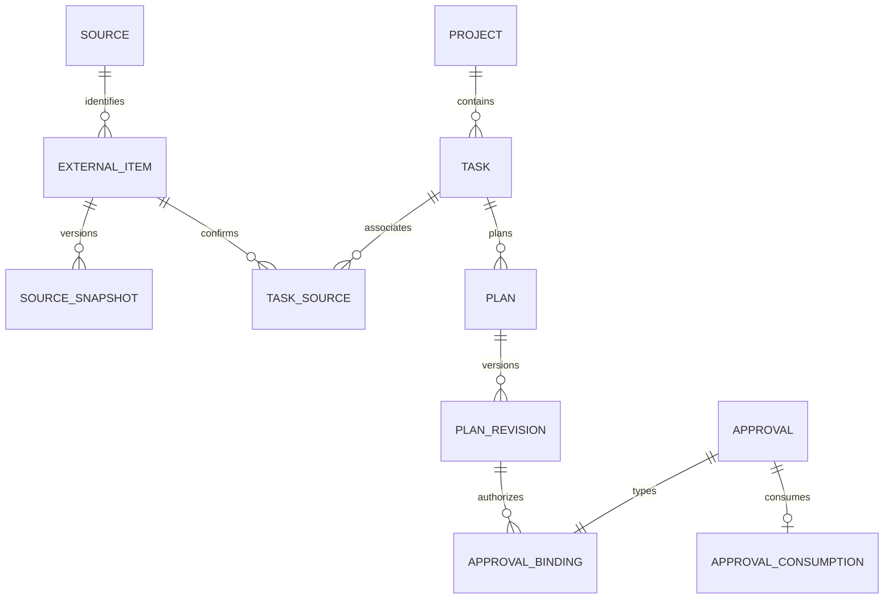
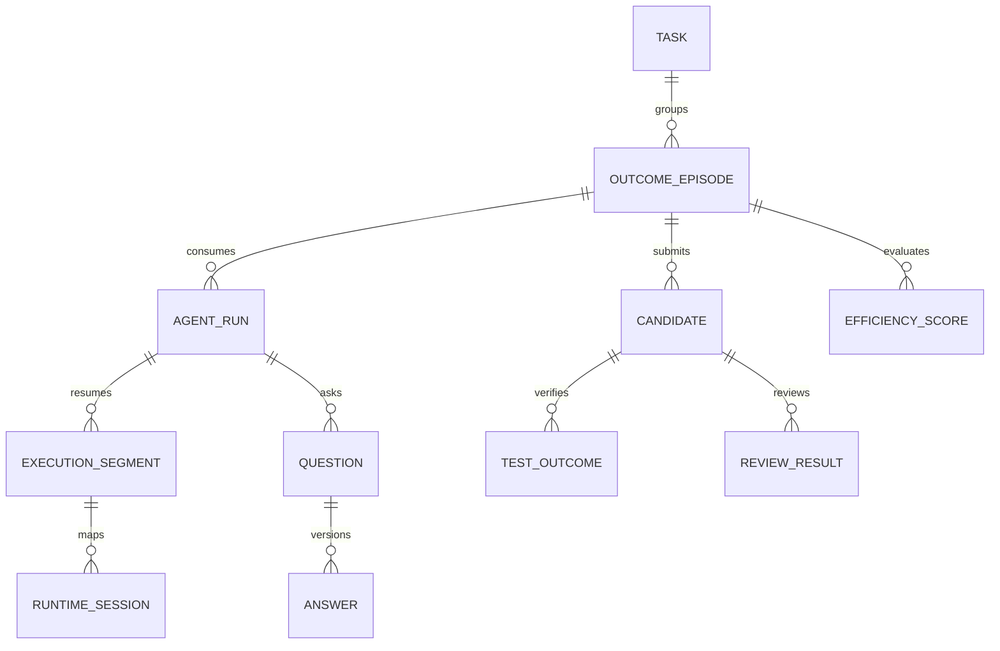
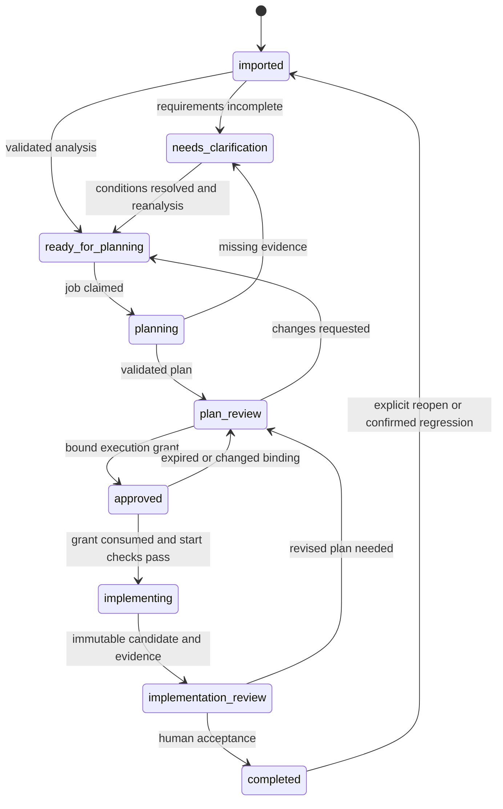

# Persistent data model

Proposed logical schema, revision 2. Configurable source/profile and runtime identity additions are described in `CONNECTIONS_AND_PROFILES.md`. Implement only the phase-owned subset in each migration. SQLAlchemy/Alembic implementation must preserve these invariants on SQLite and PostgreSQL. Naming below is canonical across the blueprint; JSON examples in agent contracts are transport envelopes, not alternative storage schemas.

Phase 2 status, 2026-10-21: migrations `0001_foundation` and `0002_source_sync`
implement the Phase 1 foundation plus connection/profile revisions, test/activation/
invalidation evidence, sync runs/cursors/pages/snapshots, manual sync requests,
allocations, allocation days, schedules, daily views and NX-011 resolution history.
`resolve_task` creates/reuses one canonical task keyed by its primary Jira source,
stores immutable requirements/profile/link/repository resolution evidence in
`planning_task_resolutions`, and stores each Tempo allocation snapshot association in
`planning_task_allocations`. Explicit local project/repository-binding IDs are required
by profile rules. The complete fixture-scope Phase 2 acceptance passed in the hardened
container; PostgreSQL portability and all live providers remain unverified.

## Conventions

- Entity PK `id`: application-generated UUID string; event sequence is the exception (monotonic 64-bit integer). Every FK named `*_id` references the corresponding entity PK unless explicitly stated. Avoid polymorphic unvalidated FK strings.
- Mutable rows have `created_at`, `updated_at`, `version NOT NULL >=1`; immutable rows have `created_at`, `content_hash`, optional `supersedes_id` FK to the same table. Revisions use parent ID + positive revision with a unique constraint. Deleting a parent never silently cascades away approvals or evidence.
- Store UTC instants with a tested UTC-aware type adapter (SQLite canonical UTC text / PostgreSQL timestamptz). Store local dates and IANA timezone separately. Never store all-day dates as invented midnight UTC timestamps.
- Money is signed integer micros plus currency, never binary float. Counts/durations are nonnegative 64-bit integers; unknown counts/costs are NULL, not zero. Corrections may have signed monetary deltas; usage observations remain nonnegative snapshots.
- JSON is for provider payloads, strict versioned contracts, algorithm inputs and presentation preferences; relationships, ownership and frequently filtered fields are normalized. Canonical JSON hash uses UTF-8, sorted keys, deterministic number/text normalization, algorithm version and SHA-256.
- Foreign keys enabled per connection, NOT NULL by default, explicit checks for states/ranges, FK indexes on referencing columns. `UQ` denotes unique constraint; `IX` denotes an additional query index. Nullable alternatives require a CHECK rather than an unenforced convention.
- Immutable application evidence is insert-only through services; runtime has no database access. SQLite does not provide a strong hostile-host tamper boundary; optional triggers catch accidental UPDATE/DELETE. A privileged local administrator can alter local state; backups/hash chains detect some corruption, not a compromised host.

## Core/project/source entities

| Table | Important columns and relationships | Constraints / indexes |
| --- | --- | --- |
| `users` | Local operator identity, display name, active flag, auth credential reference | UQ identity; no model/runtime principals in this table |
| `projects` | Slug, name, ecosystem, default timezone, typed config revision, active | UQ slug |
| `repositories` | Canonical local root, origin identity, default branch, approved flag | UQ canonical root; path resolved outside agent arguments |
| `project_repositories` | project FK, repository FK, role, branch, Odoo major version, addon roots | UQ project/repository/role; version is asserted config, separate from detected evidence |
| `external_sources` | Adapter kind tempo/jira/odoo/graph/google/ics, instance identity, base URL, database/calendar ID, secret reference, adapter/version, active | UQ kind/instance identity; URL/field mapping validated, no inline credentials |
| `connection_revisions` | external source FK, revision, adapter build/version, typed config artifact/hash, secret references, identity/scope fingerprint | UQ source/revision; immutable; no secrets or executable mappings in JSON |
| `planning_profiles` | Owner/project scope, slug, active revision FK nullable | UQ owner/slug; active pointer projection only |
| `planning_profile_revisions` | profile FK, revision, typed authority/classification/link/repository/timezone policy artifact/hash | UQ profile/revision; no arbitrary expression execution; draft/active/superseded derived projection |
| `profile_connections` | profile revision FK, connection revision FK, role schedule/context_calendar/work_items/requirements/repository_metadata | UQ revision/connection/role; remote source identity remains stable across config revisions |
| `connection_test_runs` | connection/profile revision FK, adapter build/hash, test kind, status, tested/expires times, redacted result artifact, scope/identity evidence | IX config hash/status/tested; test results bind exact config; no mutation of active task generation |
| `profile_activations` | profile/revision FKs, human user FK, prior activation FK, tests/preview artifact, activated_at, operation activate/rollback | Append-only; CAS active revision and one activation per command receipt; rollback never revives grants |
| `setup_proposals` | Human user FK, connection/profile draft revision references, requested changes artifact, provenance and state | No execution authority; proposal activation must name human decision; config not synthetic task identity |
| `project_sources` | project FK, source FK, external project/company scope, mapping config hash/version | UQ project/source/external scope |
| `external_items` | source FK, remote type/immutable ID, display key, current snapshot FK, visibility status | UQ source/type/remote ID; IX source/visibility |
| `external_item_snapshots` | external item FK, revision, provider modified time/revision, fetched time, raw artifact FK, normalized requirement JSON, raw hash, requirement hash, status | UQ item/revision; UQ item/raw hash/normalizer version; IX item/provider modified time |
| `sync_runs` | source FK, generation, status, started/finished, page count, errors, cursor before/after | IX source/started_at; failure never clears prior good data |
| `source_cursors` | source FK, stream key, successful watermark/token, query config hash, generation, last success | UQ source/stream key; advance only after completed sync |
| `sync_pages` | sync run FK, page key/hash, applied time, next-page locator | UQ sync run/page key; permits partial-page recovery |
| `tasks` | project FK, title projection, lifecycle state, current fingerprint/algorithm, primary source association FK, latest analysis/plan pointers, merged_into_task FK nullable | IX project/state; IX fingerprint; CHECK merged target != self |
| `task_sources` | task FK, external item FK, relation same_work/context, primary/secondary role, confirmed by user FK, evidence, active flag | Partial UQ external item where active (one canonical task); UQ task/item; exactly one primary enforced transactionally |
| `task_links` | from/to task FKs, kind depends_on/related/supersedes, evidence, confirmed user FK | UQ from/to/kind; CHECK no self; service checks dependency cycles |
| `task_resolutions` | task FK, profile revision FK, Jira identity item FK, requirements item FK nullable, repository mapping hash, classification, trace artifact/hash, validation state | Immutable resolution revisions; missing/conflicting Odoo reference is an explicit hold; source fetch does not guess authority |
| `task_fingerprint_revisions` | task FK, algorithm, snapshot references artifact, fingerprint, reason/event | UQ task/fingerprint/algorithm; immutable input manifest includes every source/config mapping |
| `task_holds` | task FK, reason code, question/source/conflict reference, opened/resolved times, resolver user FK | IX task/resolved_at; hold is orthogonal to lifecycle |
| `task_criteria` | task FK, stable criterion key, origin source snapshot FK or human proposal, text, priority, required | UQ task/criterion key; text changes create a new requirements revision |
| `planning_allocations` | source item FK, allocated account/resource type, native date range, item kind/reference, current snapshot FK, timezone, precision, status | UQ source item; capacity allocation distinct from calendar event; unknown exact start stays NULL |
| `allocation_days` | allocation FK, local date, planned seconds nullable, optional verified clock start, precision and source snapshot FK | UQ allocation/date in current projection; nonnegative known seconds; no arbitrary equal daily spreading |
| `allocation_tasks` | allocation FK, task FK, issue-resolution evidence | UQ allocation/task; unresolved/project-only capacity does not fabricate a task |
| `planning_task_resolutions` | task FK, profile revision FK, canonical Jira item/snapshot, requirements source/item/snapshot, classification/status/blockers, local repository mapping reference/binding IDs, route trace and hashes | UQ task/resolution hash; immutable; linked Odoo requirements do not replace Jira task identity |
| `planning_task_allocations` | task FK, resolution FK, Tempo allocation FK and immutable allocation snapshot FK | UQ resolution/allocation/snapshot; each allocation remains separately traceable |
| `schedules` | source external item FK nullable, occurrence ID/UID/original start, UTC start/end OR all-day start/end dates, source timezone, status, revision hash | UQ source item/occurrence key; CHECK timed XOR all-day; end > start; IX starts/ends |
| `schedule_tasks` | schedule FK, task FK, association evidence, confirmed/derived flag | UQ schedule/task; multiple tasks per event allowed |
| `daily_views` | user FK, local date, timezone, generated_at, source freshness manifest | UQ user/date/timezone; projection, not task ownership |
| `daily_view_tasks` | daily view FK, task FK, section, sort key, profile revision FK, calendar/allocation membership evidence | UQ view/task/section; no duplicated task state |

Source identity is instance-scoped. A Jira key or an Odoo numeric ID without database identity is insufficient. External-item raw revision retention is bounded but the normalized evidence supporting an approval is retained with that approval. Generic source errors do not create deletion snapshots. Merge/unmerge uses audited task-source reassignment plus preserved task aliases and invalidates all execution bindings.

## Requirements, planning and authorization

| Table | Important columns and relationships | Constraints / indexes |
| --- | --- | --- |
| `requirements_analyses` | task FK, agent run FK, revision, fingerprint revision FK, contract version, readiness, report artifact FK, validation status | UQ task/revision; IX task/readiness; immutable only after server validation |
| `plans` | task FK, stable plan identity | IX task |
| `plan_revisions` | plan FK, revision, analysis FK, fingerprint revision FK, content hash, strict report artifact FK, environment/tool policy/config hashes, complexity assessment pointer | UQ plan/revision; UQ plan/hash; approved revisions never updated |
| `plan_repository_bindings` | plan revision FK, repository FK, full base commit SHA, source snapshot hash, target branch | UQ revision/repository; no floating branch-only approval |
| `plan_steps` | plan revision FK, stable step key, order, action/evidence/check references | UQ revision/step key; UQ revision/order |
| `plan_scope_paths` | revision FK, repository FK, normalized path/pattern, read/write capability | UQ revision/repository/path/capability; no `..`, absolute paths or uncontrolled glob |
| `verification_requirements` | plan revision FK, stable check key, profile ID/version, criterion mappings, required flag, approved manual strategy | UQ revision/check key; references allowlisted command profile, no free shell |
| `plan_criteria` | revision FK, criterion FK, frozen text/hash, weight, evidence requirement | UQ revision/criterion; positive fixed-point weights |
| `plan_reviews` | plan revision FK, user FK, accept/request_changes, comment, reviewed hash | Immutable; planning acceptance grants no execution capability |
| `approvals` | kind implementation_start/implementation_continuation/external_write, user FK, envelope hash, issued/expires, predecessor approval FK nullable, decision allow/reject | Immutable; CHECK expiry > issued; IX expiry; exactly one typed subject row below |
| `execution_approval_bindings` | approval FK/PK, plan revision FK, fingerprint revision FK, policy/image/config hashes, planning profile/resolution/config hashes, runtime connection revision/adapter/transport/capability-report hash, budget policy FK nullable, run FK nullable for continuation, next segment index nullable | Start has no run binding before consumption; continuation requires run+segment. Envelope includes sorted repository bases, paths, commands, egress and limits |
| `write_approval_bindings` | approval FK/PK, writeback draft revision FK, target snapshot/version, payload hash | Same approval cannot have execution binding; service/type check and transaction assertion |
| `approval_consumptions` | approval FK/PK, job FK, run FK nullable, consumed_at, dispatch/segment key | UQ job; single row atomically creates launch or delivery job |
| `approval_revocations` | approval FK, reason, actor reference, event time | IX approval; append-only; a revoked consumed grant stops active capabilities |
| `run_capability_epochs` | run FK/PK, active epoch, state, grant FK, expiry, segment FK nullable | CAS update; revoked epochs cannot be reused |

Store the canonical authorization envelope as a content-addressed artifact as well as relational bindings. Bind all repositories, not just the first. A tool-policy or container-image change invalidates the envelope. An approval's status is derived from decision, expiry, consumption, revocation and current binding validity; do not mutate a signed/hashed decision record to claim it was never issued.

## Runs, questions, execution and review

| Table | Important columns and relationships | Constraints / indexes |
| --- | --- | --- |
| `runtime_connections` | Adapter ID and reviewed launch/endpoint reference, instance identity, active config revision FK | UQ adapter/instance identity; no arbitrary shell string from a profile |
| `runtime_connection_revisions` | runtime connection FK, revision, trusted adapter/build/transport/schema/config hashes, secret references | UQ connection/revision; immutable, scoped provider credentials outside prompts |
| `runtime_capability_reports` | runtime config revision FK, capability, result tested_pass/tested_fail/untested/unsupported/stale, evidence artifact, tested/expires times | IX config/capability/tested; advertised native support separate from tested result |
| `runtime_selections` | User/project/role scope, runtime connection revision FK, selection revision/hash | UQ scope/project/role; explicit precedence project-role > project default > global role > global default; no silent fallback |
| `agent_definitions` | Role, revision, model/provider variant, trusted instruction/skill/plugin hashes, tool policy hash, contract version | UQ role/revision; immutable |
| `outcome_episodes` | task FK, fingerprint revision FK, initial plan revision FK nullable before execution binding, predecessor episode FK nullable, frozen complexity FK, first implementation time | IX task/created; create episode at requirement fingerprint before analysis; bind/freeze initial plan at first implementation; new material scope creates successor episode |
| `agent_runs` | task/episode FKs (nullable only for setup/declared shared-overhead roles), setup proposal FK nullable, selected runtime config/report/selection hashes, agent definition FK, role, state, parent run FK nullable, approval FK nullable, attempt, source/plan bindings, started/finished, terminal reason | IX task/role/state; IX episode; implementation requires task/episode/approval; setup requires setup proposal and no execution grant |
| `execution_segments` | run FK, segment index, job FK, capability epoch, state, start/end, stop acknowledgment, checkpoint artifact FK, environment digest | UQ run/segment; only one active segment per run, enforced on claims |
| `runtime_sessions` | run/segment FKs, runtime connection revision FK, runtime instance ID, adapter ID/build, native session ID nullable, storage/continuation ref, status | UQ runtime/native session ID where known; generic NEXUS session ID always exists; unsupported resume stays unavailable |
| `opencode_sessions` | runtime session FK/PK, native OpenCode session ID, API schema fingerprint, optional native parent mapping | Optional adapter-specific extension; core/task/telemetry relations reference runtime_sessions |
| `dispatch_intents` | job/segment FKs, operation, request hash, correlation marker, upstream message ID nullable, state prepared/accepted/uncertain/reconciled | UQ operation idempotency key; persisted before network dispatch |
| `run_time_intervals` | run/segment FKs, category active/queue/provider_wait/human_wait/downtime, start/end, observation source | IX episode via run; end >= start; overlapping active intervals unioned for score |
| `human_interventions` | episode/run FKs, user FK, kind, explicit active time nullable, event reference | Unknown time remains NULL |
| `questions` | task/run FKs, category, structured prompt artifact, answer schema/version, blocking condition, question key, state open/answered/rejected/expired/cancelled/superseded, due_at | UQ run/question key; IX state/created; answered alone does not equal resumed |
| `question_answers` | question FK, revision, user FK, answer/guidance artifact, expected question version, decision answer/reject | UQ question/revision; immutable; one effective answer pointer on question projection |
| `question_conditions` | question FK, kind answer/configuration/approval/evidence, required reference and state | UQ question/condition key; secret-related answers contain references only |
| `execution_jobs` | Kind, state, task/run/source FKs nullable, payload artifact, idempotency key, priority, not_before, attempts/max, lease owner/expiry/epoch, checkpoint, last error | UQ idempotency key; IX state/not_before/priority; IX lease expiry |
| `job_dependencies` | job FK, prerequisite job FK | UQ pair; CHECK no self; service detects cycles |
| `repository_locks` | repository FK/PK, run FK, fencing epoch, acquired_at, stop-confirmed release metadata | Only worker claims/releases; expired DB lease alone cannot prove runtime stopped |
| `git_worktrees` | run/repository FKs, trusted path, branch/ref, full base SHA, manifest/artifact hash, state active/quarantined/archived/removed, final patch FK | UQ run/repository; UQ path; do not expose host common Git dir to runtime |
| `implementation_candidates` | episode/run FKs, ordinal, diff artifact/hash, complete tree manifest hash, plan revision FK, submitted_at | UQ episode/ordinal; first candidate immutable for first-pass metrics |
| `test_outcomes` | candidate FK, verification requirement FK, execution segment FK, environment/profile hash, exit code, pass/fail/skip counts nullable, state passed/failed/timeout/error/waived, evidence artifact | IX candidate/check; immutable; unique attempt key; no result inferred from prose |
| `review_results` | candidate FK, reviewer run FK, report artifact, blocking count, status validated/rejected | UQ candidate/reviewer run; independent session |
| `review_findings` | review FK, stable finding key, severity, path/evidence, condition, resolution reference nullable | UQ review/finding key; changes append finding-resolution evidence |
| `criterion_evidence` | candidate FK, plan criterion FK, test/review/artifact reference, worker/human verification decision | UQ candidate/criterion/evidence hash; agent cannot mark itself verified |
| `outcome_reviews` | episode/candidate FKs, user FK, accepted/request_changes/regression, patch hash, decision evidence, verification coverage | Immutable; human acceptance binds exact candidate/hash |
| `corrective_cycles` | episode FK, cause key, kind failure/review/scope_miss/provider_outage, affected runs, adjudicator/reason | UQ episode/cause key; non-overlapping counting rules in score doc |
| `artifacts` | SHA-256, media type, bytes, private storage path, sensitivity, schema version, retention class | UQ hash/media type; validate path and size; no arbitrary remote URL dereference |

For normalized corrective attribution, use `cycle_runs(cycle_id, run_id)` and `criterion_verifications`/finding resolutions if multiple records apply; never encode relational IDs as an unvalidated array. `agent_runs` status is a mutable projection of immutable run events/audit. Deferred FKs and ordered inserts resolve circular latest pointers; do not disable integrity checks to load data.

## Usage, scoring and operations

| Table | Important columns and relationships | Constraints / indexes |
| --- | --- | --- |
| `telemetry_events` | generic runtime session FK or provider source; adapter/build fingerprint, event identity/kind, source/received time, redacted accounting payload/hash, adapter version, simulated flag | UQ source/event key; fallback semantic receipt key with documented limits; IX received_at |
| `usage_observations` | telemetry event FK, runtime/session/message/accounting-unit key, observation revision/hash, raw counters, normalized nullable buckets, overlap semantics, cost kind/currency/micros, completed time | UQ unit/hash/adapter version; immutable replacements, never blindly sum message updates |
| `usage_ledger` | Current observation FK, accounting-unit key, run/episode attribution, semantic flags, pricing coverage | UQ runtime/session/message/accounting unit; rebuildable projection |
| `model_prices` | Provider/model/variant/region/tier, unit/category, currency, rate micros + denominator, effective interval, source URL, retrieved_at, version/hash | UQ tariff key/effective start/version; enforce no overlapping active tariff for exact key in service |
| `usage_valuations` | ledger unit/observation FK, tariff snapshot/hash, estimated cost, category breakdown, method version | UQ observation/tariff/method; recalculation adds a row |
| `billing_reconciliations` | Provider-account/window, bill evidence artifact, actual currency/amount, coverage, match method, supersedes FK | UQ bill identity/revision; nullable unmatched amount is not task spend |
| `billing_allocations` | reconciliation FK, usage ledger FK nullable or account-only bucket, allocated micros, confidence | Allocation totals must reconcile; no duplicating invoice sum across messages |
| `subscription_observations` | Provider/account, native allowance unit/scope/window, observed remaining/used/limit nullable, source, observed/expires, status known/unknown/stale | IX provider/account/observed; no invented token conversion |
| `budget_policies` | Scope project/provider/run, revision, metric actual/estimate/tokens, currency/unit, period limit, soft/hard mode, policy hash | Immutable revisions; UQ scope/revision; allowance is separate |
| `budget_reservations` | policy FK, job/run FK, reserved amount, released/settled time, observed spend binding | UQ policy/job; atomic admission; delayed telemetry overshoot disclosed |
| `complexity_assessments` | task/episode/plan revision FKs, revision, six axis scores, class, evidence artifact, assessor, reason, pre_run flag | UQ task/revision; each axis 0..2, sum 0..12 |
| `scoring_configurations` | Version/hash, immutable weights, formula version, gates/cohort rules | UQ version; weights sum exactly one via service validation |
| `efficiency_baselines` | scoring config FK, cohort predicates artifact, cutoff, valuation basis/tariff snapshot, medians, N/lineages/IQR, dataset hash | Immutable; no evaluated episode in own baseline |
| `baseline_episodes` | baseline FK, episode FK, weight, included/excluded reason | UQ baseline/episode; lineage weighting preserved |
| `efficiency_scores` | episode FK, scoring config/hash, baseline FK nullable, evidence hash, status, components/result, confidence, inputs artifact, supersedes FK | UQ episode/config hash/baseline/evidence hash; use explicit sentinel baseline identity or portable expression strategy for NULL uniqueness |
| `writeback_drafts` | task FK, source item FK, current revision FK, delivery projection | IX task/state |
| `writeback_draft_revisions` | draft FK, revision, immutable before snapshot, exact field/comment payload artifact/hash, allowed operation, target version | UQ draft/revision; mutation creates revision and invalidates authorization |
| `writeback_deliveries` | draft revision/approval/job FKs, attempt, dispatch ID, prepared/sent/uncertain/reconciled/failed, remote response/ID | UQ approval; no automatic blind retry for uncertain result |
| `notifications` | user FK, originating event FK, channel, safe payload, delivery/read status, retry deadline | UQ event/channel/user; IX user/read state |
| `schedule_policies` | User/project scope, timezone, rule/version, enabled | UQ scope/name/version |
| `schedule_slots` | policy FK, local date, slot key, timezone, UTC instant, job FK | UQ policy/date/slot/timezone; no duplicate DST/missed-run enqueue |
| `command_receipts` | User/capability scope, idempotency key, request hash, status/response reference, expiry | UQ principal scope/key; different body same key = conflict |
| `audit_events` | seq PK, UUID UQ, actor kind/user or worker/run reference, action, subject references, correlation/causation, before/after hashes, timestamp, redacted payload | IX subject/time; IX correlation; insert-only; optional previous-hash chain |
| `outbox_events` | seq PK, event UUID UQ, entity type/id/version, event kind, correlation, timestamp, safe payload, audit FK | IX seq/time; committed with corresponding state |
| `user_preferences` | user FK/PK, display mode, motion/performance tier, layout/filter JSON schema version | No authorization settings here |

`outbox_events` has typed entity references validated by services; it is an event envelope, not an ownership relation. Application model rows use real FKs. `telemetry_events` retains only accounting/operational metadata by default; full prompts/code are separate restricted artifacts if needed, never analytics payloads. See `TELEMETRY.md` for semantic replacement and reconciliation rules.

## Important relationships

These diagrams show logical singular names. Tables above are authoritative. Additional junctions link schedules/tasks, plan/repositories, baseline/episodes, cycles/runs and billing/usage without giant diagrams.

## Connection/profile and runtime identity invariants

Connection configuration revisions do not change source remote identity. Profile activation stores immutable actor/test/preview evidence, then materializes a new sync generation before replacing active task projections. Preserve previous generation on failed sync and show active-versus-materialized revision explicitly. Activate/rollback invalidates affected task fingerprints/grants; never silently relink or delete history. Resolution trace includes Tempo allocation→Jira issue→classification→Jira/Odoo requirements→repository and all consulted snapshot IDs. Profile rules may support Jira-only project work through a separate explicit reviewed rule; the initial configured project branch requires Odoo. A reused Odoo reference with conflicting work identity enters review instead of automatic merging.

Run/session identity is generic. Freeze effective runtime selection and compatibility/capability report at run admission; any material selection/build/policy change requires fresh authorization. Setup runs are taskless, bound to setup proposals, and charged to configuration overhead, never invented implementation episodes or scores. Optional native OpenCode identifiers are adapter metadata, not foreign keys required by every harness. Test fixtures must exercise a fake non-OpenCode adapter without changing domain/API/UI schemas.

Capacity allocations preserve provider dates/effort/precision. Calendar schedules preserve appointment/all-day event semantics. Daily views union configured scheduling authorities with explicit precedence; source context calendars do not reschedule development work unless the profile says so. Multiple allocations reference one canonical task and have separately traceable planned effort.

## Lifecycle and transaction invariants

`approved` is unavailable before Phase 5. A `plan_review` task can have an accepted `plan_reviews` record in M1 without an implementation grant. Blocking holds overlay any state; task stays visible with its last valid lifecycle state. Stale inputs invalidate readiness and route through reanalysis/replanning. Run/job cancellation does not erase the task or pretend completion. Cancelled/archived remote tasks have source status and hold/visibility fields rather than a forced completed lifecycle.

Run states: queued, starting, running, waiting_human, stopping, succeeded, failed, cancelled, interrupted. Job states: queued, leased, running, waiting, retry_wait, succeeded, failed, cancelled, uncertain. Unknown launch/delivery must be `uncertain`; no implicit success. A stopped segment can leave a logical run `waiting_human`. Task progress is derived by guarded service transitions, not directly assigned by agents.

Atomic transactions to test explicitly:

1. Import page: source revision + task links/fingerprint + stale-plan/grant handling + audit/outbox; cursor advances after complete run.
2. Execution authorization/launch: verify user, exact bindings, expiry, no holds, source/base freshness, budgets; consume grant + create run/job/intent + audit/outbox under CAS. External I/O happens after commit; recheck dispatch fencing before tools become active.
3. Question: deduplicate question + open hold + revoke capability epoch + audit/outbox. Stop acknowledgment precedes resume eligibility. Answer + continuation uniqueness + current bindings are checked transactionally.
4. Cancellation: revoke epoch + stop request event; release repository lock only after confirmed process/container stop.
5. Usage: immutable observation + current-unit pointer + delta-derived aggregates + outbox. Out-of-order observations cannot reduce authoritative coverage or overwrite a newer correction without provenance.
6. Human acceptance: candidate hash/check coverage/review verification + outcome record + completion transition + score invalidation/request event. A new patch invalidates prior review/check evidence.

## Retention, backup and migration

Proposed defaults, configurable by sensitivity: raw source payloads 30 days, verbose logs/tool text 14 days, accounting receipts 90 days, replayable SSE events seven days, normalized source versions supporting plans/approvals and outcome/audit evidence one year; canonical usage/pricing/billing/score evidence 24 months. Keep records referenced by active runs, accepted evidence, legal/client policy or unresolved writes regardless of age. Never purge audit solely because task leaves today's view. Content-addressed blobs use reference-aware garbage collection with dry-run and tombstone delay; no broad recursive delete based on agent paths.

Daily SQLite online backup via supported backup API (not copying only the live DB file while WAL exists), referenced artifact manifest and checksums. Retain seven daily/four weekly backups initially; encrypt via OS storage/backup configuration. Restore into a separate directory, verify FKs/artifact hashes, invalidate execution capability epochs, and reconcile sessions before starting workers. Backup includes sensitive client code; retain/restrict accordingly. Test restore before enabling M2 and again in Phase 8.

Apply additive migrations first; SQLite table rebuild uses Alembic batch operations with backup and verification. Phase 1 creates only core/source identity, task/fingerprint, jobs/receipts, artifacts, audit/outbox and basic user/config tables; approval/usage/review schemas arrive with their phases. PostgreSQL migration procedure is in `ARCHITECTURE.md`; preserve IDs and event sequence high-water marks. Run concurrency and fixed-point arithmetic fixtures on both dialects before migration.
