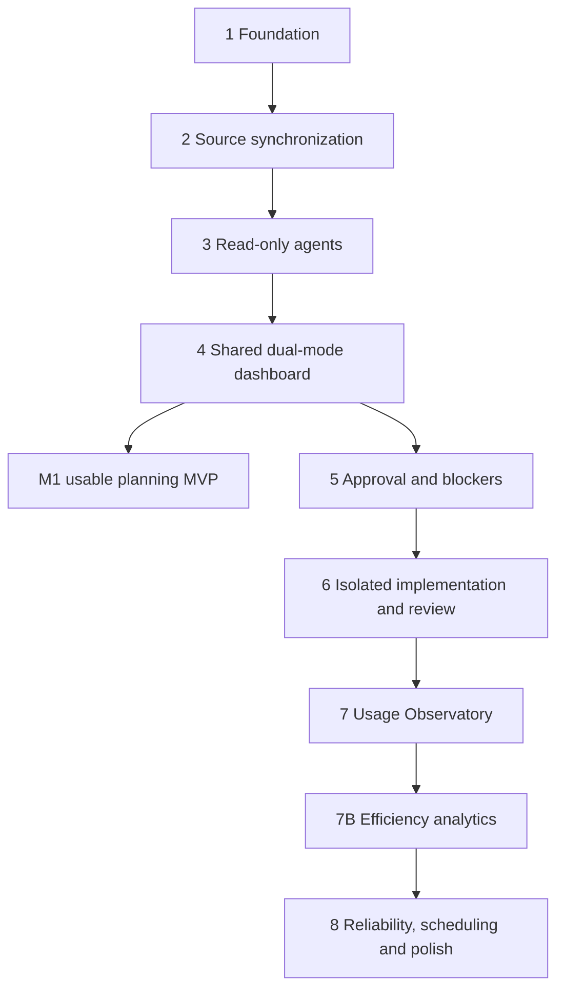

# Phased implementation and execution handoff

Blueprint revision 2, 2026-10-20; implementation status updated 2026-10-21. The confirmed initial source workflow and adapter/setup contracts are in `CONNECTIONS_AND_PROFILES.md`. Start with `AGENTS.md`; read the phase's linked contracts and `BACKLOG.md`. Phase 1 and Phase 2 passed their documented hardened-container checks; see `PHASE1_VERIFICATION.md` and `PHASE2_VERIFICATION.md`. No Phase 3 work is included.

## Dependencies and release slices



Worker leases, event identity, run timestamps and outcome evidence start when their owning domain exists, not when analytics arrives. Phase 3 collects raw accounting observations; Phase 6 captures first-candidate/test/review/outcome facts. Phase 7/7B reconcile and visualize them. Phase 8 hardens scheduling; manual enqueue and restart-safe jobs work earlier. Avoid postponing security until Phase 8.

Each ticket has a stable ID in `BACKLOG.md`. The phase exit requires all listed tickets and their tests, or a documented developer-approved scope change. Use fixture-backed demos without credentials; label them as simulated. Live connection acceptance is separately reported as verified or blocked by actual configuration.

## Revision 2 integration scope and execution order

The initial live path is **Tempo allocation → Jira issue → configured work classification**. Helpdesk requirements come from Jira; the configured project-work branch reads its description/criteria from the explicitly linked Odoo task. Missing/ambiguous Odoo links block readiness. Outlook/Google are optional context or replacement calendars, not prerequisites. Tempo effort/date allocations must not become invented clock appointments.

NEXUS owns provider-neutral source/profile and runtime contracts. OpenCode is the first/default harness adapter, not a mandatory core/domain dependency. A fake alternate adapter proves decoupling; additional real harnesses need verified capability/security gates. Optional ACP transport is evaluated separately. Both dashboard modes use the same normalized APIs.

Existing ticket IDs remain stable. Execute the added tickets at these dependency positions:

| Phase | Revised execution order | New required result |
| --- | --- | --- |
| 1 | NX-001–NX-006 | Neutral source identities/config hashing only; no adapter scaffolding |
| 2 | NX-007, NX-051, NX-008, NX-009, NX-052, NX-010, NX-011, NX-012 | Tested configurable connections/profiles and Tempo/Jira/Odoo routing |
| 3 | NX-053, NX-013–NX-018, NX-054 | Runtime contract, OpenCode adapter, constrained optional setup assistant |
| 4 | NX-019, NX-020, NX-055, NX-021–NX-024 | Shared connection/profile/runtime settings and setup preview |
| 5–8 | Existing IDs in dependency order | Profile/runtime revisions in approvals, telemetry and recovery |

Configuration discovery/test/preview must be available through CLI in Phase 2; the UI arrives in Phase 4. Manual bootstrap works without an AI harness, avoiding a setup dependency cycle. Setup assistant proposes typed drafts and runs allowlisted read tests; user authentication and local activation remain human actions. No external provider settings or writes are changed during testing.

## Phase 1 — Python foundation, database and state machine

**Goals/scope:** deliver the smallest reliable control-plane foundation. No frontend, connectors, OpenCode processes or application code execution. Read `ARCHITECTURE.md`, `DATA_MODEL.md`, `SECURITY.md`. Tickets NX-001–NX-006.

**Engineering tasks:** create the Python package and locked development dependencies, typed settings, FastAPI app factory/lifespan, health/CLI entrypoints, SQLAlchemy session/transaction setup and first Alembic migration. Implement only users/projects/repository/source identity, tasks/fingerprints/holds, artifacts, jobs/claims, command receipts and audit/outbox needed for foundation fixtures. Define task/run/job state enums and guarded domain transition graph; future execution transitions remain unreachable through public commands until their evidence-backed services exist. No client `approved=true` placeholder. Implement CAS version checks, stable hashing, idempotent enqueue, short atomic transition/audit/outbox service and safe error envelope. Create fixture commands for a synthetic daily task and job, never startup demo data in real state. Add structured redacted logging and correlation IDs.

**Dependencies:** Python 3.12+ and local filesystem only. External accounts, container engine and OpenCode are not prerequisites. Use current docs for exact library setup; record chosen versions.

**Outputs:** reproducible package/lockfile, migration, domain services, minimal authenticated local API skeleton/health (bootstrap auth before mutation endpoints), CLI fixture/enqueue/status commands, pytest suite and README with exact run/test/migrate instructions. Record implementation commands actually tested; do not prewrite fictional results.

**Acceptance/tests:** new DB migrates from empty; persistent task survives process restart; FK/check/unique constraints reject invalid data; transition graph rejects forbidden edges and missing evidence; task updates use expected version; concurrent same-key commands create one result; changed-body same-key returns conflict; audit/outbox commit with mutation or all roll back. Two workers racing for one fixture job produce one lease; stale epoch cannot finalize; no DB transaction remains open during mocked slow work. Test WAL/foreign key/transaction setup on file-backed SQLite, not only in-memory SQLite. Local auth/Origin/CSRF tests accompany exposed mutation routes.

**Failures/security:** locked/full disk, malformed configuration, conflicting commands, lost leases and partial transactions fail with safe diagnostics, not secret dumps. No generic shell endpoint. Restrict state directory permissions; no credentials in fixture files. Foundations do not expose future launch/write paths.

**Demo:** install dependencies; migrate temporary DB; create synthetic project/task via CLI; enqueue/claim fixture no-op job; show state/audit/outbox; restart and show persisted record; repeat idempotency key; demonstrate invalid transition and stale version rejection. All paths stay in a temporary private state directory.

**Definition of done:** NX-001–006 pass; docs reflect actual layout/commands; no future-phase placeholders with permissive behavior, no external calls and no agent or implementation functionality. Leave Phase 2 as next ticket.

## Phase 2 — Configurable Tempo/Jira/Odoo planning synchronization

**Implementation status, 2026-10-21:** NX-007, NX-051, NX-008, NX-009, NX-052, NX-010, NX-011 and NX-012 passed fixture-scope acceptance in the hardened container. NX-011 profiles name explicit local project and repository-binding IDs. Jira issue identity creates the canonical task, Odoo task snapshots remain project requirements provenance, and Tempo allocation snapshots are separately associated and historically retained. Missing/ambiguous/inaccessible Odoo links block readiness without fallback. Live providers remain untested; see `PHASE2_VERIFICATION.md`. No Phase 3 work is included.

**Goals/scope:** import the developer's actual planned work with configurable source authorities, without external writeback or AI. Tickets NX-007–NX-012 plus NX-051–NX-052. Read `CONNECTIONS_AND_PROFILES.md`, source contracts in `ARCHITECTURE.md` and identity schema in `DATA_MODEL.md`.

**Engineering tasks:** add connection/profile revision, read-test, preview, activation and source-resolution records; CLI discovery/test/draft/activate/rollback over typed installed adapters; source/snapshot/cursor/page and calendar/allocation migrations. Build Jira Cloud discovery/ADF/specific-issue fetching; Odoo 17/18 RPC and 19 JSON-2 reads with field/company/project controls; verify the account's Tempo product/deployment before enabling its planning adapter. Initial Cloud candidate uses official v4 allocation search/user reads and native daily effort when available. Resolve Tempo allocated account and immutable issue ID, classify Jira helpdesk/project rules, and choose Jira versus explicitly linked Odoo requirements. Preserve raw provenance, missing links and repository mapping errors. Keep effort allocations separate from calendar appointments. ICS supports local demo/context; implement Outlook/Google live adapters only when selected, through the same source contract. Materialize daily/upcoming views with profile/routing hashes and freshness; no UI code knows provider endpoints.

**Dependencies:** Phase 1; actual Tempo/Jira/Odoo connection configuration for live tests only. Separate Tempo authentication/permissions from Jira authentication. No Outlook/Google credential required for this workflow.

**Outputs:** typed connection/profile revisions; safe CLI setup and sample-day trace; read-test results bound to config/build; Tempo allocations and normalized source snapshots; helpdesk/project requirement resolution; generation-based activation/rollback and deterministic daily view.

**Acceptance/tests:** repeat/multi-page sync deduplicates and failed pages do not advance cursor; Tempo allocation IDs survive rescheduling and linked Jira key changes; allocated user different from Jira assignee is not lost; multiple allocations create one task with distinct scheduling evidence; project-only/generic allocations remain capacity context. Date/effort without exact time never fabricates an appointment; unknown daily breakdown stays unknown. Fetch overlapping horizon allocations and reconcile removed/reassigned plans without relying on partial-result absence. Helpdesk requirements use Jira; project requirements use the explicitly linked Odoo task. Missing/ambiguous/inaccessible Odoo links block without fallback; instance/database/company mismatches fail. Identical titles do not merge. Profile activation/rollback preserves task history, uses complete preview/test evidence and invalidates affected readiness/grants. Test ICS recurrence/all-day/DST and configured-source stale states; selected live calendar adapters need their own cursor/cancellation fixtures.

**Failures/security:** 401/403 requests configuration; 429 honors retry delay; 5xx bounded retry; missing fields/schema fail explicit mapping tests. Test traffic uses exact read-operation allowlists, including documented POST searches. Configurable mappings cannot execute code or fetch untrusted hosts. Secrets never enter draft prompts/test logs. Failed preview/activation keeps last good active generation. Setup does not enable Tempo↔Jira sync or modify external settings.

**Demo:** configure fixture connections and one profile with helpdesk and project routing. Preview a day containing a Jira helpdesk issue, Jira issue linked to Odoo, missing-link task and effort-only allocation; show every resolution step. Activate manually; sync; edit an Odoo requirement/Tempo allocation/link and show history plus invalidation. Change/rollback a profile without losing task identity. Optionally repeat with developer-configured read-only accounts and explicitly report live coverage.

**Definition of done:** NX-007–012 and NX-051–052 pass; the confirmed workflow works without calendar credentials, dashboard provider logic or arbitrary code configuration. Live connection gaps remain labeled, not fabricated.

## Phase 3 — Harness-agnostic agents with OpenCode first

**Goals/scope:** turn imported work into evidence-backed plans using real supported OpenCode interfaces with no code modifications. Tickets NX-053, NX-013–NX-018 and NX-054. `OPENCODE_INTEGRATION.md` and `AGENT_CONTRACTS.md` are authoritative.

**Engineering tasks:** implement the minimal RuntimeAdapter contract, capability report/session identities and frozen project/role runtime selection; use a fake alternate adapter to prove domain decoupling. Implement OpenCode as the first/default concrete adapter, selecting exact runtime build/digest and passing compatibility probes; add run/segment/session/dispatch/analysis/plan/artifact/accounting receipt schema; supervise read-only sandbox runtimes; use Python HTTP/SSE adapter and trusted TypeScript tools/skills; sanitize runtime config and enforce broker read/search/report tools. Capture repositories at exact commits and inspect Odoo manifests/models/XML/security/dependencies without executing them. Add strict role schemas, one bounded report repair, persistent requirements questions/checkpoints and CLI answer/resume for planning. Record raw usage observations and run time intervals from the first real call. Add the optional separate setup-assistant role over Phase 2 draft/discovery/test services; it cannot receive credentials, activate drafts, broaden scopes or approve itself. ACP and additional real harnesses are follow-up adapters, not assumed equivalent.

**Dependencies:** Phase 2, approved model/data policy, tested read-only isolation environment. Real OpenCode integration acceptance cannot pass solely with a fake server; fake fixtures cover deterministic failure cases.

**Outputs:** runtime compatibility manifest/fixtures, trusted role configs, requirements analyses, plan revisions/base manifests and recorded uncertainties. Missing installed-module inventory remains unknown.

**Acceptance/tests:** pinned server create/prompt/events/messages/abort/auth/structured-report/tool behavior verified; unrecognized schema disables starts. Requirements produce specific source-linked questions; planner identifies paths and tests. Planning leaves host checkout and source snapshot unchanged. Reconnect reconciles messages without duplicated costs/reports. Unknown prompt acceptance becomes uncertain, not a second prompt. A repository plugin, injected command or write attempt cannot execute. Persistent planning question survives process death and resumes once after answer.

**Failures/security:** provider errors/timeouts have bounded budgets; invalid reports cannot enter review as valid plans; no built-in arbitrary shell/edit/delegation/web access. No connector credentials in runtime, no unsafe repo config discovery. Read-only permissions alone do not permit test execution. All known blind spots visible in report.

**Demo:** one clear Odoo fixture task produces a validated analysis/plan; ambiguous task asks a question; answer through CLI and resume. Stop worker during SSE, restart and recover; demonstrate denied write and unchanged source hashes.

**Definition of done:** NX-053, NX-013–018, NX-054 and the real compatibility probe pass for the configured OpenCode adapter; fake alternate harness uses the same NEXUS domain contract; reports/observations persist; no implementation capability exists. If safe runtime isolation cannot be proven, report gate failure and keep starts disabled.

## Phase 4 — Dashboard foundation in both modes (M1)

**Goals/scope:** usable daily planning and human review in Mission Control and Focus. Tickets NX-019–NX-024 plus NX-055. Follow `DASHBOARD_DESIGN.md`; advanced particle/GPU polish is deferred.

**Engineering tasks:** shared Connections/Planning Profiles/Runtime Settings with guided auth, read-test results, preview/source trace, config diff/impact, explicit activation/rollback and truthful capability gates; static SvelteKit app, typed API client, shared scoped domain store/selectors, one replayable SSE feed; source-aware task/calendar/attention/session detail; plan review/request-change commands; shared semantic components in two presentation shells. Persist mode/motion preferences, URL context and filters; implement keyboard/screen-reader navigation and responsive layouts. Add lightweight meaningful status animation only; Observatory/efficiency sections show honest unavailable states until later phases.

**Dependencies:** Phase 3 plan contract and Phase 2 snapshots; local auth and safe read APIs. Review acceptance creates `plan_reviews`, not execution approval.

**Outputs:** functional screens, both wireframes realized, static build served same origin, Vitest/Playwright fixtures and documented accessibility/performance measurements.

**Acceptance/tests:** import → view today → inspect requirements/plan → accept planning review/request changes works in both modes. Toggle without reload preserves task/filter/calendar state; events arriving during switch apply once. SSE gap/expired cursor loads consistent snapshot; offline/stale states visible. Reduced motion disables unnecessary animation; hidden tab/Focus suspends canvas. No permission differences; implementation launch remains visibly unavailable. Meet Phase 4 functional budgets; measure browser baseline before cinematic work.

**Failures/security:** server unavailable, malformed event, stale review version and missing evidence render actionable safe states. Sanitize external markup and diff filenames. No direct runtime connection, auth token URL, or duplicated state store.

**Demo:** complete morning workflow in both modes with the same task, switch during active planning, ask/answer a planning question, reload preference and inspect a changed-source warning. Narrow viewport and keyboard-only pass.

**Definition of done:** NX-019–024 and NX-055 pass, both modes useful, M1 can import/analyze/plan/review. Code implementation, launch permissions and advanced analytics remain unavailable, not fake working buttons.

## Phase 5 — Human approval and blocker workflows

**Goals/scope:** hardened execution authorization and durable decision workflows before writable agents. Tickets NX-025–NX-029. Read security/approval schema and agent question contracts.

**Engineering tasks:** execution envelope builder, immutable approval/revocation/consumption schema, source/base live recheck, single-use launch transaction, capability epochs and budget admission foundation. Bind planning profile/config/routing revisions and runtime adapter/build/transport/capability evidence; configuration changes cannot silently alter approved runs. Implement approval UI, diff between revisions, expiry/rejection/renewal and separate continuation kind. Expand persistent questions to all categories, conditions, answer revisions and reject/expire/cancel; guidance versus scope expansion routing. Implement checkpoint stop acknowledgment and authenticated command parity. Add external immutable writeback draft/preview schema and approval type, but leave actual delivery to Phase 8.

**Dependencies:** Phase 4, source freshness and pinned runtime artifacts. A fake executor proves orchestration without enabling writable code.

**Outputs:** reviewable exact authorization envelopes, attention actions/history, guarded launch intents and question/answer/resume state machine.

**Acceptance/tests:** double-click/two tabs consume one approval; stale source/base/config/plan/hash/expiry/holds reject launch; altered payload under same idempotency key conflicts. Answer duplicate/late/unauthorized cases cannot resume twice. Scope expansion never resumes automatically. Expiry while waiting requires continuation grant only for unchanged bindings; a retry needs new start approval. Kill at every question/answer/consumption transaction boundary and recover. Separate write approval cannot authorize code or vice versa.

**Failures/security:** no secrets in questions, user-only approval endpoints, CSRF/Origin enforcement, runtime cannot modify grants/answer itself. Stop failure leaves lock/quarantine. Approval creates no blanket filesystem authority.

**Demo:** approve fake execution envelope, change ticket before launch and see rejection; replan/approve/start one fake run; create durable blocker, restart, answer and show single continuation. Show scope-change path and separate remote draft preview.

**Definition of done:** NX-025–029 pass security/chaos tests; execution adapter still cannot write code until Phase 6 isolation gate passes.

## Phase 6 — Isolated implementation and independent review (M2)

**Goals/scope:** safely produce a local reviewed patch from an approved plan. Tickets NX-030–NX-035. No merge, push or deploy tools.

**Engineering tasks:** trusted worktree lifecycle/locks/manifest, sanitized runtime source export, no-follow patch broker and expected-blob CAS, isolated verification profiles/dependency images/test DBs, resource/network/secret controls and process-tree termination. Implement agent executor and checkpoint guidance, immutable candidates/first-candidate facts, worker test receipts, independent read-only review and human outcome acceptance. Record episodes/corrective cycles/time intervals/complexity proposal before first implementation. Collect patch/test/review evidence from trusted observers, not agent claims. Add backup/restore rehearsal before enabling live M2.

**Dependencies:** Phase 5 plus verified container engine/image/data policy, tests appropriate to project/Odoo version. Multi-repository plan envelope supported, but first live execution should use one repository; multi-repository execution requires all-or-none admission and explicit partial-failure preservation before enablement.

**Outputs:** isolated candidate patch, test artifacts, independent review and human acceptance trail; no host checkout change. Supported sandbox controls documented with actual platform evidence.

**Acceptance/tests:** symlink/hardlink/path traversal/mode/deletion/rename/out-of-scope write rejected; target Git common directory not mounted. Malicious tests cannot reach secrets/host/network/DB; descendants stop on timeout/cancel. Crash after session start does not duplicate implementation; changed source revokes and stops. New candidate invalidates previous tests/review. Human acceptance requires the exact diff, resolved blocking findings and required verification passed or a specific human-recorded waiver. Waivers remain visible, never count as test passes, and prevent a final efficiency score. Capture first-pass result before rework. Fresh approval for every new attempt.

**Failures/security:** disk full, incomplete patch, dependency failure, timeout, sandbox unavailable and stop failure preserve evidence/quarantine. No fallback host shell. Worktree cleanup only trusted owned paths after stopped confirmation. Emergency stop tested.

**Demo:** approve small fixture change; watch execution in both modes; answer technical blocker; run tests and independent reviewer; accept local patch. Demonstrate denied escape and cancel. Confirm original checkout/ref/remotes remain unchanged; no push/merge/deploy occurs.

**Definition of done:** NX-030–035 pass platform security gates and restore rehearsal; a reviewed patch is usable locally and its resources/outcome are recorded.

## Phase 7 — Token telemetry and Usage Observatory

**Goals/scope:** trustworthy consumption, costs, allowance states and aggregated visuals. Tickets NX-036–NX-040. Raw evidence already exists from Phase 3. Follow `TELEMETRY.md`.

**Engineering tasks:** immutable usage revisions/current ledger, provider/runtime semantic adapters, source deduplication/reconciliation, versioned tariffs/valuation, billing allocation only with evidence, allowance observations with expiry/unknown state, budget policies/reservations and dashboard rollups. Implement measured bucket rates, Canvas2D reactor and Focus charts/tables, performance controls and clearly isolated simulated feed.

**Dependencies:** Phases 3/6 real observation fixtures, Phase 4 shared UI. Provider billing/allowance integrations are capability-specific, not assumed universally available.

**Outputs:** explainable task/run/provider usage, valuation provenance, pricing history, reconciliation report, configured budget controls and both telemetry presentations.

**Acceptance/tests:** duplicate/cumulative/out-of-order/corrected message events count once; unknown category overlaps prevent invented totals; mixed currency not summed; missing price not zero; actual billing separated from OpenCode-reported/estimated cost. Simulated usage excluded from budgets/baselines. Unknown subscription never shows percentage. Concurrent admissions reserve budget atomically; delayed accounting overshoot warning honest. Replay/reconciliation rebuild matches final aggregates. Reactor budget/hidden-tab/reduced-motion fallback tests pass.

**Failures/security:** accounting gaps mark partial coverage; failed tariffs do not replace valid history; no account credentials or message bodies in browser telemetry. Spend caps are admission/observed-usage controls, not a guarantee against unseen provider charges.

**Demo:** replay a fixed measured fixture with cumulative updates/retries/cache and unknown subscription; compare task totals and valuation evidence in both modes; disconnect/reconcile and show unchanged totals. Toggle simulated feed visibly.

**Definition of done:** NX-036–040 pass accounting golden fixtures and dashboard performance budgets; no fabricated billing/quota claim.

## Phase 7B — Per-task efficiency scoring and analytics

**Goals/scope:** reproducible quality-aware scores and fair comparisons. Tickets NX-041–NX-044. `AI_EFFICIENCY_SCORE.md` is the only formula authority.

**Engineering tasks:** immutable complexity/config/baseline/score migrations; freeze pre-run assessment; build comparable eligible episode cohorts with cutoff/data/tariff hashes; Decimal scoring with versioned weights/gates; confidence/evidence detail; filtered model/agent/project/strategy analytics, failed-run denominators and regression supersession.

**Dependencies:** Phase 6 outcome evidence and Phase 7 valuations. Real final scores depend on sufficient history; shipping correct `Insufficient data` is expected during cold start.

**Outputs:** deterministic engine, worked-example golden test, evidence drilldown, score history and sample-aware comparison views in both modes.

**Acceptance/tests:** reproduce 79.3 example; missing evidence never reweights remaining metrics; skipped tests, agent-only completion, unreviewed patch, absent first-candidate facts and unknown costs prevent final score. Baseline excludes self/future outcomes, requires 20 episodes/five lineages and lineage caps; mixed-model outcomes not duplicated. Genuine scope changes preserve task cost and episode boundaries; regression invalidates current score without erasing history. Human complexity revisions cannot silently improve historical scores.

**Failures/security:** bad/cold-start baselines yield unavailable score, not arbitrary defaults. Agents cannot edit metrics evidence or adjudicate their own rework. Ranking communicates confounding and sample size; no automatic agent selection based on score.

**Demo:** inspect incomplete real-history state; load clearly labelled synthetic worked example into a separate demo dataset and inspect 79.3 breakdown; remove test evidence and see `Insufficient data`; compare cohorts without merging simulated data into production.

**Definition of done:** NX-041–044 pass formula/provenance/gaming tests; no unsupported performance ranking.

## Phase 8 — Scheduling, notifications, reliability and visual polish

**Goals/scope:** dependable daily operation and polished presentation after functional gates. Tickets NX-045–NX-050. No expansion to production deployment automation.

**Engineering tasks:** launchd service/timer templates and enqueue slot policy, wake/startup catch-up, nightly reconciliation, notification inbox/local OS adapter with quiet hours and dedup, uncertain-job recovery UI/doctor, log/artifact retention and backup tooling, Linux systemd/server migration guide, opt-in conditional external delivery, final animation/responsive/performance hardening. Keep webhooks deferred unless reachable verified deployment exists. Implement delivery only for documented safe operations; unsupported conditional field updates remain preview/copy-only.

**Dependencies:** prior phases; explicit notification/external-write destinations and approved payloads for live delivery. No user message/email is sent just to test an adapter without authorization.

**Outputs:** service templates/runbooks, operational health/freshness views, recovery/restore procedure, proven authorized write reconciliation and polished dual dashboard.

**Acceptance/tests:** sleeping/waking laptop runs one catch-up, no missed-slot storm; DST/duplicate launchd ticks enqueue once; worker/API independent restart and expired lease fencing pass. Cancel/emergency-stop acknowledges actual process death; uncertain dispatch stays blocked until reconciled. Backup/restore keeps IDs/blobs/event cursor and invalidates capabilities. Notifications deduplicate/quiet hours/redact. Remote comment timeout reconciles without duplicate resend; field conflict blocks. Accessibility/manual keyboard and measured rendering budgets pass under representative concurrent activity and smaller viewport.

**Failures/security:** power-off means no scheduling; stale UI says so. Provider webhook requires verified provenance/replay controls and re-fetch, not trusted payload actions. Server guide demands TLS/auth/secret reprovisioning; no automatic public exposure. Retention cannot delete active evidence or unresolved delivery receipts.

**Demo:** controlled service restart, simulated missed morning and DST fixture, recovered blocker, emergency stop and restore; approved sandbox-account append-only write if explicitly configured. Show final Mission Control animation and immediate Focus transition with no context loss or privilege change.

**Definition of done:** NX-045–050 pass operational/manual acceptance; runbooks use tested commands; all implemented capabilities honestly labeled. Developer can operate M1/M2 without remembering an interactive OpenCode session.

## Exact recommended prompt for the next Codex session

```text
Implement Phase 1 of NEXUS only in this repository.

First read the applicable parent AGENTS.md, ./AGENTS.md, docs/DECISIONS.md,
docs/ARCHITECTURE.md, docs/DATA_MODEL.md, docs/SECURITY.md,
docs/CONNECTIONS_AND_PROFILES.md,
docs/IMPLEMENTATION_PLAN.md and docs/BACKLOG.md. Inspect the current files and
working tree before editing; preserve unrelated changes. This repository began
as a planning-only blueprint. Planning requirements describe intended behavior,
not functionality already implemented.

Execute NX-001 through NX-006 in dependency order. Create the minimal Python
3.12+ package with FastAPI, Pydantic, SQLAlchemy, Alembic and pytest, a reproducible
dependency lock, typed configuration, explicit SQLite transaction/FK/WAL setup,
core persistence, guarded state transitions, idempotent command/enqueue services,
fenced persistent job leases, and atomic audit/outbox events. Expose only the
Phase 1 health/local-auth and safe fixture/CLI surfaces. Future execution or
writeback transitions must remain unreachable through public commands until
their real evidence-backed authorization services exist; do not use permissive
stubs or client-supplied approval booleans.

Use current official documentation through Context7 for exact framework syntax.
Follow the directory layout where needed without scaffolding future phases.
Do not implement Jira/Odoo/calendar connectors, OpenCode integration, frontend,
agent execution, writable worktrees, external writes, analytics, push, merge,
deployment or OS service installation. Do not require live credentials or model
access. Codex is building NEXUS; OpenCode is the first/default future runtime
adapter behind a provider-neutral contract. Phase 1 must not implement adapters.

Add meaningful tests for file-backed SQLite migrations/constraints, allowed and
forbidden transitions, version conflicts, same-key/different-body idempotency,
atomic mutation/audit/outbox rollback, racing job claims, stale lease fencing,
and restart persistence. Test local auth/Origin/CSRF for any mutation routes you
expose. Run the Phase 1 demonstration using a temporary private state directory.

Update the backlog with completed ticket status and actual verification evidence;
add a README with exact install/migrate/run/test/demo commands. Document any
material deviation and its reason. Finish all Phase 1 acceptance criteria and
stop before Phase 2. Report files changed, what works, checks actually run,
remaining limitations, and the next ticket. Do not claim unrun checks passed.
```
