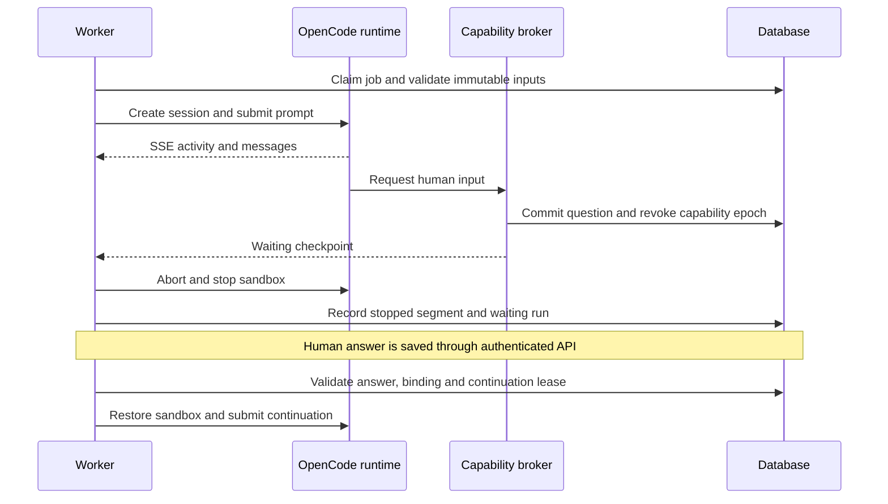

# Runtime adapters and OpenCode integration

Status: implementation blueprint; verified against official documentation on 2026-10-20. No runtime binary was installed or executed during planning. NEXUS supports capability-tested runtime adapters; OpenCode is the first/default runtime harness. Codex builds NEXUS.

## 0. Harness-independent control plane

NEXUS owns task state, immutable plans, questions, approvals, execution jobs, worktree policy and accounting attribution. A runtime harness supplies model/tool execution behind a minimal NEXUS `RuntimeAdapter`. OpenCode is the **first and default adapter**, using its official native server HTTP API below. Other harnesses require their own verified adapters; adopting this boundary does not assert that any two harnesses are interchangeable. Codex is the development agent building NEXUS, not an implicit runtime replacement.

### Minimal adapter contract

The following names describe NEXUS interfaces to implement, not official OpenCode or ACP method names. Use one adapter module and typed records initially; no plugin marketplace, universal SDK wrapper or separate orchestration service.

| NEXUS operation | Result / required behavior |
| --- | --- |
| `probe(runtime_profile)` | Exact adapter/build/transport/schema identity; advertised capabilities; tested capability report and expiry; no task execution |
| `start(bound_request, dispatch_key)` | Run-bound execution handle and acceptance state; preserve uncertain admission rather than blindly retry |
| `observe(handle, cursor?)` | Normalized progress/status/tool/question/accounting observations with native provenance; cursor/replay optional and explicitly declared |
| `reconcile(handle)` | Known runtime state and recoverable evidence, or `unknown`; never assume idle is success |
| `cancel(handle, reason)` | Cancellation request and observed stop state; supervisor independently confirms descendant termination |
| `collect_result(handle)` | Bounded report/artifact references and accounting coverage; strict NEXUS role-schema validation remains outside adapter |

A worker-owned run/segment exists before adapter dispatch. `runtime_sessions` holds optional native session IDs/metadata keyed by runtime instance and adapter; a sessionless or multi-session adapter still has the NEXUS run/segment. OpenCode session/message IDs are optional native evidence, never universal mandatory FKs on tasks, questions or approvals. Persist dispatch identity and adapter-specific reconciliation references even when no native session exists. Native details may be in a typed extension record/artifact; do not flatten OpenCode fields into the universal interface.

`RuntimeCapabilityReport` uses canonical projection states `tested_pass`, `tested_fail`, `untested`, `unsupported` and `stale`, with exact build/config/policy/environment hashes and probe evidence. Advertised support is a separate native observation and never implies `tested_pass`; unknown support maps to `untested` until a probe resolves it. A claimed capability is not a security result. Missing token usage, native reload, replay, plugins or native structured output remains `unsupported` or `untested`. Strict NEXUS output validation is required even when the harness has no native JSON-schema facility; bounded plain JSON submission can satisfy the report contract only after testing.

| Feature | Minimum gate | If unavailable |
| --- | --- | --- |
| Requirements/read-only planning | Safe context delivery, bounded validated result, reliable supervised stop, proven no source writes/arbitrary execution, durable NEXUS question/checkpoint path | Keep that adapter's planning starts disabled; no prompt-only “read-only” fallback |
| Code implementation | Planning gate plus bound broker edits, approved verification sandbox, no internal write/shell bypass, exact scope enforcement, secret/egress isolation, stop/recovery tests | Disable implementation while retaining any independently proven read-only capability |
| Continuation | NEXUS checkpoint plus tested same-adapter restart/context strategy | Require explicit recovery; native resume is optional, never guessed |
| Usage/cost analytics | Proven native observation identity/semantics and coverage | Show missing/unknown metrics; no fabricated equivalence |
| Native plugins/skills/session UI | Adapter-specific capability tests | Hide/label native feature unavailable; NEXUS roles remain separate contracts |

Freeze adapter ID/revision, harness build/image, transport/protocol schema, tested capability-report hash, effective permissions, trusted role/tool definitions, source-routing profile revision/hash and execution scope in each run's bound envelope. Probe again after any relevant change. An untested build or an adapter losing a required capability cannot start or silently continue an approved run. Revocation still stops it through supervisor controls.

Resolve the effective runtime by project-role override → project default → global role default → global default; show the chosen source of the setting before launch. An incompatible selected override causes a visible capability error rather than silently falling back to another harness. Changing the default runtime affects **future** runs. A live or waiting run cannot move to another harness by changing a preference. A deliberate handoff first confirms the old sandbox has stopped, freezes its candidate/checkpoint/evidence, and creates a linked successor run with explicit transfer context and fresh approval for implementation. The original approval is never transplanted; no import of an opaque native conversation is assumed. Even switching native HTTP to ACP for the same OpenCode build changes the transport/capability binding and requires this explicit handoff. Read-only reanalysis is a new run under its current policy and input snapshot.

### ACP candidate transport, not an authorization standard

Official ACP v1 documentation defines initialization/capability negotiation and baseline session operations; optional load/resume support must be negotiated `[S10,S11]`. The reviewed documentation labels v1 Latest and v2 Draft. Its stdio transport uses JSON-RPC; Streamable HTTP is still described as a draft proposal `[S12]`. OpenCode officially documents `opencode acp` as a JSON-RPC stdio subprocess `[S13]`.

Recommendation: retain OpenCode native HTTP as the initial production adapter because the detailed session, extension and accounting probe below is designed for it. ACP v1 is a candidate standard transport for a later adapter spike, not a mandatory Phase 1 dependency or a promise of feature parity. Do not mix v1 fields with v2 draft examples returned by documentation indexes. Pin protocol/schema/SDK and harness build separately, then capture actual `initialize` capabilities and representative transcript fixtures.

The ACP spike must prove session start/prompt/update/cancel behavior, bounded report delivery, permission handling, broker-tool integration, replay/recovery limits, accounting coverage and sandbox invariants. `session/request_permission` is a runtime callback; it cannot create a NEXUS execution grant. Tool-call notifications report activity and do not prove every internal operation is mediated `[S14]`. Advertising no client filesystem writes/terminal prevents exposing those client services; it does **not** prove the agent has no internal filesystem or shell access. Require the same OS isolation and bypass-denial tests as a native adapter. Reject broad/persistent permission choices, validate opaque session references, and stop on unexpected permission requests. Protocol cancellation is not a substitute for observed process termination `[S15]`.

### Setup agent and source-routing profiles

See [CONNECTIONS_AND_PROFILES.md](CONNECTIONS_AND_PROFILES.md) for canonical profile and setup lifecycle definitions. Manual configuration remains available before any runtime is connected; the optional setup agent cannot be required to configure its own first runtime. A separate setup assistant may discover allowed metadata, validate read-only connections and propose a typed profile. Its tools can inspect configured connector capability/status, permitted Tempo/Jira fields and classifications, explicit Jira–Odoo links, repository metadata and available verified runtime profiles. They cannot issue credentials, broaden source access, grant execution/external-write authority, install arbitrary harnesses/plugins, write arbitrary configuration files, or activate their own proposal. Human authentication occurs through a secure setup flow; credentials are provisioned to trusted connector processes only. The human reviews the exact profile diff, validation evidence and intended data transmission before control-plane activation creates a new immutable revision.

For this deployment, the intended planning path is **Tempo planning allocations → Jira issue references → configured requirements source**. Helpdesk issues normally take requirements from Jira. Project work may take requirements from an explicitly linked Odoo task, according to a configurable issue/project classification; a Jira project issue does not automatically imply an Odoo task. Each route records scheduling authority, requirement authority, explicit link identity and conflict policy. Missing/ambiguous classifications or links produce a question; never search by title and silently attach a task. Calendar sources remain separately selectable; activating Tempo as the schedule authority must be explicit.

Tempo Cloud/server product, account entitlement, API variant, authentication, allocation schema and issue-reference resolution are not live verified. The setup assistant must test the chosen read-only adapter/field mapping and show unsupported states rather than invent endpoint compatibility. Source-routing/profile revisions become inputs to fingerprints and approvals; changing them invalidates affected analyses/plans and execution grants. Disabled sources do not silently fall back to another authority.

## 1. Recommended OpenCode native integration

The Python worker talks directly to OpenCode's officially exposed HTTP server API. Use a small, typed `httpx` adapter and a bounded SSE reader. Do not add a permanent Node bridge or scrape a terminal. A small, pinned TypeScript custom-tool package is appropriate for the NEXUS tools described below; it runs inside OpenCode's supported extension mechanism.

Run one supervised OpenCode server per sandbox/run, with persistent session storage isolated from other runs. Requirements, planning and review use read-only repository snapshots; implementation edits its worker-owned worktree through the capability broker. OpenCode itself receives only a sanitized read-only source export; the host common Git directory is never mounted. The broker updates the authoritative worktree and sanitized export after each accepted content-hash-checked patch. Tests run in a separate disposable no-secret sandbox against a frozen candidate. The worker owns the server URL, authentication and container identity. The browser only talks to FastAPI. An interactive terminal is optional and is never the scheduler or source of truth.

### Official capability evidence

The following table describes website documentation, not a captured contract for an installed release. `[S1]` through `[S7]` are linked in the evidence register.

| Capability | Documented surface | NEXUS use |
| --- | --- | --- |
| Headless runtime | `opencode serve` | Supervised process `[S1]` |
| Health/version | `GET /global/health` | Startup probe `[S1]` |
| API discovery | `/doc`, OpenAPI 3.1 | Compatibility manifest `[S1]` |
| Session lifecycle | `POST /session`, `GET /session/{id}` | Session mapping `[S1]` |
| Async execution | `POST /session/{id}/prompt_async` | Submit turn `[S1]` |
| Reconciliation | `GET /session/status`, `/session/{id}/message` | Recover state `[S1]` |
| Cancellation | `POST /session/{id}/abort` | Best-effort stop `[S1]` |
| Streaming | `GET /event`, `/global/event` | Observe activity `[S1]` |
| JS/TS client | `@opencode-ai/sdk` | Supported alternative `[S2]` |
| Structured response | JSON-schema output support | Validate reports `[S2]` |
| Extensions | Plugins and custom tools | Bounded broker calls `[S3,S4]` |
| Reusable instructions | Native `skill` tool | Trusted skills `[S5]` |
| Tool policy | Allow/ask/deny permissions | Defense in depth `[S6]` |

### Version uncertainty is a release gate

The official release URL resolved to `v1.19.3` during this review `[S7]`; it is a **candidate pin**, not a claim that all website examples match it. Context7's official-repository index also contains development-generation routes under `/api/session/...`, a different permission/form protocol, and different message shapes. Even the SDK page uses differing structured-output names between its example and API table (`format` versus `outputFormat`). Do not combine snippets from these generations.

Phase 3 must select an exact release and artifact digest, capture its advertised OpenAPI document, and record a compatibility manifest under `opencode/compatibility/<version>/`. The manifest records binary/SDK/plugin versions, schema hash, OS/image digest, verified route names, auth scheme, response fields, event variants, tool discovery and accounting semantics. The candidate may change if its probe fails. No moving `latest`, unpinned development branch or automatic runtime upgrade.

The initial OpenCode native adapter targets only one proven release. A changed schema disables new agent starts and shows `incompatible runtime`; existing artifacts remain readable. Do not build speculative support for two API generations.

## 2. Phase 3 compatibility probe

Use a disposable fixture repository, fake credentials and no external task connections.

1. Confirm executable version, health and authenticated access. Website documentation supports `OPENCODE_SERVER_PASSWORD` and optional `OPENCODE_SERVER_USERNAME` `[S1]`. Bind internally/loopback and reject unauthenticated requests; do not expose a runtime port to the browser or LAN.
2. Obtain and hash the OpenAPI document advertised at `/doc`; its exact media type/download mechanism is an implementation probe. Pin schema definitions for session creation, async prompt, messages, abort, events and permissions.
3. Create a session with a NEXUS correlation title. Persist the returned ID before prompting. Read it back. Prove runtime storage survives an intentional restart.
4. Submit one bounded analysis prompt and observe busy/idle/error/message activity. Verify accepted input versus completed output: HTTP acceptance and idle alone never mean a valid plan.
5. Request a strict JSON-schema report. Inspect actual output placement and validate in Pydantic with unknown fields forbidden. An invalid report is a failed report, not a plan awaiting approval. Permit at most one repair turn, billed and traced to the same attempt.
6. Load the trusted custom-tool package and skills. Check tool names, session/message context, and cancellation signal behavior. Prove target-repository plugins and configuration cannot load. Failure blocks autonomous runs; no prompt-only fallback.
7. Trigger a human question through `nexus_request_human_input`. Prove a committed pending question survives process death, an unauthorized answer is rejected, and a valid answer creates exactly one continuation.
8. Cancel a running provider request and running test tool. Confirm process-group/container termination stops descendants; a successful abort response alone is insufficient.
9. Disconnect SSE, finish a turn, reconnect and reconcile messages/status. Show no duplicate usage, answer or job. Do not assume server event replay or SSE IDs.
10. Capture representative provider message samples: raw counts, costs, finish/error, creation/completion time and retry representation. Match accounting semantics to that release/provider before deriving totals.
11. In Phase 3 deny every source write, unauthorized shell/subagent/network access, malicious plugin and symlink escape. Confirm host checkout and control DB are untouched. Phase 6 extends this same probe suite with approved patch admission, out-of-scope write denial and no-secret test-sandbox checks before enabling implementation.

Store small redacted fixtures, capability assertions and a test transcript. This probe is a deliverable of Phase 3, not work to perform by guessing routes during Phase 1.

## 3. Session and execution lifecycle

`agent_run` is a NEXUS logical execution. A blocked run may have several execution segments and sessions after restarts; preserve their identities and costs. Continue the same run only while its original approval, plan, ticket fingerprint, base commit, source-routing/profile hash, runtime adapter/build/transport/permissions and scope remain valid. Expiry must be checked again on continuation. A new attempt/retry requires a new implementation approval. Transport reconnection is not a new implementation attempt.

Do not create a session implicitly when retrying an uncertain POST. Persist an intent and dispatch identifier first; after an ambiguous response inspect runtime sessions/messages before reissuing. Client-supplied message IDs can help correlate where the pinned schema supports them; they are not a documented exactly-once guarantee. If acceptance cannot be resolved, set job `uncertain` and require recovery, avoiding duplicate code changes or provider spend.

Requirements/planning sessions have no implementation approval and no writable source path. Independent review uses a separate session with a frozen final diff and sanitized read-only candidate export. Review output cannot approve itself, launch implementation, mark acceptance criteria verified, merge or update Jira/Odoo.

## 4. Durable questions, permissions and resume

### NEXUS questions are the durable contract

Do not depend on an OpenCode tool keeping an in-memory Promise alive while the developer is absent. The broker commits the question and its blocking condition, revokes the run capability epoch, and returns a checkpoint marker. The worker aborts and stops the sandbox; stopped acknowledgment precedes resumable state. Every capability tool checks the active epoch, so later calls are denied. Built-in arbitrary writes/shell tools must not bypass this broker. Preserve partial diff and scratch artifacts.

On answer, the API validates identity, question version and allowed answer schema. It records immutable answer evidence. A transactional continuation job rechecks approval/freshness, required question set, worktree integrity and runtime compatibility. It then recreates the sandbox and submits a new prompt referencing the answer and checkpoint. Reuse a runtime session only if restart behavior and context integrity have been proven; otherwise create a new linked session with a bounded context summary. No provider request is left running while waiting.

### Native OpenCode prompts are separate

OpenCode documents a native `question` permission, but this review did not verify a stable server question/reply API for the candidate release. Context7 development code uses form concepts rather than the website's older shape. Native questions therefore remain disabled for autonomous NEXUS agents; use the custom tool. A later native-question adapter requires pinned endpoint/event tests and a durable NEXUS projection before enablement.

Website documentation describes a permission-response route and `once`, `always`, `reject` decisions, but these are runtime tool permissions, not NEXUS plan approvals `[S1,S6]`. NEXUS never forwards `always`. Unexpected runtime permission requests create attention items and stop the run. A human answer cannot grant an agent broad host access; execution policy is enforced separately and may require a revised plan.

## 5. Trusted skills, tools and plugins

OpenCode supports TypeScript/JavaScript custom-tool definitions, with schema-validated arguments and session/message/directory context `[S4]`. Use unique `nexus_` names. Keep implementation policy in the broker; extension code is an adapter, never an approval authority.

| Proposed tool | Arguments | Server-enforced authority |
| --- | --- | --- |
| `nexus_request_human_input` | Category, bounded prompt/options, evidence references, idempotency key | Create a question only for bound run; cannot answer it |
| `nexus_read_repository` | Relative path, offset/limit | Snapshot/worktree only; normalized and bounded |
| `nexus_search_repository` | Pattern and scope | Bounded search; no shell interpolation |
| `nexus_apply_patch` | Relative paths, expected blob hashes, patch | Active implementation grant; allowed paths; compare-and-swap |
| `nexus_run_verification` | Approved command-profile ID, typed parameters | Disposable test sandbox, time/resource limits; no arbitrary shell |
| `nexus_record_evidence` | Typed artifact references | Append run-owned evidence only; cannot claim verified outcomes |

Tool request/run IDs are bound server-side from a narrow capability credential, not accepted as authority from model arguments. The agent receives no credential value in text. A plugin-side credential is still potentially accessible to runtime code; it must grant no approval/external-write/config authority. Host broker and provider-egress proxy are outside the sandbox. Direct model credentials stay at the proxy when compatible; otherwise document the scoped provider credential exposure and block risky configurations.

Plugins support event hooks such as `message.updated`, `session.status`, `session.idle`, and before/after tool hooks `[S3]`. Prefer the server SSE stream for ordinary telemetry; avoid duplicate plugin telemetry. Add hooks only for a proven missing observation or bounded broker tool. Hooks are not a replacement for filesystem/process/network isolation.

Trusted skills are bundled, versioned instructions, loaded through the native mechanism `[S5]`: `requirements-analysis`, `odoo-repository-planning`, `approved-implementation`, and `independent-review`. Store their content hashes with the agent definition. Repository-provided `AGENTS.md`, skills and instructions are data unless explicitly reviewed and adopted into trusted configuration. Do not install third-party plugins dynamically from an inspected repository. Package required dependencies in the pinned image before a run.

## 6. Events, telemetry and completion

Treat upstream events as observations. FastAPI publishes its own durable, monotonically numbered event stream after DB commit; never expose OpenCode's stream directly to the frontend. Persist relevant event metadata and redacted message revisions, then update current projections. Coalesce verbose text/tool progress; preserve final reports, tool failures, question events and accounting evidence.

On `idle`, fetch final messages and validate the expected report. Worker-observed tests, diff integrity and approval policy determine NEXUS outcomes. A model's completion text is not authoritative. Reconcile after a disconnect and periodically during active runs. Unknown event variants are retained as bounded metadata and flagged; do not crash the consumer or silently interpret them as success.

Phase 3 preserves allowlisted raw accounting receipts and timestamps from the first real run; Phase 7 adds normalized ledgers, reconciliation, derived prices and usage visualization. Do not postpone raw evidence collection or assume normalized accounting is a Phase 3 prerequisite. Usage must be attributed to every linked session, including repair turns, child sessions if explicitly allowed, review and continuations. For MVP disable autonomous delegation and use separately scheduled NEXUS runs; this makes attribution and scope enforceable. No generic assumption about reasoning being disjoint from output, caches being included in input, zero cost meaning free, or message updates being deltas. See [TELEMETRY.md](TELEMETRY.md).

## 7. Operational limitations and decisions

- No verified native pause/resume promise: pause means stop at a safe checkpoint; cancellation has a stop acknowledgment and escalation timeout.
- No assumed event replay: reconcile durable messages and status after gaps.
- No assumed official provider subscription remaining quota API: display unknown until a reliable provider-specific observation is available.
- Runtime session links are NEXUS detail links by default. Offer a copyable `opencode attach` command/server link only after verifying supported syntax and authenticated access. Do not fabricate a stable public session deep-link URL or share sessions externally.
- Production deployment, push and merge tools are absent from MVP runtime capabilities.
- A Git worktree alone is not a sandbox; the real isolation boundary is described in [SECURITY.md](SECURITY.md).

## Official evidence register

All links checked 2026-10-20; public documentation may subsequently change. The pinned installed contract is still an implementation gate. Context7 was used to resolve `/anomalyco/opencode` and query server, extension and accounting concepts; development snippets were used to identify uncertainty, not assert release compatibility.

| ID | Primary source | Evidence and limits |
| --- | --- | --- |
| S1 | [OpenCode Server](https://opencode.ai/docs/server/) | Headless server, HTTP/OpenAPI, routes, SSE, basic auth; website generation only |
| S2 | [OpenCode SDK](https://opencode.ai/docs/sdk/) | Official JS/TS client and structured output; example/table naming differs |
| S3 | [OpenCode Plugins](https://opencode.ai/docs/plugins/) | Supported plugin loading/event hooks; dynamic plugin code is executable |
| S4 | [OpenCode Custom Tools](https://opencode.ai/docs/custom-tools/) | JS/TS tool definition and contextual invocation |
| S5 | [OpenCode Agent Skills](https://opencode.ai/docs/skills/) | Native skill discovery; isolate ambient project/home configuration |
| S6 | [OpenCode Permissions](https://opencode.ai/docs/permissions/) | Permission actions, permissive defaults, per-agent override |
| S7 | [Official v1.19.3 release](https://github.com/anomalyco/opencode/releases/tag/v1.19.3) | Candidate release observed; not tested locally |
| S8 | [Official development permission protocol](https://github.com/anomalyco/opencode/blob/dev/packages/protocol/src/groups/permission.ts) | Context7 source evidence of generation drift; mutable development source |
| S9 | [Official development session schema](https://github.com/anomalyco/opencode/blob/dev/packages/schema/src/session-message.ts) | Context7 accounting/message evidence; not a stable pinned schema |
| S10 | [ACP v1 initialization](https://agentclientprotocol.com/protocol/v1/initialization) | Version/capability negotiation and v1 baseline; v2 explicitly draft |
| S11 | [ACP v1 session setup](https://agentclientprotocol.com/protocol/v1/session-setup) | Session creation; optional load/resume negotiation, not universal persistence |
| S12 | [ACP v1 transports](https://agentclientprotocol.com/protocol/v1/transports) | JSON-RPC stdio; HTTP transport still draft |
| S13 | [OpenCode ACP support](https://opencode.ai/docs/acp/) | Official ACP subprocess support; no NEXUS compatibility probe performed |
| S14 | [ACP v1 tool calls](https://agentclientprotocol.com/protocol/v1/tool-calls) | Tool observation and permission callbacks; no universal interception guarantee |
| S15 | [ACP v1 cancellation](https://agentclientprotocol.com/protocol/v1/cancellation) | Protocol cancellation/propagation limits; require supervisor stop confirmation |
