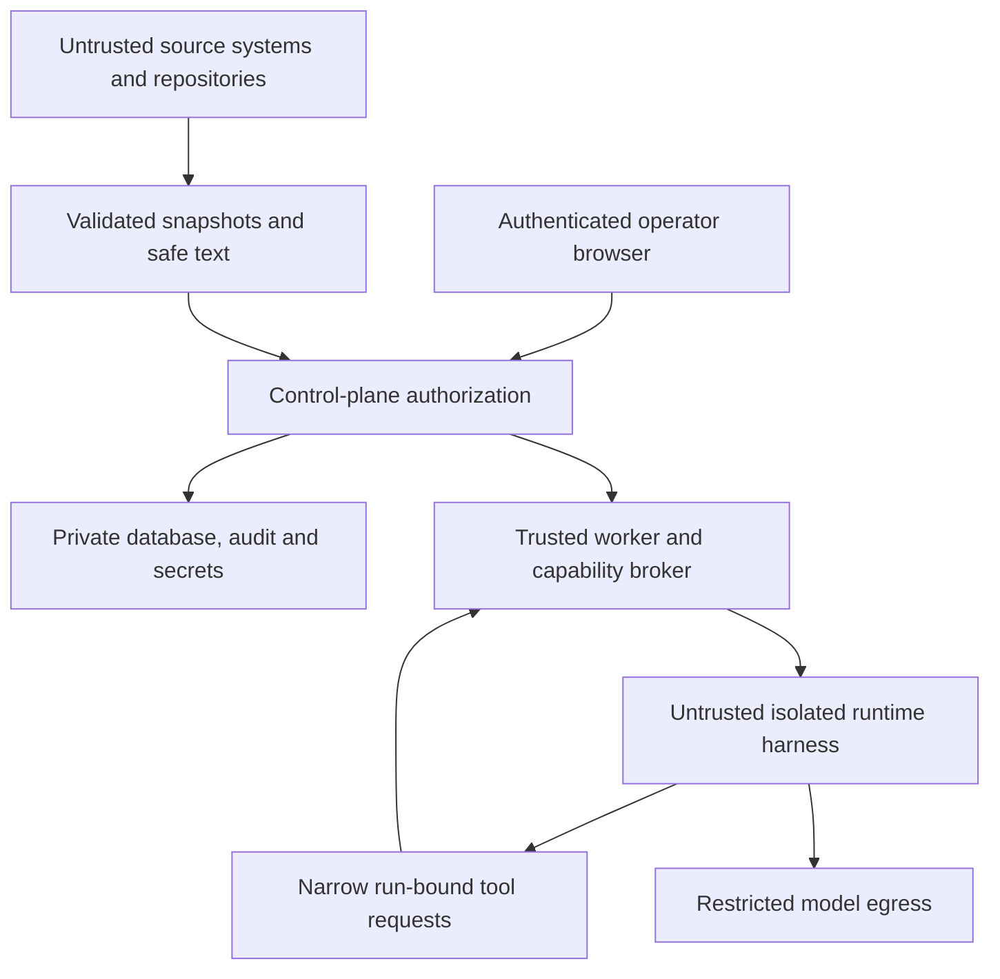

# Security architecture and authorization

Design threat model, 2026-10-20. These are required controls and test gates, not claims that the unimplemented application is already secure. Read `AGENT_CONTRACTS.md` for execution envelopes and `OPENCODE_INTEGRATION.md` for the adapter capability and native-runtime compatibility gates. OpenCode is the first/default adapter; these boundaries apply to every harness.

## Assets, adversaries and limits

Protect client repository content, host filesystem, API/model credentials, local task state, approval integrity, code-change provenance, external Tempo/Jira/Odoo records and source-routing profile integrity, usage/billing evidence and operator decisions. Threat actors include a malicious ticket author, compromised repository/attachment/plugin, model following injected instructions, malicious webpage reaching localhost, a compromised provider connection, and a failed/restarted worker producing duplicate side effects.

Trust the authenticated local operator, reviewed NEXUS control-plane code and pinned execution images. Do not trust models, third-party text, repository configuration, test/build scripts, provider callbacks or runtime completion claims. A fully compromised host administrator is outside the MVP's containment guarantee; local SQLite/hash chains cannot stop that adversary. Local-first does not mean hosted inference is offline or confidential by default: project policy determines permitted code/ticket transmission.

## Concrete boundaries

No runtime route reaches D. Only the operator path can issue approval decisions. A custom tool's credentials can append evidence/ask questions or perform explicitly granted code operations; they cannot call the operator API, read arbitrary tasks, alter configuration, or draft-and-send external writes.

## Permission matrix

| Principal | Read tasks/plan | Approve execution | Read source | Write code | Run tests | Write Jira/Odoo |
| --- | --- | --- | --- | --- | --- | --- |
| Operator | Yes, local account | Yes, exact bound envelope | Through UI/host | Manual or bound grant | Manual or profile | Separately approve exact draft |
| Control-plane API | Scoped to operator | Validate/store user decision only | Artifact projections | No arbitrary edits | No shell in HTTP handler | Enqueue authorized delivery |
| Connector worker | Scoped configured sources | Never | No repository execution | Never | Never | Only approved exact-payload delivery worker path |
| Setup assistant | Operator-selected metadata/draft only | Never | Approved repository metadata only | Never | Read-only connection tests only | Never |
| Requirements/planning runtime | Supplied snapshots | Never | Bounded read tools | Never | Never | Never |
| Implementation runtime | Bound envelope only | Never | Approved worktree snapshot | Broker applies approved paths | Approved profile in disposable sandbox | Never |
| Independent reviewer | Frozen candidate/evidence | Never | Read-only snapshot | Never | Explicit isolated verification profile only | Never |

Mission Control and Focus Mode both call the same authenticated services. No display preference changes roles, endpoint rights, tool scope or freshness guards.

## Adapter and source-profile trust boundaries

Runtime agnosticism is a control-plane property, not an exemption from safety controls. A NEXUS `RuntimeAdapter` reports advertised and tested capabilities tied to exact adapter/harness/transport/config/image digests. Native OpenCode HTTP is first/default. An ACP transport or other harness is eligible only after build-specific tests prove its assigned role's isolation, broker enforcement, stop/recovery and report behavior. A generic “ACP compatible” label, prompt instruction or native permission dialog is not sufficient.

A read-only planning adapter may be enabled while its implementation capability remains disabled. Only `tested_pass` capabilities satisfy role admission; `tested_fail`, `untested`, `unsupported` or `stale` evidence blocks a required capability. Advertised support is metadata, not a passing probe. Neither negotiated protocol features nor UI settings can widen effective permissions. Native session IDs and native plugin/skill facilities are optional adapter evidence, not authorization principals. Tool telemetry is informational; receiving every tool update is not proof all underlying operations were intercepted.

For ACP, advertise only client services implemented through NEXUS's bounded broker; do not expose generic host filesystem writes or terminals. An agent may still have internal tools, so the sandbox must deny their bypass paths and the adapter probe must demonstrate that denial. `session/request_permission` never grants a NEXUS execution scope. Protocol cancel is followed by supervisor stop confirmation; session load/replay/resume is used only when advertised and proven. ACP v1 and v2 draft fields cannot be mixed. See the official-source evidence register in `OPENCODE_INTEGRATION.md` for reviewed protocol limits.

Source-routing profiles define scheduling authority, classification and requirements authority. The intended live path is Tempo allocations to Jira issue references, then Jira requirements for helpdesk or explicitly linked Odoo task requirements for configured project work. Project classification alone does not imply an Odoo task; Jira-only project work is valid. Treat allocation text, issue references, classification metadata and link fields as untrusted evidence. Resolve only explicit identities under configured instance/account/database/project allowlists; no title-based automatic linking, arbitrary-host URLs or disabled-source fallback. A missing/conflicting route produces a blocker.

The activated immutable profile revision/hash and route decisions are bound into task fingerprints, plans and execution envelopes. A changed rule, explicit-link mapping, source authority, runtime binding or effective permission revokes affected grants and stops active capabilities; it cannot silently redirect an approved task to another repository/source/harness. Freshness checks re-read the bound schedule and requirements sources, including Tempo where selected. Unrelated sources do not need to be online. Tempo account/API/product support remains unverified until its own read-only setup probe passes; no claim that Jira and Tempo authentication or API variants are interchangeable.

## Setup assistant boundaries

The setup assistant operates with a separate capability class and configuration-bound run identity, not an invented development task. Manual setup must remain possible before connecting the first runtime. Allow only bounded metadata discovery, read-only connection/field/link tests and inactive typed configuration proposals for operator-selected accounts/hosts. Read-only search may use POST when the exact verified endpoint is allowlisted; HTTP verb alone does not establish safety. No arbitrary RPC/HTTP proxy, shell, secret read, unrestricted filesystem scan, runtime/plugin installation, production writes or dynamic dependency execution. A test's API allowlist is independent of the model's proposed configuration.

Credentials are issued/authenticated by the human through the trusted secure setup flow and provisioned directly to connector/provider processes; the assistant sees only a reference and safe connection status. It cannot create credentials, approve grants, enlarge its own discovery scope or activate its proposal. Successful test results prove only the tested read operations, not rights to write or transmit all client data.

Activation is a user-only command bound to an immutable proposal hash, expected current configuration version, explicit source/runtime scope, transmission policy and validation receipts. Present a concrete diff and unsupported states before activation. The control plane checks the decision and appends a new profile revision/audit event transactionally; the setup tool itself has no activation endpoint. Changed proposals require review again. Rollback selects a prior reviewed configuration into a new revision and invalidates affected bindings; it never resurrects old approvals.

## Local HTTP and secret handling

- Bind user API to `127.0.0.1` by default; validate Host and Origin against exact configured values to resist DNS rebinding and malicious pages. No wildcard CORS.
- Bootstrap with a high-entropy one-time local pairing mechanism, exchanged for an HttpOnly SameSite session cookie; do not leave API open because it is localhost. No reusable secrets in URLs or localStorage. Apply CSRF token plus Origin checking to mutations, including approval, answer, cancel and writeback routes. Static frontend and API share an origin.
- Distinguish user API and internal broker listeners/credentials. Runtime cannot mint an operator session; its network policy blocks operator routes, DB and keychain services. SSE is authenticated and read-only; cookie auth avoids embedding a bearer token in its URL.
- Store connector secrets using OS keychain or restrictive environment/secret-file injection to connector processes only. Typed config contains references. Runtime gets separate provider access through a compatible proxy or a documented scoped credential; never mount operator home, SSH agent, cloud config, Docker socket or macOS keychain.
- Logs and telemetry use field allowlists, not just regex scrubbing. Redact authorization headers, cookie values, URL query credentials, tool env and provider response secrets. Questions asking for credentials route to settings and store configuration references, never passwords/API keys in answers.
- Encrypt backups with OS/backup controls; private state directories/files use owner-only permissions. There is no claim of application-level encryption against an active same-user attacker. Add TLS, proper login/session security and firewall checks before remote access.

## Approval protocol

The server constructs a canonical execution envelope from stored, validated artifacts. It includes task/fingerprint algorithm and hash, immutable plan revision/hash, every repository/base commit, allowed paths and operations, test profiles/parameters, trusted agent/tool/skill/plugin hashes, adapter revision/harness build/transport/schema/tested-capability and image digests, effective permissions, activated source-routing profile revision/hash and classification/link/authority bindings, environment/network policy, budget limits, expiry and operation kind. The UI shows the concrete envelope and material differences from any previous grant.

Operator decision records are append-only. Approval ID is not itself a bearer capability. At launch the server re-fetches relevant source records (maximum cached freshness five minutes), resolves live repository target refs, checks no source conflict/hold/cancellation, and compares every binding. If a source cannot be verified, launch is blocked. Revalidate through a fenced dispatch before enabling broker capabilities. This minimizes the TOCTOU window; it cannot make external systems and local DB one global transaction. Polling/source-change events revoke running capabilities and stop the sandbox.

Launch consumes approval once in a DB transaction with run/job/intent/audit/outbox creation. Expiry defaults to 24 hours and is checked at every segment/tool admission. Same-run checkpoint continuation within validity uses the original envelope. After expiry, an explicit `implementation_continuation` grant can bind the same run, next segment and unchanged inputs. A new attempt needs `implementation_start`; source/base/scope/profile/runtime binding or permission changes require a new plan and start grant. Changing the default harness/profile applies only to future runs. A deliberate harness/build/transport handoff stops and freezes the original run, then creates a linked successor run and fresh implementation approval; opaque native conversation transfer and approval portability are never assumed. Retrying HTTP delivery of an idempotent launch command returns the existing run, not another execution.

Reject path traversal, unrestricted globs, unknown command profiles and scopes permitting control data, credentials or trusted plugin/policy files. New requirements cannot be authorized by a casual answer in a blocker thread. Guidance containing “go ahead and deploy” remains text; no deployment capability exists in the MVP.

## Filesystem and process isolation

Git worktrees are change-isolation artifacts only. They share Git metadata and are not a security boundary. Trusted worker creates a clean worktree at the approved full commit with hooks disabled and no automatic submodule/network checkout. It checks host dirty state without altering it. Symlinks/submodules, executable files and Git config are inspected as untrusted content.

Recommended macOS execution boundary: a pinned Linux container in the selected container engine's VM, running non-root, with dropped capabilities, read-only root, resource/process/disk/time limits and no privileged mounts or Docker socket. Linux deployment uses equivalent hardened container settings. Validate the actual engine's filesystem/network controls; do not assume every macOS networking flag has identical Linux semantics. If these controls cannot be proven, implementation remains disabled. A native host fallback is not acceptable.

The authoritative isolated worktree is worker-owned outside the host checkout. Every harness, including OpenCode, receives a sanitized source export/read-only view without the host common Git directory or repository runtime configuration. Brokered read/search exposes bounded content. Built-in arbitrary edit/bash/task/delegation/web tools are denied; approved edits go through `nexus_apply_patch` and approved verification through `nexus_run_verification`. The broker updates the worker-owned worktree and subsequent sanitized source view with content-hash checks. No runtime code has unrestricted host write access. This satisfies worktree isolation without exposing the shared `.git` pointer.

The edit broker validates repository/path scope, rejects absolute paths, `..`, NUL, unexpected symlinks/hardlinks and protected files, checks expected content hashes, uses descriptor-relative/no-follow operations (or equivalent proven isolation) and applies patches atomically. A final tree/diff check enforces scope again, including deletions, renames, mode changes, binary size and symlink changes. Post-hoc diff inspection alone is insufficient.

Tests/builds/install scripts are arbitrary code even when the command name is allowlisted. Run them against a frozen candidate export in a separate disposable sandbox with no provider or connector credential, no writable host mounts, network denied, test-specific DB/service containers only, and explicit resource/timeout limits. Dependencies come from prebuilt pinned images or a separately approved installation step restricted to required registries; never arbitrary internet access from a ticket-supplied command. Odoo verification uses disposable test databases and version-specific images, never staging/production databases by default. Test host-command profiles include executable and typed argument constraints; never interpolate model text through a shell.

Model egress is restricted to configured provider endpoints via a gateway/proxy where supported. Do not claim domain allowlisting alone prevents data exfiltration: malicious source content could be sent to an allowed model endpoint. Minimize disclosed content and enforce project/provider data policy; reject hosted inference where client policy prohibits it. Provider proxy compatibility and credential visibility must be verified. A local model or isolated provider account is an alternative when policy demands it.

## Trusted configuration and prompt injection

Build runtime homes from a reviewed template: empty HOME/config dirs, isolated session storage, trusted NEXUS adapter/harness config (OpenCode first), pinned supported skills/plugins and no ambient MCP servers. Prevent automatic discovery of repository/home plugins and instructions; prove this with a malicious fixture. If the selected harness cannot bypass unsafe repository discovery in the pinned build, run from a sanitized directory and expose repository content only through broker tools.

Tickets, source code, `AGENTS.md`, XML comments, report templates, attachments, log output and previous agent summaries are all labeled untrusted evidence. Trusted prompts define role/output contracts but are only defense in depth. Authorization is enforced out of process. Do not execute manifests, QWeb expressions or migration scripts during planning. Human attachments are bounded and safely parsed; archives reject path traversal/decompression bombs. HTML/Markdown renders without script/unsafe links; no active SVG/HTML attachment execution.

## External writeback protocol

An immutable draft contains target source/account/database/project/record, operation allowlist, before snapshot and version, exact payload/hash, reason, expected effects and expiry. Show it separately from code review. Draft edits create a new revision and invalidate its approval. The runtime cannot send a draft or obtain write credentials.

Before send, re-read target and compare expected fields/version. Jira/Odoo do not universally expose an atomic conditional-write primitive for every operation; a read-before-write check alone leaves a race. Initial remote write scope is append-only progress comments/messages carrying a NEXUS operation marker if supported and approved. For field updates requiring strong concurrency, require a verified conditional endpoint or a narrowly reviewed server-side Odoo method that atomically checks expected revision and applies changes in one transaction. Otherwise keep field-update drafts preview/copy-only. Never advertise atomic compare-and-set from generic RPC `write`.

Persist send intent before network I/O. A timeout after send becomes `uncertain`. Reconcile via returned IDs/operation markers and fresh target state where reliable. If a provider lacks reliable idempotency or searchable markers, require operator inspection; do not resend. No blanket retry of comments or workflow transitions. Immutable delivery receipts prove what was attempted and observed.

## Attack scenarios and required tests

| Scenario | Controls to verify | Expected result |
| --- | --- | --- |
| Tempo/Jira/Odoo content says to ignore approval and run curl | Runtime no shell/network, broker scope, source provenance | Question/invalid output; no command or external action |
| ACP agent reports benign tool activity but uses internal shell | Build-specific bypass tests, sandbox, denied host/terminal capabilities | Planning/implementation capability denied unless contained |
| Runtime selector changes while an approved run waits | Frozen adapter/build/transport binding and explicit handoff workflow | No same-run swap; new implementation grant required |
| Setup assistant tests successfully then activates its own profile | Separate proposal/test/activation capabilities, operator-only activation transaction | Activation denied; draft remains inactive |
| Jira project classification lacks explicit Odoo link | Profile authority rules and explicit identity validation | Blocker; no title match or Jira/Odoo fallback |
| Tempo allocation points to an arbitrary issue URL/host | Instance/account allowlists and immutable issue resolution | Fetch denied and route remains unresolved |
| Source routing changes after approval | Profile hash and live source checks, capability revocation | Prior grant invalid; affected run stopped |
| Repository plugin reads host SSH/cloud credentials | Sanitized export/home, no ambient plugin discovery, no host mounts | Plugin does not load; credential path unavailable |
| Planning agent edits report XML | Read-only snapshot and tool deny | Rejected before filesystem mutation |
| Approved path replaced by symlink to DB | No-follow broker, root mapping, sandbox limits | Rejected; DB and host unchanged |
| User switches mode to expose privileged launch | Shared backend authorization and command client | Same 403/409 and audit in both modes |
| Two tabs launch same grant concurrently | Consumption PK, CAS, idempotent command receipt | One run/job; second returns existing result or conflict |
| Source/base changes after approval | Fingerprint/ref recheck, running capability revocation | Start denied or active sandbox stopped; diff preserved |
| Agent fabricates passing tests/completion | Worker test receipts, candidate hash, independent review/human outcome | No accepted completion/score |
| Ticket requests secret in answer | Configuration-reference workflow, redaction | No secret saved in transcript |
| Malicious webpage posts to localhost | Host/Origin, session cookie, CSRF, network separation | Mutation denied |
| Process dies after remote comment creation | Durable send intent, uncertain state, reconciliation | No duplicate blind resend |
| Old worker returns results after lease takeover | Epoch fencing on tools and result writes | Late mutation/result rejected |
| Test attempts fork bomb or provider credential read | Disposable no-secret test sandbox, PID/resource limits | Test terminated; run records error/timeout |
| Model claims exact subscription remaining percentage | Adapter provenance and unknown semantics | Unknown display, no invented quota |

## Operations, recovery and release gates

Health distinguishes API/DB reachable, worker heartbeat, source freshness, compatible runtime, sandbox availability and degraded telemetry; never equate “API 200” with safe execution. Emergency stop revokes active capability epochs and terminates owned sandboxes; persist stop confirmation and quarantine on failure. Stop acknowledgment, not DB lease expiry, releases repository locks.

Retain evidence/audit under the data model policy, redact before logging and publish only safe event DTOs to the UI. Back up using SQLite's supported online backup path plus artifacts; rehearse restoration with execution disabled and capabilities invalidated. Cleanup only trusted recorded worktree/container paths after stopped confirmation, operator-visible retention, and evidence archive; no agent-provided recursive-delete paths.

M1 release gates: authenticated local API, human-only profile activation, setup capability tests when optional assistance is enabled, explicit Tempo/Jira/Odoo routing fixtures, role-specific runtime adapter gates, source sanitization, immutable input fingerprints, verified read-only planning isolation, malicious config/HTML fixtures and source freshness indicators. M2 adds approval race/expiry/staleness, scope broker, test sandbox, secrets/network/descendant-stop checks, recovery and restore. Later remote server deployment needs its own review. Passing these gates establishes tested properties, not a guarantee against a compromised OS or model data leakage beyond configured provider policy.
