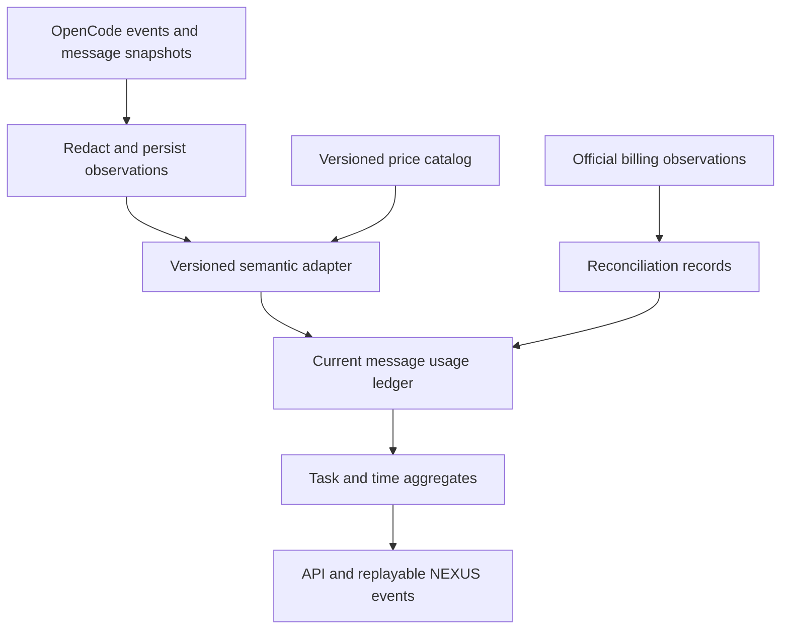

# Token, cost, and subscription telemetry

Status: implementation blueprint; verified documentation date: 2026-10-20. No provider account or running OpenCode installation was inspected. See [OpenCode integration](OPENCODE_INTEGRATION.md), [data model](DATA_MODEL.md), and [efficiency scoring](AI_EFFICIENCY_SCORE.md).

## Runtime-independent attribution (revision 2)

Core accounting references generic `runtime_sessions`, adapter/build/transport/config/capability evidence and role/model identities. Native OpenCode session/message identifiers are namespaced adapter metadata; adapters report unsupported usage as unknown. Switching harnesses never splices one live session ledger into another. Preserve original charge-unit semantics and trace successor runs explicitly. Setup-assistant runs are taskless configuration overhead and excluded from implementation-task efficiency, with their own visible budget/usage. Initial development scheduling comes from Tempo allocations; those planned seconds are human work allocation, not observed agent execution duration or a token-cost measure. See `CONNECTIONS_AND_PROFILES.md`.

## 1. Accounting boundaries

Collect usage from the first requirements run in Phase 3. Phase 1 introduces identity, timestamps, durable jobs and audit/event foundations only; Phase 3 adds accounting receipts and fixtures alongside real agent execution. Phase 7 adds reconciliation, budgets, and the Observatory. Phase 7B computes scores from the history already collected.

| Measure | Meaning | UI rule |
| --- | --- | --- |
| Token consumption | Provider/runtime-reported counts with a declared semantic mapping | Show categories and coverage; unknown is not zero |
| Runtime-reported cost | Cost field returned by OpenCode or another runtime observation | Label `runtime reported`; do not label as billed |
| Estimated API-equivalent cost | Tokens priced against a versioned published or configured API tariff | Show tariff date, currency, omissions, and estimate label |
| Actual billed cost | Provider billing statement or officially authenticated billing observation | Show source, account scope, accounting period, and attribution precision |
| Subscription allowance | Officially observed entitlement/limit and usage in its native units/window | Show unknown/unavailable if no reliable observation exists |
| User budget | NEXUS policy selected by the developer | Label `configured budget`; not a provider quota |

Never add actual and estimated costs. Never describe an API-equivalent estimate as money paid under a flat subscription. Do not derive a remaining subscription percentage from token counts, provider connection status, or an API-equivalent price. A zero OpenCode cost can mean unavailable accounting, a subscription route, free usage, or a real zero; it cannot resolve which one by itself.

## 2. Verified runtime facts and limits

The [official OpenCode server](https://opencode.ai/docs/server/) documents headless HTTP operation, message retrieval, and SSE events. The [official SDK](https://opencode.ai/docs/sdk/) describes generated types and structured responses. Those capabilities support collection without keeping an interactive TUI open. They do not promise token-by-token accounting, billing reconciliation, a replayable SSE cursor, or universal subscription quota APIs.

Context7 inspection of official upstream source exposed accounting variation between generations:

- [`AssistantMessage` generated types](https://github.com/anomalyco/opencode/blob/dev/packages/sdk/js/src/v2/gen/types.gen.ts) expose input, output, reasoning, cache-read/cache-write, cost, provider/model, and message/session identifiers.
- [`AI.Usage`](https://github.com/anomalyco/opencode/blob/dev/packages/ai/src/schema/events.ts) has an output field that can include reasoning, with a separate visible-output derivation.
- [`TokenUsage.Info`](https://github.com/anomalyco/opencode/blob/dev/packages/schema/src/token-usage.ts) describes a different normalized shape with disjoint categories.

These development-branch sources are evidence of semantic drift, not a release contract. In Phase 3, pin the runtime release and image digest, archive its `/doc` schema, and approve adapter fixtures before enabling normalized totals or price calculations. Capture only fields exposed by that build. When semantics cannot be established, preserve original counters, mark `semantic_status=unknown`, and suppress derived totals/costs. Do not import an unverified interpretation from a different SDK generation.

Provider semantics also differ. For example, the [official Claude caching documentation](https://platform.claude.com/docs/en/build-with-claude/prompt-caching) separates ordinary input, cache writes, and cache reads. An adapter must express whether categories overlap rather than apply that provider's formula to every route. No live prices are prescribed by this blueprint.

## 3. Collection and normalization

### Source observation envelope

Persist `schema_version`, source kind, runtime fingerprint, runtime instance ID, session ID, message ID, optional part/provider-request ID, event type, source sequence/version if provided, source timestamp, received timestamp, payload hash, agent run/task/episode IDs, and a redacted usage-only payload. Record the original names and values without copying prompt text, code, tool arguments, credentials, headers, or reasoning content into the usage store. Hash canonical JSON of the accounting payload, not the whole prompt-bearing event.

`source_timestamp` is evidence, not a reliable total ordering. Every receipt gets a monotonic database sequence for local ingestion. Mark provenance as `provider_native` or `opencode_normalized`: if OpenCode does not expose the underlying provider payload, preserve its normalized fields and declare native accounting unavailable. Do not reconstruct and label them as native provider counters. Raw full OpenCode events may contain sensitive data: only a short-lived, opt-in restricted debug archive may retain them, with redaction and the retention rules in [Security](SECURITY.md). `telemetry_events` contains the allowlisted accounting envelope, not an unfiltered transcript.

### Normalized counters

Use nullable nonnegative BIGINT fields for `input_reported`, `output_reported`, `reasoning_reported`, `cache_read_reported`, `cache_write_reported`, and `total_reported`. Preserve these independently. Each `usage_observation` carries an adapter/mapping version and explicit category semantics:

- Does reported input include cache reads or writes?
- Does reported output include reasoning?
- Is the observation cumulative for a message, incremental for a step, or a final response total?
- Is the count final, partial, corrected, or unknown?
- Are tool fees, multimodal units, and provider-internal retries included?

Only a verified mapping derives the disjoint billing basis: `uncached_input`, `cache_read`, `cache_write_by_ttl`, `visible_output`, and `reasoning_separately_billed`. Categories may remain null. `unique_token_total` is nullable and is only derived when all necessary categories and overlap rules are known. Expose `total_reported` separately when its provider meaning differs. Repeated context across requests is genuine consumption and is counted on each billed request.

### Duplicate prevention and corrections

1. In one transaction, insert `telemetry_events` using `UNIQUE(runtime_instance_id, source_event_id)` where a stable source ID exists. Otherwise use `UNIQUE(runtime_instance_id, session_id, message_id, event_kind, payload_hash)`. This fallback deduplicates accounting snapshots; it must not deduplicate genuinely distinct requests merely because their usage counts match.
2. Insert an immutable `usage_observation` referencing the event. Its stable charge unit is `(runtime_instance_id, session_id, message_id, accounting_unit)`. `accounting_unit` is normally `message`; a provider request ID or step ID is used only when the pinned build proves the message is an aggregate of otherwise distinct charge units.
3. Maintain one `usage_ledger` projection per charge unit. A cumulative update replaces that unit's current counters. It is never added to earlier versions. Do not sum message totals and the step totals that generated them.
4. Prefer a source revision counter where available. Otherwise, notification events trigger an authoritative message GET, serialized by charge unit. Delayed snapshots cannot replace a known final result with an incomplete one. Conflicting final snapshots without source ordering are quarantined and refetched; do not guess by maximum counts.
5. Store correction lineage. Update aggregates by `new_value - previous_value`, including negative corrections. If a projection contains inconsistent categories, mark it unresolved rather than clamp it into a plausible number.
6. A retry that creates a new message/provider request is a distinct consumed unit, even if it fails. A transport retry repeating an identical snapshot is not. If provider-internal attempts are hidden, display `retry coverage=runtime-visible`.

Reconcile all known sessions on startup, after an SSE disconnect, and when a run terminates. The collector must paginate if the pinned API supports it and otherwise document the message retrieval limit and unresolved coverage. Completion requires an accounting coverage check, not an assumption that the last SSE event was delivered. Failed and cancelled runs retain usage already consumed. Forked sessions reference ancestor messages without charging those historical messages a second time; use originating message identity and flag ambiguous cloned identities for reconciliation.

## 4. Attribution and execution time

Each run belongs to exactly one task outcome episode, agent-definition revision, role (`requirements`, `planning`, `implementation`, `review`), approved plan where applicable, and runtime configuration fingerprint. A session is owned by one run. Capture OpenCode child sessions and map them to that run before aggregation. Unknown child ownership enters `unattributed`, never the currently selected dashboard task. Do not automatically split one message across tasks. Shared overhead gets its own run/pool and an explicitly versioned allocation rule; the MVP reports it separately.

Record provider/model per message because a session can switch models. Record start/end, attempt number, failure category, exit status, and durable state intervals. The run state vocabulary is `queued`, `starting`, `running`, `waiting_human`, `stopping`, `succeeded`, `failed`, `cancelled`, `interrupted`.

Compute active wall duration as the union of `running`/`starting` intervals for a task; also show summed agent-seconds for parallel activity. Waiting for a human, queue delay, provider backoff, test execution, and human review are separate intervals. Durations use monotonic clocks inside a process and persisted UTC interval endpoints across restarts. Unexplained downtime is unknown time; do not count it as useful active execution or silently erase it. Human intervention count comes from recorded answers/reviews; human active minutes require explicit timing or are unknown.

## 5. Prices, budgets, and reconciliation

Store monetary values as fixed-point integer micros with ISO currency; use Decimal for calculations and a documented rounding mode (`ROUND_HALF_EVEN` at the final currency-micro boundary). No floating-point money. Keep unrounded Decimal calculation inputs in the audit calculation artifact. A price is immutable and has provider, exact model/variant, route, unit, input/output/cache/reasoning/tool tiers, currency, validity window, source URL, fetched/approved timestamps, and revision hash. Avoid overlapping effective windows for the same complete tariff key. Unknown model aliases require explicit resolution.

Estimated API-equivalent cost is the sum of disjoint billable units multiplied by the matching tariff. Use the request start timestamp to select a tariff; expose a documented fallback when unavailable. Long-context pricing, cache-write TTL, batch tiers, regional premiums, and tool fees need explicit fields. Missing required tier inputs means partial or unavailable estimate, with known subtotal clearly labelled. A historical repricing creates a new valuation, leaving the original preserved. Convert currencies only through a stored FX observation; do not sum USD and EUR directly.

Provider adapters are small modules behind the collector's accounting service, not separate services. Their contract is `identify_scope`, `parse_usage`, `declare_semantics`, `price_units`, and optional `observe_billing`/`observe_allowance`. Capability flags distinguish unavailable, unauthorized, stale, and supported. They use officially supported APIs only; no scraping subscription pages, stored browser cookies, or undocumented endpoints. Phase 7 starts with the OpenCode adapter plus a fixture adapter; add a provider billing adapter only after verifying the account's official capability and permissions.

`billing_reconciliations` links ledger units or an explicitly scoped account bucket to official billing observations. A request-level match can attach actual billed cost; a daily account total cannot truthfully allocate exact cost per task. Keep the difference as `unallocated_billed` and present coverage. Corrections append a reconciliation revision, never overwrite source evidence. Never both replace a unit with billed cost and add the same invoice bucket again to its task.

Budget policies define currency/units, task/provider scope, calendar period, warning levels, hard admission limit, and `estimate` or `billed` basis. Check capacity transactionally at job admission and before a new prompt; reserve an estimated maximum per run and reconcile it later. Budget reservations cannot guarantee a provider billing cap because usage arrives late. On breach, block new prompts, request cooperative abort of active work, and report possible overshoot. `quota remaining` and `budget remaining` are distinct fields and visual treatments.

## 6. Subscription observations

Store the official observation's provider/account, scope, native unit (requests, tokens, credits, windowed limit, or opaque), limit/used/remaining when explicitly supplied, window start/end, observed/expires timestamps, source provenance, reliability, and error state. Unknown values stay null. A provider can expose a rate-limit header without exposing total subscription allowance; show that specific window only. Local observations do not include activity from other clients unless the provider says they do.

A percentage is allowed only for compatible numeric limit/usage values in the same verified scope and window. Expired observations become stale. Do not extrapolate an unknown reset time. User-entered allowance is labelled manual and timestamped, and is excluded from `verified quota` warnings. No universal allowance capability is assumed for any provider or consumer subscription.

## 7. Observatory transport and rendering

NEXUS SSE emits aggregate deltas at most once per second for the active viewport; database persistence is independent of rendering cadence. Messages observed at completion produce observed-completion bucket rates. Without genuine live usage deltas, label throughput `observed tokens / last 60s`, not instantaneous generation speed. Tool activity can pulse before accounting arrives, but must be labelled activity, not token flow.

Cyan represents measured uncached input, violet measured output, and green cache reads. Cache writes get a distinct legend/pattern. If reasoning overlaps output, it is a labelled subset or tooltip rather than a second additive stream. Map each bucket to a bounded logarithmic density: `particles = min(cap, round(scale * log1p(known_units / bucket_seconds)))`. `scale` is visual calibration, not a token-to-particle promise. Sample at most eight session channels plus `other`. Missing telemetry uses a neutral unknown indicator rather than a zero-density implication.

Use one Canvas2D surface, pooled particles, a hard 300-particle desktop/150-particle compact cap, and 30 FPS maximum. Suspend animation and `requestAnimationFrame` when hidden or Focus Mode is active. Reduced motion uses static counters and conventional charts. No individual-token particles or per-event component redraws. See [Dashboard design](DASHBOARD_DESIGN.md) for shared performance budgets. Focus Mode renders the same aggregate snapshot as tables/sparklines.

Development simulation uses a seeded fixture source with `is_simulated=true`, an obvious SIMULATED badge, and a separate database/source namespace. Simulated observations cannot affect real spending limits, subscription warnings, scores, or model comparisons. Real quota warnings require a fresh official observation; budget warnings always state their configured basis.

## 8. Persistence contract

The [data model](DATA_MODEL.md) is authoritative for SQL conventions. Required accounting relations:

| Table | Primary relationships and uniqueness |
| --- | --- |
| `telemetry_events` | Accounting receipt ID; run/session links nullable until resolved; dedup keys above; runtime/schema fingerprint and redacted raw payload |
| `usage_observations` | Immutable event-to-charge-unit revisions; `UNIQUE(charge_unit_key, observation_hash, adapter_version)`; finality, category semantics, raw counters, normalized counters, quality flags |
| `usage_ledger` | `UNIQUE(charge_unit_key)`; current observation FK, task/episode/run/session IDs, provider/model, nullable current counters and runtime-reported cost; estimates join through `usage_valuations`, actual billing through `billing_allocations` |
| `model_prices` | Immutable tariff revision; provider/model/route/effective-window lookup; currency, tier JSON, source and hash |
| `usage_valuations` | Immutable `(observation_id, tariff_snapshot, method_version)` calculations; changing a tariff creates a new valuation |
| `billing_reconciliations` | Observation provenance and matched ledger/bucket scope; immutable revision/supersedes ID; unallocated balance |
| `billing_allocations` | Reconciliation-to-ledger/bucket relationships and attributed micros; service verifies allocation sum and records confidence; only verified request-level matches are actual task billing |
| `subscription_observations` | Append-only `(account_ref, provider, scope, observed_at)` observations with expiry/native unit; no credential material |
| `budget_policies` | Versioned scope, thresholds, basis/currency/window |
| `budget_reservations` | Policy/job/run binding, reserved amount and settlement/release; unique policy/job and atomic admission |

Index `(task_id, occurred_at)`, `(run_id, message_id)`, `(provider_id, model_id, occurred_at)`, unresolved observations, and allowance freshness. Enforce nonnegative known counters/costs; adjustments may be signed in reconciliation records. Use FK restrictions to preserve billing/score evidence; task archival cannot cascade-delete it.

Default configurable retention follows [Data model](DATA_MODEL.md): allowlisted accounting receipts 90 days; canonical usage/pricing/reconciliation/score evidence 24 months; aggregate trends longer only after identifying data is removed. Referenced observations are retained while an approval, dispute, score, accepted evidence, or audit retention rule needs them. Pruning preserves aggregate provenance, coverage and an explicit evidence-expired flag. Secrets never enter retention stores. Backup and restore must preserve dedup keys and adapter versions.

## 9. Verification and acceptance

- Fixtures cover inclusive/exclusive input/cache and output/reasoning semantics, nullable fields, zero cost, price gaps, tier boundaries, and multimodal/tool-fee omissions.
- Replay duplicate and reordered events, cumulative counters, corrected lower final totals, reused sessions, fork ancestry, and process restart. Resulting totals must be identical to one authoritative message snapshot.
- Prove message/step observations and runtime/invoice observations cannot double charge. Preserve failed-run consumption and unallocated provider spend.
- Deny prompts/headers/keys in usage payloads and logs using sentinel secrets. API responses expose no original credentials or reasoning text.
- Assert simulation never contributes to real aggregates or hard-budget decisions. Assert partial estimates and stale allowance cannot become authoritative percentages.
- Test concurrency for budget reservations and per-message projection updates. Explain warning/abort latency in the UI.
- Golden example: two snapshots of one message with input 100 then 120 contribute 120, not 220; a second failed message consuming 30 contributes 30; a later correction from 120 to 115 yields total 145.
- Operational demo: replay seeded multi-agent usage, disconnect/reconnect collection, reconcile from messages, switch modes, and verify identical counters and clear provenance in both.
